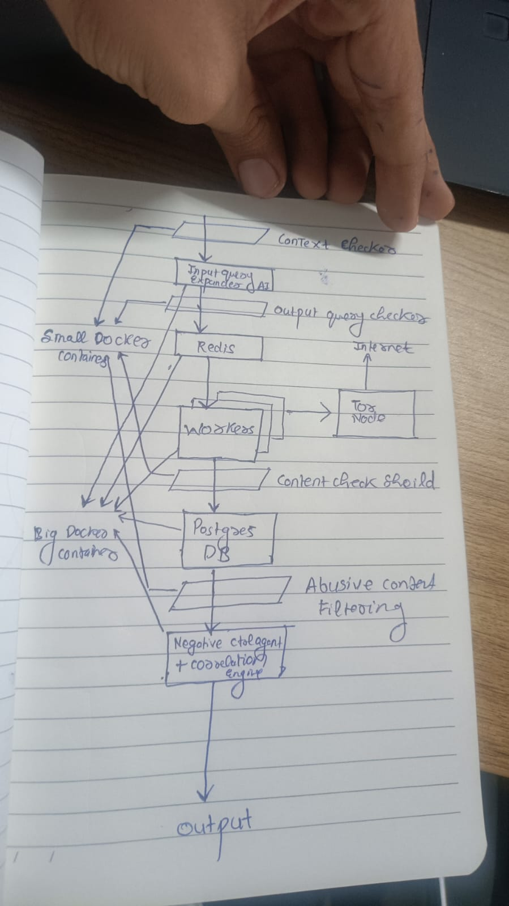
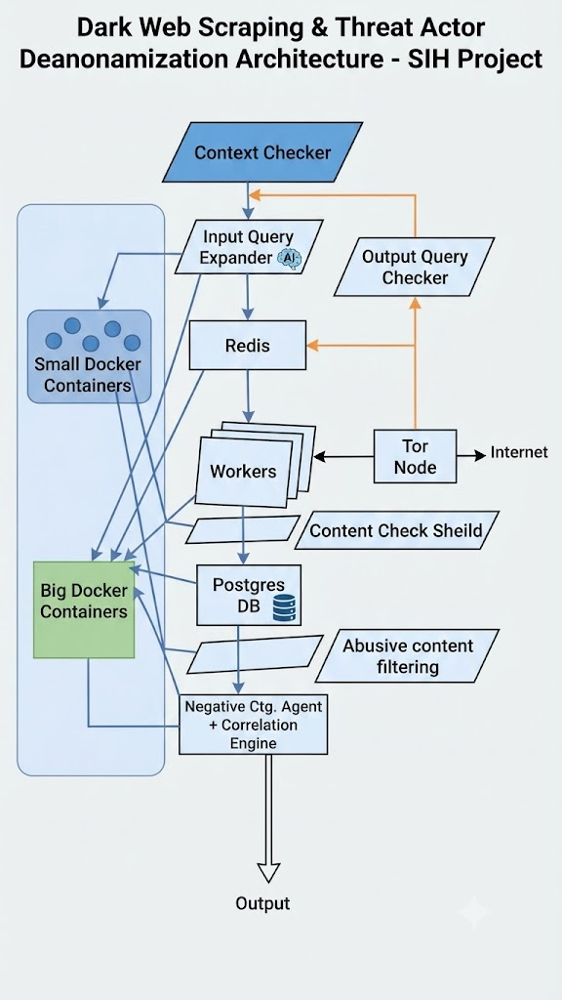
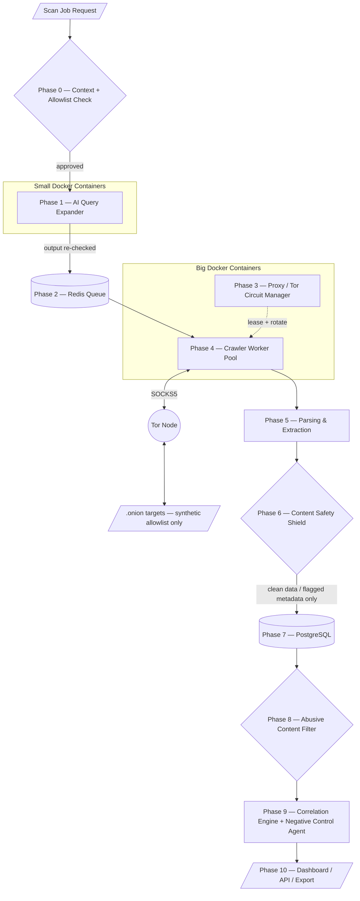

# Dark Web Threat Actor De-anonymization Platform
### System Architecture Specification

**SIH 2026 · Problem Statement 26151 · Organization: NTRO (National Technical Research Organisation) · Category: Software · Theme: Blockchain & Cybersecurity**

| | |
|---|---|
| Status | Proposed — pre-implementation draft, v1.0 |
| Primary stack | Go 1.21+ (backend services) · TypeScript/React (dashboard) · PostgreSQL 14+ · Redis 7+ · Tor |
| Demo scope | **Synthetic / self-hosted mock onion services only.** No live illicit marketplace is touched at any point — not in dev, not during judging. |
| Companion diagram | Derived from the hand-drawn pipeline sketch; see [Section 8](#8-interpretation-notes--open-questions) for reading assumptions |

---





## Scope & Design Principles

This system produces **investigative leads with confidence scores for NTRO analysts** — it does not produce public accusations. Every component below is built around six constraints pulled directly from the problem-statement notes. They are treated as architectural requirements, not policy footnotes:

1. **Passive OSINT only** — the crawler reads what a misconfigured service already exposes publicly. It never sends exploit payloads, brute-forces anything, or performs active intrusion.
2. **CSAM is detected, never touched** — any hit is hashed/classified and discarded *before* it is ever decoded, rendered, or persisted. Only the fact of its existence is logged.
3. **Confidence score, never a verdict** — there is no `confirmed_identity` field anywhere in this system's schema. Output is always `attribution_confidence ∈ [0,1]` plus supporting evidence.
4. **Human-in-the-loop** — no lead moves from "surfaced" to "actioned" without an analyst's explicit review.
5. **Allowlisted targets only** — the crawler will not resolve or fetch anything outside `configs/allowlist.yaml` (synthetic/mock targets for the demo).
6. **Data minimization** — a relevance/attribution threshold gates what gets persisted; bystander data is discarded, not warehoused.

Section 5 traces each of these to the exact component that enforces it, so the ethical requirements in your notes aren't just prose — they're testable engineering controls.

---

## Table of Contents

1. [Repository Structure](#1-repository-structure)
2. [Core Working Mechanism & Component Pipeline](#2-core-working-mechanism--component-pipeline)
3. [Input & Output Specifications](#3-input--output-specifications)
4. [Resilience & Error-Handling Strategy](#4-resilience--error-handling-strategy)
5. [Legal & Ethical Compliance Traceability](#5-legal--ethical-compliance-traceability)
6. [Data Model (PostgreSQL)](#6-data-model-postgresql)
7. [Technology Stack Summary](#7-technology-stack-summary)
8. [Interpretation Notes & Open Questions](#8-interpretation-notes--open-questions)

---

## 1. Repository Structure

```
dwd-platform/
├── cmd/                              # Entry points — thin, wire dependencies only
│   ├── api/                          # REST API server (main.go)
│   ├── worker/                       # Crawler worker pool process
│   ├── scheduler/                    # Autonomous-mode job scheduler
│   └── cli/                          # Operator CLI (dwd-cli)
│
├── internal/                         # Private application code, not importable externally
│   ├── domain/                       # Core models + interfaces. ZERO internal imports.
│   │                                 # Everything else depends on domain; domain depends on nothing internal.
│   ├── config/                       # Config loader (env + YAML + secrets), allowlist loader
│   ├── queryexpander/
│   │   ├── guard/                    # Input/output illegal-intent guard (see 2.3 Phase 1)
│   │   └── expander/                 # LLM client wrapper for query expansion
│   ├── queue/                        # Redis Streams job-queue abstraction
│   ├── proxy/                        # Tor/SOCKS5 manager, circuit rotation, control-port client, kill switch
│   ├── sandbox/                      # Docker orchestration for small/big container tiers
│   ├── crawler/                      # Worker pool, URL frontier, politeness limiter, CAPTCHA-pause hook
│   ├── parser/                       # Extraction: PII/wallet/PGP regex, HTML normalizers, stylometry features
│   ├── contentshield/                # Pre-storage safety filter (CSAM hash-match, abusive-content classifier)
│   ├── correlation/
│   │   ├── graph/                    # Identity graph builder (handles/wallets/keys/infra as nodes)
│   │   ├── stylometry/               # Persona-linking via writing-style similarity
│   │   ├── infracorrelate/           # Misconfig → clearnet infra matcher (OnionScan-style)
│   │   └── negativecontrol/          # ExoneraTor-style false-positive elimination
│   ├── storage/                      # Postgres repository layer — implements domain interfaces
│   │   └── migrations/
│   ├── api/
│   │   └── middleware/               # auth, panic-recovery, request-id, rate-limit
│   └── export/                       # CSV / JSON / report(PDF-HTML) / optional STIX 2.1 exporters
│
├── pkg/                              # Reusable, dependency-free helpers (safe to import anywhere)
│   ├── retry/                        # Exponential backoff helper
│   ├── ctxutil/                      # Context/timeout helpers
│   └── logging/                      # Structured logger
│
├── configs/
│   ├── config.yaml                   # Base config
│   ├── config.demo.yaml              # Synthetic-target-only demo profile
│   └── allowlist.yaml                # Hard allowlist of crawl targets — enforced at Phase 0
│
├── scripts/
│   ├── setup_tor.sh
│   ├── docker-compose.dev.yml
│   ├── seed_synthetic_mirror.sh      # Spins up the team's mock onion services for testing
│   └── migrate.sh
│
├── deployments/docker/
│   ├── Dockerfile.small-worker       # Query-expander sandbox image
│   └── Dockerfile.big-worker         # Crawler/stylometry sandbox image
│
├── dashboard/                        # React frontend (timeline queries, graph view)
├── test/
│   ├── integration/
│   └── fixtures/synthetic-mirror/    # Synthetic dark-web mirror used for all demo/testing traffic
├── go.mod
└── README.md
```

**Avoiding circular dependencies:** `internal/domain` defines the shared vocabulary — models (`Actor`, `Identifier`, `InfraIndicator`, `PersonaLink`, `ScanJob`) and interfaces (`Fetcher`, `Extractor`, `ContentShield`, `ActorRepository`, `CorrelationEngine`). It imports nothing else internal. Every other package depends *inward* on `domain`, never sideways on a sibling:

```go
// internal/domain/interfaces.go
type Fetcher interface {
    Fetch(ctx context.Context, target FetchTarget) (*FetchResult, error)
}
type ProxyLeaser interface {
    Lease(ctx context.Context) (*ProxyLease, error)
    Release(lease *ProxyLease) error
    RotateCircuit(ctx context.Context, leaseID string) error
}
type Extractor interface {
    Extract(ctx context.Context, raw *FetchResult) (*ExtractionResult, error)
}
type ContentShield interface {
    Screen(ctx context.Context, ex *ExtractionResult) (*ScreenedResult, error)
}
type ActorRepository interface {
    UpsertActor(ctx context.Context, a *Actor) error
    LinkPersonas(ctx context.Context, link *PersonaLink) error
    Query(ctx context.Context, filter QueryFilter) ([]*Actor, error)
}
type CorrelationEngine interface {
    Correlate(ctx context.Context, scope CorrelationScope) ([]*PersonaLink, error)
}
```

`storage` *implements* `ActorRepository`; `correlation` and `api` depend on the *interface*, never on the `storage` package directly (dependency inversion). Concrete wiring happens only in `cmd/*/main.go`. Result: `crawler` → `proxy` + `parser` + `domain` is a one-way edge; `proxy` and `parser` never import `crawler`; `contentshield` sits strictly between crawler output and storage input and never calls back upward.

---

## 2. Core Working Mechanism & Component Pipeline

### 2.1 High-Level Pipeline



The two parallelogram "checked" labels in the original sketch (context-checked input, output-query-checked, content-check-shield, abusive-content-filtering) are treated here as **data-gate checkpoints** between processing stages, in standard flowchart convention — each one is a hard gate, not a soft log line.

### 2.2 Phase-by-Phase Overview

| # | Stage | Runs in | Purpose |
|---|---|---|---|
| 0 | Job Intake & Context Check | API process | Validate requester, enforce target allowlist |
| 1 | AI Query Expander + Guard | Small container | Expand seed terms; block illegal-intent expansions in and out |
| 2 | Redis Queue | Redis | Durable work distribution to workers |
| 3 | Proxy & Tor Circuit Manager | Big container (sidecar) | Issue SOCKS5 leases, rotate circuits, enforce kill switch |
| 4 | Crawler Worker Pool | Big container | Fetch pages through Tor, bounded concurrency |
| 5 | Parsing & Extraction | Big container | Pull PII/wallets/PGP keys/infra signals/stylometry features |
| 6 | Content Safety Shield | Big container → storage boundary | CSAM discard, abusive-content tagging, before any write |
| 7 | Storage (Postgres) | DB service | Canonical store for actors/identifiers/infra/links |
| 8 | Abusive Content Filter | Read path | Second gate — filters flagged categories out of every read |
| 9 | Correlation Engine + Negative Control | Batch/async service | Builds identity graph, applies false-positive elimination, scores confidence |
| 10 | Output | API + Dashboard | Timeline queries, graph view, human review, export |

### 2.3 Phase Detail — Input / Output Contracts

#### Phase 0 — Job Intake & Context Check
- **Input**
  ```json
  {
    "job_type": "scan | rescan | targeted_lookup",
    "requested_by": "operator_id",
    "targets": ["mock-market-1.onion"],
    "crawl_depth": 3,
    "mode": "autonomous | manual",
    "authorization_ref": "demo-token-or-case-id"
  }
  ```
- **Processing:** validate the requester's role/token; check every target string-for-string against `configs/allowlist.yaml`; reject the whole job if even one target isn't pre-registered; cap `crawl_depth` at a policy maximum; stamp the job with an audit trail (who, when, under what authorization).
- **Output:** `ScanJob{id, status:"queued", validated_targets[], created_at}` → Phase 2.
- **Note:** *Autonomous mode automates scheduling, not safety.* A scheduler-triggered job passes through this exact same allowlist/authorization check as a manually-triggered one — there is no bypass path.

#### Phase 1 — AI Query Expander + Guard
- **Input:** seed terms from the job (handle fragment, PGP fingerprint, wallet address, keyword).
- **Processing:**
  1. *Input guard* — seed terms are screened against an illegal-intent classifier (flags requests oriented at acquiring child-exploitation material, weapons, or similar) **before** the LLM ever sees them.
  2. *Expansion* — LLM generates synonyms, typosquat variants, marketplace-specific slang normalization, translated terms.
  3. *Output guard* — the LLM's own output is re-screened against the same categories, since a model can be coaxed into generating a bad expansion the seed didn't contain. Anything that matches is stripped and logged, not silently dropped.
  Runs in a stateless, ephemeral **small Docker container** — destroyed after each call, no persistent disk.
- **Output**
  ```json
  {
    "expansion_id": "uuid",
    "expanded_terms": ["term1", "term2"],
    "blocked_terms_count": 0,
    "guard_verdict": "clean | partially_blocked"
  }
  ```

#### Phase 2 — Redis Queue
- **Input:** `ScanJob` + expanded terms.
- **Processing:** Redis Streams as durable queue; one stream entry per `(target, term-set)` unit of work; consumer group = worker pool; visibility-timeout re-delivery for stuck entries.
- **Output (stream entry):**
  ```json
  { "job_id": "uuid", "target": "mock-market-1.onion", "terms": ["..."], "depth_remaining": 3, "enqueued_at": "ISO8601" }
  ```

#### Phase 3 — Proxy & Tor Circuit Manager
- **Input:** `{ "target_host": "...", "purpose": "fetch" }` from a worker.
- **Processing:** hands out a SOCKS5 endpoint per worker/container; rotates circuits on a policy (every N requests, every T minutes, or immediately on a detected block); talks to the Tor control port to issue `SIGNAL NEWNYM`; enforces a **network kill switch** — a container-level firewall rule that drops all non-Tor-proxy egress, so a bug in the crawler cannot leak direct-to-internet traffic even accidentally.
- **Output:** `{ "socks_endpoint": "127.0.0.1:9050", "circuit_id": "...", "expires_at": "..." }`.

#### Phase 4 — Crawler Worker Pool
- **Input:** queue entry + active proxy lease.
- **Processing:** bounded worker pool (fixed-size, `sync.WaitGroup`-tracked); per-job URL frontier (depth-bounded, dedup via seen-set); politeness delay (randomized 2–8s per host); on CAPTCHA/block detection, the job pauses and moves to a `manual_intervention` queue with a dashboard alert, resuming only after operator action; **passive fetch only** — plain GET/HEAD against whatever the server already serves, never a crafted payload.
- **Output**
  ```json
  {
    "job_id": "uuid", "url": "...", "http_status": 200,
    "headers": {"...": "..."}, "body_ref": "blob-id",
    "fetched_at": "ISO8601", "tor_circuit_id": "..."
  }
  ```

#### Phase 5 — Parsing & Extraction
- **Input:** raw fetch result from Phase 4.
- **Processing:** regex/pattern extraction — see [2.6](#26-parsing--extraction-pipeline) for the actual patterns; text body also passed to the stylometry feature extractor (function-word frequency, punctuation habits, sentence-length distribution).
- **Output**
  ```json
  {
    "job_id": "uuid", "source_url": "...",
    "extracted": {
      "handles": ["..."], "pgp_keys": ["fingerprint-or-block"],
      "wallets": [{"currency": "BTC", "address": "..."}],
      "infra_indicators": [{"type": "exposed_status_page", "value": "..."}],
      "stylometry_vector": [0.02, 0.87]
    },
    "raw_text_ref": "blob-id"
  }
  ```

#### Phase 6 — Content Safety Shield
- **Input:** extraction result + raw body reference from Phase 5.
- **Processing:**
  - *CSAM check* — perceptual/cryptographic hash match against a maintained CSAM hash set (production deployment would source this via a recognized hash-sharing program; for the hackathon demo, stub this interface against a small synthetic "known-bad-hash" test set — never real material). On a match, the bytes are deleted from any transient buffer immediately; only `{url, hash_match:true, category:"CSAM", action:"content_discarded"}` continues, and the job is flagged for mandatory escalation. **The content is never decoded, rendered, or stored.**
  - *Abusive-content classifier* — a second, lower-severity pass (weapons imagery, extremist material) tags a category but lets metadata continue for threat-intel purposes; raw content re-display is suppressed by default in the dashboard.
- **Output:** sanitized record with `content_flags[]` attached; `body_ref` is nulled if CSAM-flagged.

#### Phase 7 — Storage (Postgres)
- **Input:** sanitized record from Phase 6.
- **Processing:** upsert into the normalized schema (Section 6). Only the `storage` service holds DB credentials — crawler/parser containers never do (zero-trust: container compromise doesn't equal DB access).
- **Output:** row IDs / write acknowledgement, propagated back for job-status tracking.

#### Phase 8 — Abusive Content Filter (read-path)
- **Input:** any read request — dashboard query, correlation engine read.
- **Processing:** filters out CSAM/most-severe-category records from *every* read path by default, independent of Phase 6 — defense in depth. Viewing flagged-category metadata at all requires elevated, logged authorization; the underlying content was already discarded in Phase 6, so there is nothing to view regardless.
- **Output:** filtered dataset → Phase 9 or dashboard.

#### Phase 9 — Correlation Engine + Negative Control Agent
See [2.7](#27-de-anonymization--correlation-engine) for algorithmic detail.
- **Input:** filtered actor/identifier/infra records across scans and marketplaces.
- **Output**
  ```json
  {
    "link_id": "uuid", "actor_id_a": "uuid", "actor_id_b": "uuid",
    "basis": "stylometry | shared_pgp | shared_wallet | infra_overlap",
    "raw_similarity": 0.81, "negative_control_passed": true,
    "attribution_confidence": 0.74,
    "rationale": "shared PGP fingerprint across 3 markets; stylometric similarity 0.81; no shared-exit-node confound"
  }
  ```

#### Phase 10 — Output (Dashboard / API / Export)
- **Input:** correlation output + stored records, filtered per Phase 8.
- **Processing:** timeline-indexed query UI, graph visualization, human-in-the-loop review workflow (analyst marks a lead reviewed/dismissed/escalated — nothing auto-publishes).
- **Output:** dashboard views + export files — exact formats in [Section 3.3–3.4](#33-json-report-schema).

### 2.4 Proxy & Tor Circuit Management

- Each worker container is issued a leased SOCKS5 endpoint (default Tor SOCKS port `9050`) and never talks to the network directly — all egress is forced through Tor via a container-level firewall rule (the kill switch from Phase 3).
- Circuit rotation is driven off the Tor **control port** (default `9051`, cookie or password auth) via `SIGNAL NEWNYM`, triggered by: a fixed request count, a fixed time window, *or* a detected block/CAPTCHA — whichever comes first.
- This mirrors the Whonix gateway/workstation split: the **Tor Node** plays the role of Gateway (the only thing allowed to touch the real internet); **worker containers** play the role of Workstation (no direct network access, only reachable outbound path is through the gateway).
- A secondary, lower-priority control loop fuzzes the container's time-sync behavior rather than tightly following NTP — reducing the crawler infrastructure's own fingerprintability to a hidden service that might try to correlate visitor timing patterns (the same rationale behind Whonix's `sdwdate`).

### 2.5 Crawler Engine

```go
// internal/crawler/pool.go
func RunWorkerPool(ctx context.Context, jobs <-chan CrawlJob, poolSize int, fetch domain.Fetcher) {
    sem := make(chan struct{}, poolSize) // bounded pool — prevents unbounded goroutine growth
    var wg sync.WaitGroup

    for job := range jobs {
        sem <- struct{}{}
        wg.Add(1)
        go func(j CrawlJob) {
            defer wg.Done()
            defer func() { <-sem }()
            defer func() {
                if r := recover(); r != nil {
                    logging.Error("worker panic recovered", "job_id", j.ID, "panic", r)
                    markJobFailed(j.ID, fmt.Sprintf("panic: %v", r))
                }
            }()

            jobCtx, cancel := context.WithTimeout(ctx, j.Deadline)
            defer cancel()

            result, err := fetchWithRetry(jobCtx, fetch, j)
            if err != nil {
                requeueOrDeadLetter(j, err)
                return
            }
            pipeline.Handoff(result) // → Phase 5
        }(job)
    }
    wg.Wait()
}
```

- **URL frontier:** per-job, depth-bounded (BFS up to `crawl_depth`), a seen-set prevents re-fetching the same address twice in one job.
- **Politeness:** randomized 2–8s delay per host — this is the "slow crawling" behavior from your notes, deliberately throttled rather than optimized for throughput.
- **CAPTCHA / human-in-the-loop pause:** a detected CAPTCHA or interstitial moves the job to a `manual_intervention` stream; the dashboard surfaces it; the worker goroutine for that job exits cleanly (releasing its pool slot) rather than blocking, and a fresh unit of work resumes the job once an operator clears it.
- **Passive-only constraint enforced in code, not just policy:** the `Fetcher` implementation only exposes `Fetch(ctx, target) (*FetchResult, error)` doing GET/HEAD — there is deliberately no method on the interface that accepts a crafted payload or alternate HTTP verb, so "add an exploit path later" would require a conscious interface change, not a quiet parameter addition.

### 2.6 Parsing & Extraction Pipeline

Pattern-matching runs only against content the server already returned — this stage is data extraction, not intrusion.

| Artifact | Illustrative pattern | Notes |
|---|---|---|
| PGP public key block | `-----BEGIN PGP PUBLIC KEY BLOCK-----[\s\S]+?-----END PGP PUBLIC KEY BLOCK-----` | Standard ASCII-armor delimiters |
| Bitcoin address | `\b(bc1[a-z0-9]{25,60}|[13][a-km-zA-HJ-NP-Z1-9]{25,34})\b` | Covers legacy + bech32; validate checksum in code, not regex |
| Monero address | `\b4[0-9AB][1-9A-HJ-NP-Za-km-z]{93}\b` | Standard mainnet address length; refine against a maintained wallet-format library rather than relying on regex alone |
| Handle / alias | Site-specific — extracted from post author fields, signature blocks | Normalized (case-fold, homoglyph-fold) before graph insertion |
| Infra indicators | Exposed `server-status`-style paths, default banner strings, SSL cert fields (when a clearnet mirror is independently discoverable), Tor descriptor anomalies | Feeds `internal/correlation/infracorrelate` |
| Stylometry features | Function-word frequency, punctuation ratios, sentence-length distribution | Numeric vector, not raw text, stored for correlation |

All regexes above should be treated as starting points and validated against your synthetic test fixtures, not shipped as-is.

### 2.7 De-anonymization & Correlation Engine

1. **Identity graph builder** — nodes: `{actor_handle, wallet, pgp_key, infra_host}`; edges: shared-identifier co-occurrence, explicit trust-link mentions scraped from forum text.
2. **Stylometric persona linking** — compares `stylometry_vector`s across handles (cosine similarity or a trained classifier's embedding distance) to produce candidate "same author, new alias" edges with a raw similarity score.
3. **Infra correlation** (OnionScan-style) — matches SSL cert hashes, banner fingerprints, and descriptor anomalies across onion and independently-observed clearnet hosts to produce candidate infra edges. This is the "misconfiguration → likely origin server" logic from the PS — it only uses what the misconfigured server is already publicly serving.
4. **Negative Control Agent** (ExoneraTor-style) — before *any* candidate edge is accepted, it's cross-checked against known confounders: shared Tor exit-node lists, shared hosting/CDN IP ranges, shared VPN egress ranges, coincidental timing. A match here discards or heavily down-weights the edge. This is what stops "two services share a hosting provider" from masquerading as "two services share an operator."
5. **Confidence scoring** — combines stylometric + infra signal strength, minus the negative-control penalty, into a single `attribution_confidence ∈ [0,1]`, always paired with a human-readable rationale string. There is no code path that outputs a bare, unscored assertion.

### 2.8 Docker Isolation Tiers

| Tier | Hosts | Lifetime | Rationale |
|---|---|---|---|
| Small containers | Query-expander AI + its guard | Ephemeral, one per request | Lightweight, stateless, no reason to hold state or elevated privilege |
| Big containers | Crawler workers, stylometry inference | One per active job/worker slot, torn down on completion | Heavier resource needs; also the tier that actually touches adversarial hidden-service content, so it gets the strongest isolation |

Both tiers run with no direct DB credentials and no direct non-Tor network path (Section 2.4's kill switch) — a compromised container (e.g., a hidden service serving something hostile back to the crawler) is contained to a disposable sandbox with nothing valuable inside it, consistent with the "compromise cannot reach the host system" requirement in your notes.

---

## 3. Input & Output Specifications

### 3.1 CLI

```bash
dwd-cli scan start --targets=configs/allowlist.yaml --depth=3 --mode=autonomous --proxy-port=9050 --control-port=9051 --demo-only
dwd-cli scan status --job-id=<uuid>
dwd-cli scan stop   --job-id=<uuid>
dwd-cli export      --job-id=<uuid> --format=csv|json|report
dwd-cli killswitch --engage    # emergency manual stop of all egress
```

### 3.2 REST API

| Method & Path | Purpose | Body / Query |
|---|---|---|
| `POST /api/v1/scans` | Start a scan job | Phase-0 job-intake schema |
| `GET /api/v1/scans/{id}` | Job status | — |
| `GET /api/v1/scans/{id}/leads?min_confidence=0.5` | Paginated correlation results | query params |
| `POST /api/v1/scans/{id}/review` | Analyst marks a lead reviewed/dismissed/escalated | `{lead_id, action, analyst_id, notes}` |
| `GET /api/v1/export/{id}?format=csv\|json\|report` | Export a completed scan | — |
| `POST /api/v1/killswitch` | Admin-only, immediate global halt | — |

### 3.3 JSON Report Schema

```json
{
  "scan_id": "uuid",
  "generated_at": "ISO8601",
  "status": "completed | partial | failed",
  "actor_profiles": [
    {
      "actor_id": "uuid",
      "primary_handle": "string",
      "aliases": ["string"],
      "identifiers": {
        "pgp_keys": ["fingerprint"],
        "wallets": [{ "currency": "BTC", "address": "string" }]
      },
      "infra_indicators": [
        { "type": "exposed_status_page", "evidence": "string", "matched_clearnet_host": "string|null" }
      ],
      "persona_links": [
        { "linked_actor_id": "uuid", "basis": "stylometry|shared_pgp|shared_wallet|infra_overlap", "confidence": 0.0 }
      ],
      "attribution_confidence": 0.0,
      "category": "marketplace_vendor | forum_admin | other",
      "last_scan_date": "ISO8601",
      "source": ["market:name", "forum:name"]
    }
  ],
  "content_flags_summary": { "csam_detected_discarded": 0, "abusive_flagged": 0 }
}
```

This mirrors the PS's required field list exactly: actor profiles, identifiers, infra indicators, persona linkages, confidence score, category, last scan date, source.

### 3.4 Export Formats

- **CSV** — flattened one-row-per-actor table for spreadsheet review.
- **JSON** — the schema above, machine-readable.
- **Report** — human-readable PDF/HTML narrative generated from the same JSON (no separate data path — one source of truth, three renderings).
- **Optional (nice-to-have):** a STIX 2.1 bundle export, since this is the standard interchange format for threat-intel tooling and directly serves the "integrate into existing OSINT tools" ask in your notes.

---

## 4. Resilience & Error-Handling Strategy

### 4.1 Failure Classification
Errors are classified at the point of failure so recovery is deliberate, not reflexive: `network_timeout`, `connection_refused`, `circuit_dead`, `blocked_or_captcha`, `parse_error`, `storage_error`. Only the first three are retryable by default.

### 4.2 Retry Logic & Exponential Backoff

```go
func fetchWithRetry(ctx context.Context, f domain.Fetcher, j CrawlJob) (*domain.FetchResult, error) {
    backoff := 500 * time.Millisecond
    const maxAttempts = 5
    for attempt := 1; attempt <= maxAttempts; attempt++ {
        result, err := f.Fetch(ctx, j.Target)
        if err == nil {
            return result, nil
        }
        if !isRetryable(err) || ctx.Err() != nil {
            return nil, err
        }
        if isCircuitDead(err) {
            _ = torProxy.RotateCircuit(ctx, j.LeaseID) // Section 4.3
        }
        jitter := time.Duration(rand.Int63n(int64(backoff) / 2))
        select {
        case <-time.After(backoff + jitter):
        case <-ctx.Done():
            return nil, ctx.Err()
        }
        backoff *= 2
        if backoff > 30*time.Second {
            backoff = 30 * time.Second
        }
    }
    return nil, fmt.Errorf("max retries exceeded for job %s", j.ID)
}
```

### 4.3 Tor Control-Port Circuit Renewal
On repeated failure against the same circuit, the retry loop above calls `RotateCircuit`, which issues `SIGNAL NEWNYM` over the control port and waits for a `CIRC BUILT` event before the next attempt proceeds. A global rate limit on renewals prevents hammering the Tor network / guard-relay churn under sustained failure.

### 4.4 Context Timeout Propagation
Every unit of work carries a `context.Context` with a deadline derived from the job's SLA, passed through `Fetch` → `Extract` → `Screen` unchanged. A deadline exceeded anywhere in that chain aborts cleanly, releases the proxy lease, and requeues the remaining crawl depth for a later run — it never blocks a worker slot indefinitely.

### 4.5 Panic Recovery Middleware
Two layers: goroutine-level (shown in 2.5) so one bad page doesn't crash the worker process, and HTTP-level for the API:

```go
// internal/api/middleware/recover.go
func Recover(next http.Handler) http.Handler {
    return http.HandlerFunc(func(w http.ResponseWriter, r *http.Request) {
        defer func() {
            if err := recover(); err != nil {
                logging.Error("api panic recovered", "path", r.URL.Path, "err", err, "stack", string(debug.Stack()))
                w.WriteHeader(http.StatusInternalServerError)
                _ = json.NewEncoder(w).Encode(map[string]string{"error": "internal_error"})
            }
        }()
        next.ServeHTTP(w, r)
    })
}
```

### 4.6 Bounded Worker Pools & Backpressure
The semaphore channel in 2.5 caps concurrent goroutines at a fixed pool size regardless of queue depth — an unbounded pool under a large backlog is exactly how a scraper leaks memory and starves the host. Backpressure comes from the queue side too: Redis consumer-group lag is monitored, and the scheduler stops enqueuing new autonomous jobs once lag crosses a threshold, rather than letting the backlog grow without bound.

### 4.7 Kill Switches & Hard Interlocks
Three independent layers, deliberately redundant:
1. **Network kill switch** (Section 2.4) — container firewall drops all non-Tor-proxy egress if the Tor circuit drops.
2. **Allowlist interlock** — if a scraped page contains a link/redirect to an address outside `configs/allowlist.yaml`, that thread halts rather than following it; it does not fall back to "warn and continue."
3. **Global manual kill switch** — `dwd-cli killswitch --engage` / `POST /api/v1/killswitch`, for an operator to freeze all activity immediately.

### 4.8 Graceful Shutdown & Checkpointing
`SIGTERM` drains in-flight jobs and checkpoints URL-frontier position back to Redis, so a restart resumes rather than re-crawling from scratch. DB writes are kept in short transactions specifically so a shutdown mid-job never leaves a half-written record.

### 4.9 Dead-Letter Queue
Jobs that exhaust `maxAttempts` move to a DLQ stream for manual inspection instead of retrying forever — keeps a single flaky target from monopolizing worker capacity.

---

## 5. Legal & Ethical Compliance Traceability

| Requirement (from project notes) | Engineering control | Component |
|---|---|---|
| No illegal-demand queries | Input **and** output LLM guard | `queryexpander/guard` |
| Never touch CSAM | Hash-match discard before any decode/store | `contentshield` |
| Passive OSINT only | `Fetcher` interface exposes only GET/HEAD — no payload-carrying method exists | `crawler`, `domain` |
| No real-world naming without authority | Schema has no `confirmed_identity` field; every link ships a bounded `attribution_confidence` | `domain`, `correlation` |
| No live illicit-marketplace crawling | Hard allowlist checked at job intake; interlock on any out-of-allowlist redirect | `config/allowlist.yaml`, `crawler` |
| Data minimization | Relevance threshold gates Postgres writes; no bulk bystander capture | `contentshield`, `storage` |
| Confidence score always attached | `attribution_confidence` is a required, non-nullable schema field | `domain`, `storage` |
| Human-in-the-loop | `/review` endpoint is the only path to "actioned" status | `api`, `domain` |
| No auto-publish / auto-notify | No outbound webhook or notification component exists in this architecture — the dashboard is pull-only, by omission | *(absence by design)* |

A red-team pass against the query-expander guard (per your team's own AI-testing notes) is worth running before demo day — it's the one component that has to hold up against adversarial input by definition.

---

## 6. Data Model (PostgreSQL)

```sql
CREATE TABLE actors (
  actor_id UUID PRIMARY KEY,
  primary_handle TEXT NOT NULL,
  category TEXT,                              -- marketplace_vendor | forum_admin | other
  attribution_confidence NUMERIC(3,2) NOT NULL DEFAULT 0.0,
  last_scan_date TIMESTAMPTZ,
  created_at TIMESTAMPTZ DEFAULT now()
);

CREATE TABLE identifiers (
  identifier_id UUID PRIMARY KEY,
  actor_id UUID REFERENCES actors(actor_id),
  kind TEXT,                                   -- handle | pgp_key | btc_wallet | xmr_wallet
  value TEXT NOT NULL,
  source TEXT,
  first_seen TIMESTAMPTZ,
  last_seen TIMESTAMPTZ
);

CREATE TABLE infra_indicators (
  indicator_id UUID PRIMARY KEY,
  actor_id UUID REFERENCES actors(actor_id),
  indicator_type TEXT,                         -- exposed_status_page | ssl_cert_reuse | banner_match | descriptor_anomaly
  onion_host TEXT,
  matched_clearnet_host TEXT,
  evidence TEXT,
  detected_at TIMESTAMPTZ
);

CREATE TABLE persona_links (
  link_id UUID PRIMARY KEY,
  actor_id_a UUID REFERENCES actors(actor_id),
  actor_id_b UUID REFERENCES actors(actor_id),
  basis TEXT,                                  -- stylometry | shared_pgp | shared_wallet | infra_overlap
  confidence NUMERIC(3,2) NOT NULL,
  negative_control_passed BOOLEAN NOT NULL DEFAULT false,
  created_at TIMESTAMPTZ DEFAULT now()
);

CREATE TABLE scans (
  scan_id UUID PRIMARY KEY,
  requested_by TEXT,
  targets TEXT[],
  status TEXT,
  started_at TIMESTAMPTZ,
  completed_at TIMESTAMPTZ
);

CREATE TABLE content_flags (
  flag_id UUID PRIMARY KEY,
  scan_id UUID REFERENCES scans(scan_id),
  source_url TEXT,
  category TEXT,                               -- csam | abusive_other
  action_taken TEXT,                           -- content_discarded
  flagged_at TIMESTAMPTZ
);
```

Note that `persona_links.negative_control_passed` and `actors.attribution_confidence` exist as first-class, non-optional columns — the "lead, not verdict" posture is enforced at the schema level, not just in application logic that could drift.

---

## 7. Technology Stack Summary

| Layer | Choice | Notes |
|---|---|---|
| Language | Go 1.21+ | Concurrency primitives (goroutines, channels, `context`) map directly onto the resilience requirements in Section 4 |
| Queue | Redis 7+ (Streams) | Consumer groups give at-least-once delivery + backpressure visibility |
| Database | PostgreSQL 14+ | Relational fit for the actor/identifier/infra/link schema in Section 6 |
| Anonymity network | Tor (SOCKS5 + ControlPort) | Standard ports 9050/9051 |
| Sandboxing | Docker + docker-compose (two tiers) | `k8s` only if scaling past a single-host demo |
| Query-expansion AI | LLM API call, guard classifier | Only ever sees operator-supplied seed terms, never raw scraped content |
| Stylometry inference | Prefer a self-hosted / open-weight model | This stage *does* process raw scraped forum text — routing that through a third-party API is a chain-of-custody and data-handling concern worth avoiding, independent of cost |
| Frontend | React/TypeScript + a graph-view library (e.g. Cytoscape.js) | Consumes the REST API in Section 3.2 only — no direct DB access |

---

## 8. Interpretation Notes & Open Questions

The source sketch is handwritten, so a few labels were inferred from context rather than read with certainty. Please confirm or correct:

- **"Negative ctrl agent + correlation engine"** → read as **Negative Control Agent** (an ExoneraTor-style false-positive filter) feeding the main correlation engine, cross-referenced against item 15 in your features list.
- **"Content check sheild"** → read as **Content Check Shield**, matching the "shield filter" phrasing in your own data-minimization note.
- **Small vs. Big Docker containers** → mapped Small → query-expander AI sandbox, Big → crawler worker sandbox, based on the Whonix gateway/workstation reference elsewhere in your notes. Flag it if you intended a different split (e.g., by pipeline stage rather than by resource weight).
- **Crossing arrows around Redis/Workers** → interpreted as the container orchestrator spinning containers up/down per job, not a literal additional data edge.
- **Not yet specified anywhere in your notes:** the exact stylometry model/algorithm, the CAPTCHA-solving hand-off UX, and which specific hash-sharing program a real (post-hackathon) CSAM-detection integration would use — all three are called out as stubs/interfaces above rather than guessed at.


