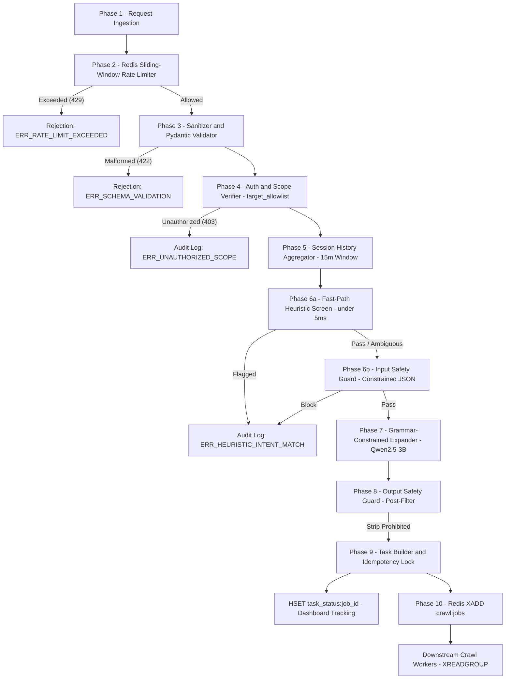

# Hardened Input Processing & Safety Pipeline — AI Query Expander + Guard
# Jinesh and Rudra Work
`analyst -> rate_limiter -> validator -> auth -> session_history -> input_guard -> expander -> output_guard -> task_builder -> stream_emission`

---

### Pipeline Contract Summary

* **Upstream Ingestion:** Accepts structured operational search requests from cleared operators via an authenticated REST interface.


* **Downstream Delivery:** Emits durable, decoupled investigation tasks to Redis Stream `crawl:jobs` accompanied by an isolated tracking hash `task_status:{job_id}`.


* **Decoupled Boundary:** Downstream crawler execution operates asynchronously through consumer groups (`XREADGROUP` / `XACK`). Static target host definitions (`markets.yaml`) and synchronous telemetry loops are fully decoupled from this perimeter phase.


```json
// Input Contract to Ingestion Pipeline
{
  "analyst_id": "analyst_042",
  "authorization_ref": "AUTH-NTRO-2026-8841",
  "target_type": "vendor_handle",
  "target_value": "shadow_vendor",
  "target_host": "mock-market-1.onion",
  "seed_terms": ["shadow_vendor", "0x71C3a9", "PGP-KEY-4A8F91B2"],
  "max_depth": 3
}

```

```bash
# Output Contract Emitted to Redis Stream
XADD crawl:jobs * \
  job_id "550e8400-e29b-41d4-a716-446655440000" \
  target "mock-market-1.onion" \
  terms "[\"shadow_vendor\",\"sh4d0w_vendor\",\"shadow_v3nd0r\",\"5h4d0w_v3nd0r\",\"shadowvendor_official\",\"shadow-vendor-v2\",\"0x71C3a9\",\"PGP-KEY-4A8F91B2\"]" \
  depth_remaining "3" \
  enqueued_at "2026-09-04T03:35:00Z"

```

---

### Core Architectural Guarantees

---

## 🔧 Reliability Update (2026-09-07): Actor-Scoped UUID Insert Guard

If the crawler/extractor cannot confidently identify an actor handle (so the derived `firstActorID` is **empty or not a UUID**), actor-scoped persistence must not attempt to write empty UUIDs.

### Contract change
- Actor-scoped inserts (infra indicators, extracted links, image hashes) are **skipped** when `actor_id` is not a valid UUID.

### Why
- Prevents intermittent HTTP 500 errors during `POST /scans` when upstream AI extraction yields no handles.


1. **Perimeter Throttling:** Requests are throttled per operator via a Redis sliding-window sorted set before invoking Python validation or loading inference weights.


2. **Session Memory Correlation:** Candidate seeds are screened against a rolling 15-minute sliding session window (`analyst_history:{analyst_id}`) to neutralize multi-request fragmented or salami-sliced injection attacks.


3. **Deterministic Grammars:** Generative LLM inference enforces GBNF grammars or strict JSON schema decoding to prevent markdown wrappers, preambles, and syntax errors.


4. **Fault-Tolerant Partial Drops:** Generated aliases that violate safety criteria are stripped individually, allowing verified terms to proceed to crawl workers.


5. **Self-Contained Handoff:** Tasks are placed onto Redis Stream `crawl:jobs` alongside status tracking hashes (`task_status:{job_id}`) without external crawler dependencies.


---



---

## Detailed Phase Breakdown with Input and Output Contracts

---

### Phase 1: Request Ingestion

* **Purpose:** Acts as the perimeter HTTP entry point for operator consoles and automated dispatchers. It terminates client connections, captures ingress network metadata, and passes the payload forward without mutating internal fields.


* **Input (Raw HTTP POST Payload):**

```json
{
  "analyst_id": "analyst_042",
  "authorization_ref": "AUTH-NTRO-2026-8841",
  "target_type": "vendor_handle",
  "target_value": "shadow_vendor",
  "target_host": "mock-market-1.onion",
  "seed_terms": ["shadow_vendor", "0x71C3a9", "PGP-KEY-4A8F91B2"],
  "max_depth": 3
}

```

* **Output → Phase 2 (Forwarded Envelope):**

```json
{
  "client_ip": "10.0.4.15",
  "analyst_id": "analyst_042",
  "raw_payload": {
    "analyst_id": "analyst_042",
    "authorization_ref": "AUTH-NTRO-2026-8841",
    "target_type": "vendor_handle",
    "target_value": "shadow_vendor",
    "target_host": "mock-market-1.onion",
    "seed_terms": ["shadow_vendor", "0x71C3a9", "PGP-KEY-4A8F91B2"],
    "max_depth": 3
  },
  "received_at": "2026-09-04T03:35:00Z"
}

```

---

### Phase 2: Redis Sliding-Window Rate Limiter

* **Purpose:** Shields local CPU inference runtimes from starvation, denial-of-service, and burst scripting.


* **Mechanism:**
* Uses a Redis Sorted Set keyed by `analyst_rate:{analyst_id}`.


* Evicts expired timestamps older than 60 seconds using `ZREMRANGEBYSCORE`.


* Queries active count via `ZCARD`.


* If count is under 5 requests per 60 seconds, appends the current timestamp via `ZADD` and refreshes `EXPIRE`.


* If quota is exhausted, rejects immediately with HTTP 429 and dynamic `Retry-After` calculation.


* **Input (Rate Limiter Envelope):**

```json
{
  "analyst_id": "analyst_042",
  "window_seconds": 60,
  "max_requests": 5,
  "current_timestamp": 1788492900.0
}

```

* **Output → Phase 3 on PASS:**

```json
{
  "rate_limit_status": "ALLOWED",
  "analyst_id": "analyst_042",
  "requests_in_window": 1,
  "remaining_quota": 4,
  "raw_payload": {
    "analyst_id": "analyst_042",
    "authorization_ref": "AUTH-NTRO-2026-8841",
    "target_type": "vendor_handle",
    "target_value": "shadow_vendor",
    "target_host": "mock-market-1.onion",
    "seed_terms": ["shadow_vendor", "0x71C3a9", "PGP-KEY-4A8F91B2"],
    "max_depth": 3
  }
}

```

* **Output on REJECT (HTTP 429):**

```json
{
  "error": "ERR_RATE_LIMIT_EXCEEDED",
  "message": "Maximum request quota reached. Retry in 42 seconds.",
  "retry_after": 42
}

```

---

### Phase 3: Defensive Sanitizer & Pydantic Validator

* **Purpose:** Strips control characters, prevents delimiter breakouts (`<DATA>`, `<|im_start|>`), and enforces schema limits.


* **Validation & Sanitization Specifications:**
* Strips zero-width characters (`\u200B` to `\u200D`, `\uFEFF`) and ASCII control characters.


* Enforces array length constraints: `1 <= len(seed_terms) <= 10`.


* Validates string regex on all seeds: `^[a-zA-Z0-9_\-\.\@\/]+$`.


* Clamps `max_depth` between 1 and 5 (default: 3).


* Validates that `target_host` follows a valid `.onion` domain or standard hostname.


* **Input (Sanitizer Candidate):**

```json
{
  "analyst_id": "analyst_042",
  "authorization_ref": "AUTH-NTRO-2026-8841",
  "target_type": "vendor_handle",
  "target_value": "shadow_vendor",
  "target_host": "mock-market-1.onion",
  "seed_terms": ["shadow_vendor\u200B", "0x71C3a9", "PGP-KEY-4A8F91B2"],
  "max_depth": 3
}

```

* **Output → Phase 4 (Validated InvestigationRequest):**

```json
{
  "analyst_id": "analyst_042",
  "authorization_ref": "AUTH-NTRO-2026-8841",
  "target_type": "vendor_handle",
  "target_value": "shadow_vendor",
  "target_host": "mock-market-1.onion",
  "seed_terms": ["shadow_vendor", "0x71C3a9", "PGP-KEY-4A8F91B2"],
  "max_depth": 3,
  "sanitized": true
}

```

* **Output on REJECT (HTTP 422):**

```json
{
  "error": "ERR_SCHEMA_VALIDATION",
  "details": [
    {
      "field": "seed_terms[0]",
      "issue": "String contains prohibited control or zero-width characters"
    }
  ]
}

```

---

### Phase 4: Authorization & Target Allowlist Verifier

* **Purpose:** Restricts search operations to approved warrants and permitted investigative scopes.


* **Mechanism:**
* Checks `authorization_ref` token validity against the directory service.


* Cross-references `target_type` against approved entity classes in `target_allowlist.yaml`.


* Unauthorized entity targets halt execution with HTTP 403 and create an immutable audit record.


* **Input (Validated Object):**

```json
{
  "analyst_id": "analyst_042",
  "authorization_ref": "AUTH-NTRO-2026-8841",
  "target_type": "vendor_handle",
  "target_value": "shadow_vendor",
  "target_host": "mock-market-1.onion",
  "seed_terms": ["shadow_vendor", "0x71C3a9", "PGP-KEY-4A8F91B2"],
  "max_depth": 3
}

```

* **Output → Phase 5 (Scope-Verified Object):**

```json
{
  "analyst_id": "analyst_042",
  "authorization_ref": "AUTH-NTRO-2026-8841",
  "target_type": "vendor_handle",
  "target_value": "shadow_vendor",
  "target_host": "mock-market-1.onion",
  "seed_terms": ["shadow_vendor", "0x71C3a9", "PGP-KEY-4A8F91B2"],
  "max_depth": 3,
  "is_authorized": true,
  "allowlist_matched": true
}

```

* **Output on REJECT (HTTP 403):**

```json
{
  "error": "ERR_UNAUTHORIZED_SCOPE",
  "message": "Authorization reference invalid or target type not approved for investigation."
}

```

---

### Phase 5: Session History Aggregator

* **Purpose:** Combats multi-request fragmented attacks (salami-slicing) by aggregating queries submitted by the same operator over a rolling 15-minute window.


* **Mechanism:**
* Queries Redis List `analyst_history:{analyst_id}`.


* Ingests current search seeds into the list via `RPUSH` and sets expiration: `EXPIRE analyst_history:{analyst_id} 900`.


* Merges historical terms with active terms into a combined classification payload.


* **Input (Session Context Request):**

```json
{
  "analyst_id": "analyst_042",
  "current_seed_terms": ["shadow_vendor", "0x71C3a9", "PGP-KEY-4A8F91B2"]
}

```

* **Output → Phase 6 (Context Window):**

```json
{
  "analyst_id": "analyst_042",
  "target_type": "vendor_handle",
  "target_host": "mock-market-1.onion",
  "max_depth": 3,
  "current_query": ["shadow_vendor", "0x71C3a9", "PGP-KEY-4A8F91B2"],
  "recent_session_queries": ["btc_tumbler_v1", "crypto_escrow_agent"],
  "session_window_seconds": 900
}

```

---

### Phase 6: Dual-Tier Input Safety Guard (Heuristic + Local LLM)

* **Purpose:** Screens inputs for prohibited topics (CSAM, violent extremism, explosive precursors) and prompt injection attempts.


* **Tier 1 (Fast-Path Regex Screen, <5ms):**
* Matches queries against a precompiled keyword trie.


* Instantly blocks known illicit vocabulary without invoking LLM inference.


* **Tier 2 (Classifier with ChatML Delimiters):**
* Evaluates ambiguous queries and correlated session histories inside an isolated instruction container.


* Wraps input data in `<DATA>...</DATA>` tags, instructing the model to treat content strictly as passive data.


* Outputs constrained JSON: `{"decision": "PASS" | "BLOCK", "reason_code": str}`.


* **Input Payload Sent to Guard:**

```json
{
  "task": "CLASSIFY_INTENT",
  "target_type": "vendor_handle",
  "current_query": ["shadow_vendor", "0x71C3a9", "PGP-KEY-4A8F91B2"],
  "session_context": ["btc_tumbler_v1", "crypto_escrow_agent"]
}

```

* **Output → Phase 7 on PASS:**

```json
{
  "decision": "PASS",
  "reason_code": "CLEAN_QUERY",
  "sanitized_seeds": ["shadow_vendor", "0x71C3a9", "PGP-KEY-4A8F91B2"],
  "target_type": "vendor_handle",
  "target_host": "mock-market-1.onion",
  "max_depth": 3
}

```

* **Output on REJECT (Security Halt):**

```json
{
  "decision": "BLOCK",
  "reason_code": "ERR_POLICY_VIOLATION",
  "violating_terms": ["buy_glock_drop"],
  "audit_event_id": "audit_c8f2a1"
}

```

---

### Phase 7: Grammar-Constrained Term Expander (Qwen2.5-3B)

* **Purpose:** Generates typosquats, leetspeak variations, forum slang, and operational suffixes.


* **Inference Specifications:**
* Runs fine-tuned `Qwen2.5-3B-Instruct` (quantized to 4-bit `Q4_K_M`, taking ~2.2 GB RAM with 2-3s CPU latency).


* Enforces GBNF grammar or Ollama `format="json"` constraints, restricting logit sampling strictly to valid JSON tokens.


* Bypasses generative expansion for non-semantic identifiers (cryptocurrency addresses, hashes `0x71C3a9`, PGP keys `PGP-KEY-4A8F91B2`) and passes them through directly.


* Employs fallback regex parsing (`re.search(r'\{.*\}', raw_output, re.DOTALL)`) if decoding is interrupted.


* **Input (ChatML Prompt with Data Isolation):**

```text
<|im_start|>system
You are a dark web OSINT entity expansion assistant. Expand the provided target handle into typosquat variations, 1337speak substitutions, common prefixes, and marketplace aliases. Respond ONLY with a valid JSON object matching the schema: {"original_term": str, "expanded_terms": [str]}.
<|im_end|>
<|im_start|>user
<DATA>
{"target_type": "vendor_handle", "seed_term": "shadow_vendor"}
</DATA>
<|im_end|>

```

* **Output → Phase 8 (Parsed Expansion Payload):**

```json
{
  "original_term": "shadow_vendor",
  "expanded_terms": [
    "shadow_vendor",
    "sh4d0w_vendor",
    "shadow_v3nd0r",
    "5h4d0w_v3nd0r",
    "shadowvendor_official",
    "shadow-vendor-v2",
    "shadowvendor_escrow",
    "shadow_supplies"
  ],
  "passthrough_identifiers": ["0x71C3a9", "PGP-KEY-4A8F91B2"],
  "target_host": "mock-market-1.onion",
  "max_depth": 3
}

```

---

### Phase 8: Output Safety Guard & Partial-Drop Sanitizer

* **Purpose:** Detects semantic drift and ensures generative expansion does not introduce prohibited vocabulary not present in the seed terms.


* **Mechanism:**
* Runs candidate variations through a secondary classifier or rule engine (`Llama-Guard-3-1B` consuming under 1 GB RAM).


* Executes partial drops: if 1 or 2 generated mutations violate policy, those specific terms are stripped while safe terms are retained.


* **Input (Candidate Terms Array):**

```json
{
  "candidate_terms": [
    "shadow_vendor",
    "sh4d0w_vendor",
    "shadow_v3nd0r",
    "5h4d0w_v3nd0r",
    "shadowvendor_official",
    "shadow-vendor-v2",
    "shadowvendor_escrow",
    "shadow_supplies"
  ]
}

```

* **Output → Phase 9 (Sanitized Verified Terms):**

```json
{
  "expansion_id": "9b1deb4d-3b7d-4bad-9bdd-2b0d7b3dcb6d",
  "verified_terms": [
    "shadow_vendor",
    "sh4d0w_vendor",
    "shadow_v3nd0r",
    "5h4d0w_v3nd0r",
    "shadowvendor_official",
    "shadow-vendor-v2",
    "shadowvendor_escrow",
    "shadow_supplies",
    "0x71C3a9",
    "PGP-KEY-4A8F91B2"
  ],
  "stripped_terms": [],
  "guard_verdict": "clean",
  "target_host": "mock-market-1.onion",
  "max_depth": 3
}

```

---

### Phase 9: Task Builder & Idempotency Lock

* **Purpose:** Assigns job identifiers, enforces deduplication locks, and initializes the status tracking hash in Redis.


* **Mechanism:**
* Computes an idempotency hash: `idemp_hash = SHA256(analyst_id + target_value + target_host + minute_bucket)`.


* Executes `SET idemp:{idemp_hash} 1 EX 60 NX` to reject duplicate clicks or re-submissions.


* Generates a UUIDv4 `job_id`.


* Writes tracking state to Redis Hash `task_status:{job_id}`, decoupling dashboard polling from stream reads.


* **Input (Verified Expansion Envelope):**

```json
{
  "expansion_id": "9b1deb4d-3b7d-4bad-9bdd-2b0d7b3dcb6d",
  "verified_terms": [
    "shadow_vendor",
    "sh4d0w_vendor",
    "shadow_v3nd0r",
    "5h4d0w_v3nd0r",
    "shadowvendor_official",
    "shadow-vendor-v2",
    "0x71C3a9",
    "PGP-KEY-4A8F91B2"
  ],
  "target_host": "mock-market-1.onion",
  "max_depth": 3,
  "analyst_id": "analyst_042"
}

```

* **Output 1 → Phase 10 (Stream Message Data):**

```json
{
  "job_id": "550e8400-e29b-41d4-a716-446655440000",
  "target": "mock-market-1.onion",
  "terms": [
    "shadow_vendor",
    "sh4d0w_vendor",
    "shadow_v3nd0r",
    "5h4d0w_v3nd0r",
    "shadowvendor_official",
    "shadow-vendor-v2",
    "0x71C3a9",
    "PGP-KEY-4A8F91B2"
  ],
  "depth_remaining": 3,
  "enqueued_at": "2026-09-04T03:35:00Z"
}

```

* **Output 2 → Redis Hash (`HSET task_status:550e8400-e29b-41d4-a716-446655440000`):**

```json
{
  "status": "queued",
  "analyst_id": "analyst_042",
  "target": "mock-market-1.onion",
  "terms_count": "8",
  "guard_verdict": "clean",
  "created_at": "2026-09-04T03:35:00Z",
  "last_updated": "2026-09-04T03:35:00Z"
}

```

---

### Phase 10: Redis Stream Emission (`crawl:jobs`)

* **Purpose:** Durably publishes the completed search job to Redis Stream `crawl:jobs` for distributed crawler workers.


* **Serialization:**
* Complex array fields (`terms`) are serialized via `json.dumps()` into valid JSON strings.


* Numerical fields (`depth_remaining`) are cast to strings to conform with Redis key-value specifications.


* **Input (Prepared Task Object):**

```json
{
  "job_id": "550e8400-e29b-41d4-a716-446655440000",
  "target": "mock-market-1.onion",
  "terms": "[\"shadow_vendor\",\"sh4d0w_vendor\",\"shadow_v3nd0r\",\"5h4d0w_v3nd0r\",\"shadowvendor_official\",\"shadow-vendor-v2\",\"0x71C3a9\",\"PGP-KEY-4A8F91B2\"]",
  "depth_remaining": "3",
  "enqueued_at": "2026-09-04T03:35:00Z"
}

```

* **Output (Command Executed):**

```bash
XADD crawl:jobs * \
  job_id "550e8400-e29b-41d4-a716-446655440000" \
  target "mock-market-1.onion" \
  terms "[\"shadow_vendor\",\"sh4d0w_vendor\",\"shadow_v3nd0r\",\"5h4d0w_v3nd0r\",\"shadowvendor_official\",\"shadow-vendor-v2\",\"0x71C3a9\",\"PGP-KEY-4A8F91B2\"]" \
  depth_remaining "3" \
  enqueued_at "2026-09-04T03:35:00Z"

```

* **Stream Response Returned to Caller:**

```text
"1788460418303-0"

```

---

## Appendix: Domain Entity Reference (5 Samples per Category)

The following 75 reference samples across 15 operational categories define the mutation and alias expansion targets for Phase 7 (Term Expander).

### Category: `vendor_handle`

| # | Seed Term (`original_term`) | Expected Generated Variations (`expanded_terms`) |
| --- | --- | --- |
| 1 | `deep_root_market` | `["deep_root_market", "d33p_r007_mark37", "d33pr00tmarke7", "deep-root-market", "deep_desk", "deep_escrow", "deep_root_market_desk", "deep_root_market_escrow"]`<br> |
| 2 | `phantom_x` | `["phantom_x", "ph4n70mx", "ph4ntom_x", "phantom-x", "phantom_crew", "phantom_hub", "phantom_vip", "phantom_x_crew"]`<br> |
| 3 | `zero_day_x` | `["zero_day_x", "z3r0_d4y_x", "z3r0d4yx", "zero-day-x", "zero_backup", "zero_day_x_backup", "zero_day_x_escrow", "zero_day_x_v2"]`<br> |
| 4 | `krypton_direct_direct` | `["krypton_direct_direct", "kryp70nd1r3c7direct", "kryp7on_dir3ct_d1r3c7", "krypton-direct-direct", "krypton_direct_direct_escrow", "krypton_direct_direct_shop", "krypton_direct_direct_vip", "krypton_escrow"]`<br> |
| 5 | `aurora_supplies_sec` | `["aurora_supplies_sec", "4ur0r4_5uppli35_53c", "4ur0r4suppl13ssec", "aurora-supplies-sec", "aurora_backup", "aurora_escrow", "aurora_shop", "aurora_supplies_sec_backup"]`<br> |

### Category: `forum_persona`

| # | Seed Term (`original_term`) | Expected Generated Variations (`expanded_terms`) |
| --- | --- | --- |
| 1 | `buffer_arbiter_direct` | `["buffer_arbiter_direct", "buffer-arbiter-direct", "buffer4rbi73rd1r3c7", "buffer_4rb173r_d1rec7", "buffer_arbiter_direct_core", "buffer_arbiter_direct_pgp", "buffer_arbiter_direct_vip", "buffer_core"]`<br> |
| 2 | `red_team_admin_net` | `["red_team_admin_net", "r3d7e4madm1nn3t", "r3d_73am_4dm1n_ne7", "red-team-admin-net", "red_desk", "red_pgp", "red_rep", "red_team_admin_net_desk"]`<br> |
| 3 | `black_meta_veteran_sec` | `["black_meta_veteran_sec", "bl4ck_m37a_v373r4n_53c", "bl4ckm374v373r4n53c", "black-meta-veteran-sec", "black_desk", "black_meta_veteran_sec_desk", "black_meta_veteran_sec_pgp", "black_meta_veteran_sec_verified"]`<br> |
| 4 | `cipher_99` | `["cipher_99", "c1ph3r99", "ciph3r_99", "cipher-99", "cipher99", "cipher_99_dread", "cipher_99_verified", "cipher_99_vip"]`<br> |
| 5 | `shellcode_direct` | `["shellcode_direct", "5h3llc0d3_d1r3c7", "shellc0d3d1r3c7", "shellcode-direct", "shellcode_backup", "shellcode_core", "shellcode_direct_backup", "shellcode_direct_core"]`<br> |

### Category: `mixer_service`

| # | Seed Term (`original_term`) | Expected Generated Variations (`expanded_terms`) |
| --- | --- | --- |
| 1 | `blender_desk_net` | `["blender_desk_net", "bl3nd3r_desk_n37", "bl3nderd35kn37", "blender-desk-net", "blender_desk_net_fast", "blender_desk_net_onion", "blender_desk_net_telegram", "blender_fast"]`<br> |
| 2 | `zero_trace_relay_v2` | `["zero_trace_relay_v2", "z3r0_7race_r3l4y_v2", "z3ro7r4cer3layv2", "zero-trace-relay-v2", "zero_bot", "zero_fast", "zero_telegram", "zero_trace_relay_v2_bot"]`<br> |
| 3 | `sat_cleaner_pro_sec` | `["sat_cleaner_pro_sec", "s47_cl34n3r_pr0_53c", "sa7cle4n3rpros3c", "sat-cleaner-pro-sec", "sat_bot", "sat_cleaner_pro_sec_bot", "sat_cleaner_pro_sec_hub", "sat_cleaner_pro_sec_onion"]`<br> |
| 4 | `stealth_wash_ops` | `["stealth_wash_ops", "5teal7h_w45h_0ps", "s7e4l7hw4sh0p5", "stealth-wash-ops", "stealth_clearing", "stealth_telegram", "stealth_v1", "stealth_wash_ops_clearing"]`<br> |
| 5 | `tumbler_node_99` | `["tumbler_node_99", "7umbler_nod3_99", "7umblern0d399", "tumbler-node-99", "tumbler_clearing", "tumbler_direct", "tumbler_node_99_clearing", "tumbler_node_99_direct"]`<br> |

### Category: `stealer_broker`

| # | Seed Term (`original_term`) | Expected Generated Variations (`expanded_terms`) |
| --- | --- | --- |
| 1 | `titan_stealer_harvest_rep_pro` | `["titan_stealer_harvest_rep_pro", "7174nst34l3rh4rv3s7reppr0", "7i7an_5734l3r_harv3st_r3p_pr0", "titan-stealer-harvest-rep-pro", "titan_auto", "titan_direct", "titan_stealer_harvest_rep_pro_auto", "titan_stealer_harvest_rep_pro_direct"]`<br> |
| 2 | `mars_stealer_vault_official` | `["mars_stealer_vault_official", "m4r5_s7e4l3r_vaul7_0ff1c1al", "mars-stealer-vault-official", "mars_auto", "mars_premium", "mars_stealer_vault_official_auto", "mars_stealer_vault_official_premium", "mars_stealer_vault_official_us"]`<br> |
| 3 | `meduza_harvest_rep_v2` | `["meduza_harvest_rep_v2", "m3duz4harv3s7r3pv2", "meduza-harvest-rep-v2", "meduza_auto", "meduza_h4rv3st_r3p_v2", "meduza_harvest_rep_v2_auto", "meduza_harvest_rep_v2_premium", "meduza_harvest_rep_v2_verified"]`<br> |
| 4 | `agent_tesla_harvest_rep_v2` | `["agent_tesla_harvest_rep_v2", "4g3n77esl4h4rv3s7repv2", "4g3n7_735l4_h4rv3st_rep_v2", "agent-tesla-harvest-rep-v2", "agent_tesla_harvest_rep_v2_us", "agent_tesla_harvest_rep_v2_verified", "agent_tesla_harvest_rep_v2_vip", "agent_us"]`<br> |
| 5 | `mars_stealer_depot_official` | `["mars_stealer_depot_official", "m4r55734l3rd3p070ff1c14l", "m4r5_st3al3r_d3p07_0ff1ci4l", "mars-stealer-depot-official", "mars_auto", "mars_stealer_depot_official_auto", "mars_stealer_depot_official_us", "mars_stealer_depot_official_verified"]`<br> |

### Category: `data_broker`

| # | Seed Term (`original_term`) | Expected Generated Variations (`expanded_terms`) |
| --- | --- | --- |
| 1 | `leak_base_clearinghouse_pro` | `["leak_base_clearinghouse_pro", "l3ak_b4s3_cl34r1ngh0us3_pro", "le4kb453cl34ringhou53pr0", "leak-base-clearinghouse-pro", "leak_base_clearinghouse_pro_dumps", "leak_base_clearinghouse_pro_exclusive", "leak_base_clearinghouse_pro_official", "leak_dumps"]`<br> |
| 2 | `sql_haven_market_official` | `["sql_haven_market_official", "5ql_hav3n_m4rk37_0ff1ci4l", "sql-haven-market-official", "sql_db", "sql_haven_market_official_db", "sql_haven_market_official_leaks", "sql_leaks", "sqlh4v3nm4rk370fficial"]`<br> |
| 3 | `insider_leak_clearinghouse_v2` | `["insider_leak_clearinghouse_v2", "in51d3r_l34k_cl34r1ngh0u53_v2", "ins1d3rleakcl34r1nghou5ev2", "insider-leak-clearinghouse-v2", "insider_exclusive", "insider_leak_clearinghouse_v2_exclusive", "insider_leak_clearinghouse_v2_official", "insider_official"]`<br> |
| 4 | `id_repository_clearinghouse_v2` | `["id_repository_clearinghouse_v2", "1d_r3p05170ry_cl34ringhous3_v2", "1dr3p0si70rycl3ar1nghou53v2", "id-repository-clearinghouse-v2", "id_db", "id_dumps", "id_repository_clearinghouse_v2_db", "id_repository_clearinghouse_v2_dumps"]`<br> |
| 5 | `sql_haven_broker_official` | `["sql_haven_broker_official", "5qlhav3nbr0k3r0ff1c14l", "sql-haven-broker-official", "sql_dumps", "sql_exclusive", "sql_hav3n_brok3r_0ff1c14l", "sql_haven_broker_official_dumps", "sql_haven_broker_official_exclusive"]`<br> |

### Category: `access_broker`

| # | Seed Term (`original_term`) | Expected Generated Variations (`expanded_terms`) |
| --- | --- | --- |
| 1 | `network_foothold_admin_eu` | `["network_foothold_admin_eu", "n37work_fo07h0ld_4dm1n_eu", "n3tw0rkf007h0ld4dmin3u", "network-foothold-admin-eu", "network_fast", "network_foothold_admin_eu_fast", "network_foothold_admin_eu_v2", "network_foothold_admin_eu_vip"]`<br> |
| 2 | `rdp_shop_master_01` | `["rdp_shop_master_01", "rdp-shop-master-01", "rdp_5h0p_m457er_01", "rdp_ad", "rdp_fast", "rdp_rent", "rdp_shop_master_01_ad", "rdp_shop_master_01_fast"]`<br> |
| 3 | `vpn_gateway_master_net` | `["vpn_gateway_master_net", "vpn-gateway-master-net", "vpn_direct", "vpn_fast", "vpn_g473w4y_m4573r_n37", "vpn_gateway_master_net_direct", "vpn_gateway_master_net_fast", "vpn_gateway_master_net_vip"]`<br> |
| 4 | `active_directory_pool_official` | `["active_directory_pool_official", "4c71v3_d1r3c70ry_p0ol_offic14l", "4c7ived1r3c7oryp0ol0ff1c14l", "active-directory-pool-official", "active_ad", "active_directory_pool_official_ad", "active_directory_pool_official_root", "active_directory_pool_official_vip"]`<br> |
| 5 | `cpanel_bulk_eu` | `["cpanel_bulk_eu", "cp4n3lbulk3u", "cpan3l_bulk_eu", "cpanel-bulk-eu", "cpanel_bulk_eu_official", "cpanel_bulk_eu_root", "cpanel_bulk_eu_vip", "cpanel_official"]`<br> |

### Category: `infra_broker`

| # | Seed Term (`original_term`) | Expected Generated Variations (`expanded_terms`) |
| --- | --- | --- |
| 1 | `offshore_rack_relay_99` | `["offshore_rack_relay_99", "0ff5hor3r4ckr3l4y99", "off5h0r3_r4ck_r3l4y_99", "offshore-rack-relay-99", "offshore_ad", "offshore_bulletproof", "offshore_ops", "offshore_rack_relay_99_ad"]`<br> |
| 2 | `offshore_vps_datacenter_v2` | `["offshore_vps_datacenter_v2", "0ff5h0r3vp5d474cen7erv2", "offsh0r3_vps_d4t4c3nt3r_v2", "offshore-vps-datacenter-v2", "offshore_bulletproof", "offshore_onion", "offshore_vip", "offshore_vps_datacenter_v2_bulletproof"]`<br> |
| 3 | `cloud_bullet_relay_eu` | `["cloud_bullet_relay_eu", "cl0ud_bull37_relay_eu", "cloud-bullet-relay-eu", "cloud_bullet_relay_eu_unmetered", "cloud_bullet_relay_eu_v2", "cloud_bullet_relay_eu_vip", "cloud_unmetered", "cloud_v2"]`<br> |
| 4 | `fast_flux_node` | `["fast_flux_node", "f4s7fluxn0d3", "fa57_flux_n0d3", "fast-flux-node", "fast_direct", "fast_flux_node_direct", "fast_flux_node_ops", "fast_flux_node_unmetered"]`<br> |
| 5 | `stealth_datacenter_node_v2` | `["stealth_datacenter_node_v2", "s73al7h_d474c3n7er_n0d3_v2", "s7e4l7hda74c3n73rn0d3v2", "stealth-datacenter-node-v2", "stealth_ad", "stealth_backup", "stealth_datacenter_node_v2_ad", "stealth_datacenter_node_v2_backup"]`<br> |

### Category: `maas_vendor`

| # | Seed Term (`original_term`) | Expected Generated Variations (`expanded_terms`) |
| --- | --- | --- |
| 1 | `rat_distro_suite` | `["rat_distro_suite", "r47d157r05u17e", "rat-distro-suite", "rat_bypass", "rat_d15tr0_su17e", "rat_distro_suite_bypass", "rat_distro_suite_private", "rat_distro_suite_v2"]`<br> |
| 2 | `exploit_kit_lab_v2` | `["exploit_kit_lab_v2", "3xplo17_k17_l4b_v2", "expl0i7ki7l4bv2", "exploit-kit-lab-v2", "exploit_kit_lab_v2_ops", "exploit_kit_lab_v2_premium", "exploit_kit_lab_v2_pro", "exploit_ops"]`<br> |
| 3 | `payload_hub_lab_99` | `["payload_hub_lab_99", "p4ylo4dhublab99", "payl04d_hub_lab_99", "payload-hub-lab-99", "payload_bypass", "payload_fud", "payload_hub_lab_99_bypass", "payload_hub_lab_99_fud"]`<br> |
| 4 | `ransom_affiliate_stub_01` | `["ransom_affiliate_stub_01", "r4n5om4ff1l1a73s7ub01", "r4n5om_4ff1l147e_5tub_01", "ransom-affiliate-stub-01", "ransom_affiliate_stub_01_bypass", "ransom_affiliate_stub_01_fud", "ransom_affiliate_stub_01_official", "ransom_bypass"]`<br> |
| 5 | `botnet_builder_pro` | `["botnet_builder_pro", "b07netbu1lderpr0", "b0tn3t_builder_pr0", "botnet-builder-pro", "botnet_builder_pro_custom", "botnet_builder_pro_fud", "botnet_builder_pro_premium", "botnet_custom"]`<br> |

### Category: `contact_identifier`

| # | Seed Term (`original_term`) | Expected Generated Variations (`expanded_terms`) |
| --- | --- | --- |
| 1 | `xmpp_clearing_bot_99` | `["xmpp_clearing_bot_99", "xmpp-clearing-bot-99", "xmpp_cle4r1ng_b07_99", "xmpp_clearing_bot_99_direct", "xmpp_clearing_bot_99_room", "xmpp_clearing_bot_99_tox", "xmpp_direct", "xmpp_room"]`<br> |
| 2 | `tox_nexus_ops_v2` | `["tox_nexus_ops_v2", "70x_n3xu5_0p5_v2", "7oxn3xu50p5v2", "tox-nexus-ops-v2", "tox_nexus_ops_v2_room", "tox_nexus_ops_v2_secure", "tox_room", "tox_secure"]`<br> |
| 3 | `tox_direct_bot_eu` | `["tox_direct_bot_eu", "70x_d1r3c7_b0t_3u", "tox-direct-bot-eu", "tox_desk", "tox_direct_bot_eu_desk", "tox_direct_bot_eu_jabber", "tox_jabber", "toxdir3c7b0teu"]`<br> |
| 4 | `jabber_dark_clearing` | `["jabber_dark_clearing", "j4bber_d4rk_cl3ar1ng", "j4bberdarkcl34r1ng", "jabber-dark-clearing", "jabber_dark_clearing_official", "jabber_dark_clearing_onion", "jabber_dark_clearing_support", "jabber_official"]`<br> |
| 5 | `telegram_vip_clearing_v2` | `["telegram_vip_clearing_v2", "73l3gr4mv1pcle4ringv2", "7elegram_v1p_cl34ring_v2", "telegram-vip-clearing-v2", "telegram_onion", "telegram_secure", "telegram_tox", "telegram_vip_clearing_v2_onion"]`<br> |

### Category: `pgp_identifier`

| # | Seed Term (`original_term`) | Expected Generated Variations (`expanded_terms`) |
| --- | --- | --- |
| 1 | `matrix_pgp_token` | `["matrix_pgp_token", "ma7r1xpgpt0k3n", "matr1x_pgp_7ok3n", "matrix-pgp-token", "matrix_backup", "matrix_master", "matrix_pgp_token_backup", "matrix_pgp_token_master"]`<br> |
| 2 | `rsa_fingerprint_vault_v2` | `["rsa_fingerprint_vault_v2", "r54_f1ng3rpr1nt_v4ult_v2", "rsa-fingerprint-vault-v2", "rsa_fingerprint_vault_v2_master", "rsa_fingerprint_vault_v2_pub", "rsa_fingerprint_vault_v2_sign", "rsa_master", "rsa_pub"]`<br> |
| 3 | `anon_vault_vault_99` | `["anon_vault_vault_99", "4non_v4ult_v4ul7_99", "4nonvaul7v4ult99", "anon-vault-vault-99", "anon_official", "anon_sign", "anon_vault_vault_99_official", "anon_vault_vault_99_sign"]`<br> |
| 4 | `ghost_sec_fingerprint_01` | `["ghost_sec_fingerprint_01", "gh0575ecf1ngerpr1n701", "gh0st_s3c_f1ng3rprin7_01", "ghost-sec-fingerprint-01", "ghost_backup", "ghost_master", "ghost_official", "ghost_sec_fingerprint_01_backup"]`<br> |
| 5 | `nemesis_sign_pro` | `["nemesis_sign_pro", "n3m3s15_s1gn_pr0", "n3me515s1gnpr0", "nemesis-sign-pro", "nemesis_master", "nemesis_official", "nemesis_sign_pro_master", "nemesis_sign_pro_official"]`<br> |

### Category: `wallet_cluster`

| # | Seed Term (`original_term`) | Expected Generated Variations (`expanded_terms`) |
| --- | --- | --- |
| 1 | `anon_ledger_vault_v2` | `["anon_ledger_vault_v2", "4n0n_l3dger_v4ul7_v2", "4n0nledg3rv4ul7v2", "anon-ledger-vault-v2", "anon_escrow", "anon_hot", "anon_ledger_vault_v2_escrow", "anon_ledger_vault_v2_hot"]`<br> |
| 2 | `eth_mixer_vault_vault_v1` | `["eth_mixer_vault_vault_v1", "37h_mixer_v4ul7_vaul7_v1", "37hmix3rv4ul7v4ultv1", "eth-mixer-vault-vault-v1", "eth_hot", "eth_mixer_vault_vault_v1_hot", "eth_mixer_vault_vault_v1_xmr", "eth_xmr"]`<br> |
| 3 | `phantom_pay_vault_v1` | `["phantom_pay_vault_v1", "ph4ntom_p4y_v4ult_v1", "phan70mp4yv4ultv1", "phantom-pay-vault-v1", "phantom_multisig", "phantom_pay_vault_v1_multisig", "phantom_pay_vault_v1_pool", "phantom_pay_vault_v1_verified"]`<br> |
| 4 | `xmr_escrow_pool_v2` | `["xmr_escrow_pool_v2", "xmr-escrow-pool-v2", "xmr35cr0wp00lv2", "xmr_35cr0w_p00l_v2", "xmr_deposit", "xmr_escrow_pool_v2_deposit", "xmr_escrow_pool_v2_vault", "xmr_vault"]`<br> |
| 5 | `crypto_settle_deposit` | `["crypto_settle_deposit", "cryp705377l3d3p05i7", "crypt0_s377l3_d3p051t", "crypto-settle-deposit", "crypto_clearing", "crypto_pool", "crypto_settle_deposit_clearing", "crypto_settle_deposit_pool"]`<br> |

### Category: `escrow_broker`

| # | Seed Term (`original_term`) | Expected Generated Variations (`expanded_terms`) |
| --- | --- | --- |
| 1 | `cryptoclearing_shield_net` | `["cryptoclearing_shield_net", "crypt0cl34ring_shi3ld_net", "crypt0cl34ringshieldnet", "cryptoclearing-shield-net", "cryptoclearing_admin", "cryptoclearing_official", "cryptoclearing_shield_net_admin", "cryptoclearing_shield_net_official"]`<br> |
| 2 | `titan_escrow_agent_official` | `["titan_escrow_agent_official", "7174n_35cr0w_ag3n7_0ff1c14l", "ti74n3scr0w4g3n7off1c1al", "titan-escrow-agent-official", "titan_escrow_agent_official_ops", "titan_escrow_agent_official_team", "titan_escrow_agent_official_trust", "titan_ops"]`<br> |
| 3 | `dread_broker_shield_eu` | `["dread_broker_shield_eu", "dr34d_br0k3r_shi3ld_3u", "dr34dbr0kershield3u", "dread-broker-shield-eu", "dread_admin", "dread_broker_shield_eu_admin", "dread_broker_shield_eu_desk", "dread_broker_shield_eu_ops"]`<br> |
| 4 | `nexus_escrow_alpha_v2` | `["nexus_escrow_alpha_v2", "n3xu535crow4lph4v2", "n3xus_35cr0w_4lpha_v2", "nexus-escrow-alpha-v2", "nexus_clearing", "nexus_escrow_alpha_v2_clearing", "nexus_escrow_alpha_v2_mod", "nexus_escrow_alpha_v2_official"]`<br> |
| 5 | `dread_broker_shield_99` | `["dread_broker_shield_99", "dr34d_brok3r_5h1eld_99", "dr34dbr0k3rsh13ld99", "dread-broker-shield-99", "dread_broker_shield_99_mod", "dread_broker_shield_99_official", "dread_broker_shield_99_ops", "dread_mod"]`<br> |

### Category: `market_entity`

| # | Seed Term (`original_term`) | Expected Generated Variations (`expanded_terms`) |
| --- | --- | --- |
| 1 | `bohemia_eu` | `["bohemia_eu", "b0h3m14_3u", "boh3m1a3u", "bohemia-eu", "bohemia_eu_hub", "bohemia_eu_mirror", "bohemia_eu_shop", "bohemia_hub"]`<br> |
| 2 | `torzon_depot` | `["torzon_depot", "70rz0ndep0t", "t0rz0n_d3p07", "torzon-depot", "torzon_depot_direct", "torzon_depot_onion", "torzon_depot_shop", "torzon_direct"]`<br> |
| 3 | `torzon_market_pro` | `["torzon_market_pro", "70rz0n_m4rk37_pr0", "torz0nmarke7pr0", "torzon-market-pro", "torzon_backup", "torzon_market_pro_backup", "torzon_market_pro_node", "torzon_market_pro_shop"]`<br> |
| 4 | `wallstreet_mirror_express_v2` | `["wallstreet_mirror_express_v2", "w4ll57r337mirr0r3xpr355v2", "w4lls7r337_m1rror_3xpre55_v2", "wallstreet-mirror-express-v2", "wallstreet_direct", "wallstreet_escrow", "wallstreet_mirror_express_v2_direct", "wallstreet_mirror_express_v2_escrow"]`<br> |
| 5 | `nemesis_depot_official` | `["nemesis_depot_official", "n3m3515_d3p07_0ff1cial", "nem3si5d3p070ff1c14l", "nemesis-depot-official", "nemesis_depot_official_hub", "nemesis_depot_official_v2", "nemesis_hub", "nemesis_v2"]`<br> |

### Category: `cashout_service`

| # | Seed Term (`original_term`) | Expected Generated Variations (`expanded_terms`) |
| --- | --- | --- |
| 1 | `western_union_wire_cashout_net` | `["western_union_wire_cashout_net", "we573rn_union_wir3_cashou7_n37", "western-union-wire-cashout-net", "western_desk", "western_fast", "western_union_wire_cashout_net_desk", "western_union_wire_cashout_net_fast", "westernunionwir3c45h0u7n37"]`<br> |
| 2 | `bank_drop_pro_mule_official` | `["bank_drop_pro_mule_official", "b4nk_dr0p_pr0_mul3_0ffici4l", "b4nkdr0ppromul30ff1c1al", "bank-drop-pro-mule-official", "bank_desk", "bank_drop_pro_mule_official_desk", "bank_drop_pro_mule_official_fast", "bank_drop_pro_mule_official_verified"]`<br> |
| 3 | `atm_skimmer_team_cashout_eu` | `["atm_skimmer_team_cashout_eu", "47m5k1mm3r734mc45h0u7eu", "a7m_5k1mmer_734m_c45h0ut_3u", "atm-skimmer-team-cashout-eu", "atm_fast", "atm_service", "atm_skimmer_team_cashout_eu_fast", "atm_skimmer_team_cashout_eu_service"]`<br> |
| 4 | `prepaid_vault_vault_v2` | `["prepaid_vault_vault_v2", "pr3p4idvaul7v4ultv2", "pr3pa1d_v4ul7_v4ult_v2", "prepaid-vault-vault-v2", "prepaid_fast", "prepaid_us", "prepaid_vault_vault_v2_fast", "prepaid_vault_vault_v2_us"]`<br> |
| 5 | `atm_skimmer_team_cashout_99` | `["atm_skimmer_team_cashout_99", "4tm_5kimm3r_734m_c4shou7_99", "4tmsk1mm3r73amca5h0u799", "atm-skimmer-team-cashout-99", "atm_direct", "atm_fast", "atm_skimmer_team_cashout_99_direct", "atm_skimmer_team_cashout_99_fast"]`<br> |

### Category: `forgery_vendor`

| # | Seed Term (`original_term`) | Expected Generated Variations (`expanded_terms`) |
| --- | --- | --- |
| 1 | `eu_resident_permit_lab_net` | `["eu_resident_permit_lab_net", "3ur3sidentpermitl4bn37", "eu-resident-permit-lab-net", "eu_high_quality", "eu_id_docs", "eu_r351dent_perm1t_lab_ne7", "eu_resident_permit_lab_net_high_quality", "eu_resident_permit_lab_net_id_docs"]`<br> |
| 2 | `kyc_bypass_docs_print_official` | `["kyc_bypass_docs_print_official", "kyc-bypass-docs-print-official", "kyc_byp455_doc5_pr1n7_0ff1c1al", "kyc_bypass_docs_print_official_high_quality", "kyc_bypass_docs_print_official_ops", "kyc_bypass_docs_print_official_v2", "kyc_high_quality", "kyc_ops"]`<br> |
| 3 | `dl_counterfeit_lab_eu` | `["dl_counterfeit_lab_eu", "dl-counterfeit-lab-eu", "dl_c0un73rf317_l4b_eu", "dl_counterfeit_lab_eu_id_docs", "dl_counterfeit_lab_eu_official", "dl_counterfeit_lab_eu_v2", "dl_id_docs", "dl_official"]`<br> |
| 4 | `scan_forge_lab_permit_v2` | `["scan_forge_lab_permit_v2", "5c4n_f0rg3_l4b_p3rm1t_v2", "5c4nf0rg3labp3rm17v2", "scan-forge-lab-permit-v2", "scan_direct", "scan_forge_lab_permit_v2_direct", "scan_forge_lab_permit_v2_high_quality", "scan_forge_lab_permit_v2_id_docs"]`<br> |
| 5 | `dl_counterfeit_lab_99` | `["dl_counterfeit_lab_99", "dl-counterfeit-lab-99", "dl_c0un7erfe17_lab_99", "dl_counterfeit_lab_99_eu", "dl_counterfeit_lab_99_passport", "dl_counterfeit_lab_99_v2", "dl_eu", "dl_passport"]`<br> |


---

## The New Features

### 1. Fail-Open Fault Tolerance & AI / Redis Graceful Degradation
To support development, testing, and edge deployments where heavyweight local LLM infrastructure (Ollama) or Redis clusters may be unavailable, the 10-phase ingestion pipeline has been upgraded with intelligent fail-open resilience:
- **Phase 2 (Rate Limiter):** If Redis sliding-window execution encounters a connection error or network partition, the limiter fails open (`allowed: true, remaining: max`), allowing operational ingestion without hard-blocking requests.
- **Phase 5 (Session History):** If Redis is offline, session context building gracefully falls back to the current query array (`recent: []`), ensuring request continuity.
- **Phase 6 (Input Guard Tier-2 Fallback):** When Ollama is offline or unreachable, Tier-1 regex inspection remains fully active (blocking high-confidence CSAM, malware-as-a-service, and weapon terms), while Tier-2 LLM classification yields `PASS_NO_LLM` with `ReasonCode: "TIER2_LLM_UNAVAILABLE"`.
- **Phase 7 (Term Expansion Fallback):** When Ollama's Qwen2.5-3B model is offline, seed terms pass through unexpanded into the verified term set without throwing a 500 error or terminating the scan.
- **Phase 9 (Task Builder) & Phase 10 (Stream Emitter):** If Redis stream persistence is unavailable, the pipeline generates a deterministic SHA-256 job ID, logs an offline task record, and returns HTTP 202 Accepted (`job_id: "offline-..."`) with `llm_unavailable: true`.

### 2. Expanded Target Allowlist Taxonomy
The Phase 4 authorization matrix (`target_allowlist.yaml`) has been expanded to natively authorize analyst frontend and UI aliases:
- `onion_address` (Tor v3 Hidden Service endpoints)
- `pgp_key` (PGP key fingerprints and armors)
- `btc_wallet` (Bitcoin / Monero cryptocurrency addresses)

### 3. Nginx Reverse Proxy Route Alignment
Standardized production reverse proxy routing in `config/nginx.conf`:
- `location /api/v1/investigations` directly proxies to `ingestion-api:8080`.
- Retained legacy alias `location /api/v1/ingest` with rewrite to `/api/v1/investigations` for backwards compatibility with earlier client scripts.

### 4. Optional Docker Compose AI Profile
- Placed `ollama` under an optional Docker Compose profile (`profiles: ["ai"]`).
- Removed strict `ollama: service_healthy` startup dependency on `ingestion-api`, allowing the core stack to start instantly on lightweight developer workstations.

