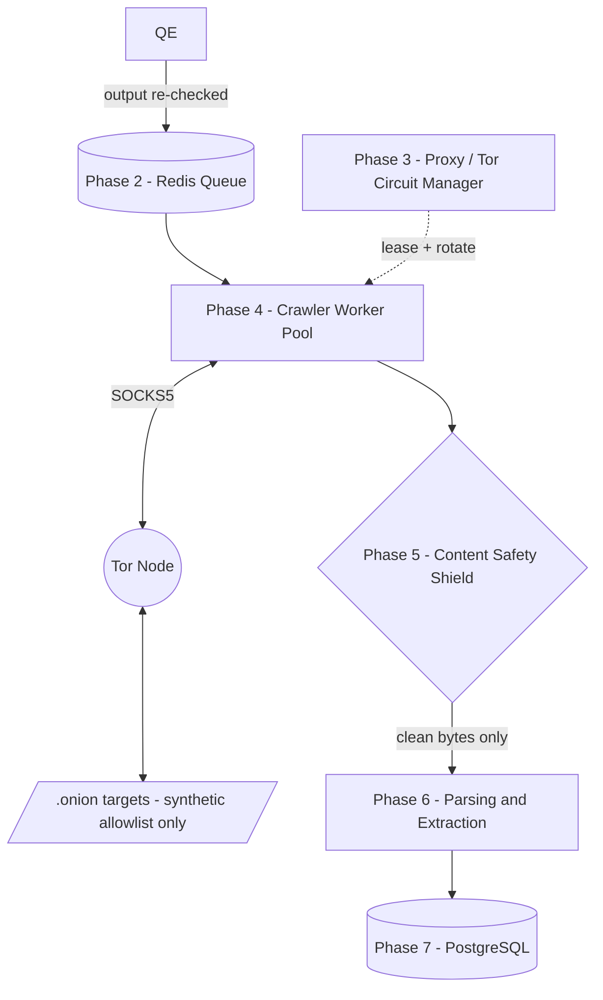

# Shivansh and Shubham Work

`redis -> postgres`

**Input to this phase**
```
XADD crawl:jobs * \
  job_id "550e8400-e29b-41d4-a716-446655440000" \
  target "mock-market-1.onion" \
  terms "[\"term1\",\"term2\"]" \
  depth_remaining "3" \
  enqueued_at "2026-09-02T10:00:00Z"
```

**Output of this phase**
```json
{
  "job_id": "550e8400-e29b-41d4-a716-446655440000",
  "scan_id": "8a1f...",
  "source_url": "http://mock-market-1.onion/thread/42",
  "provenance_tag": "forum_post",
  "extracted": {
    "handles": ["vendor_x"],
    "pgp_keys": ["ABCD1234EF56..."],
    "wallets": [{ "currency": "BTC", "address": "1A1zP1..." }],
    "infra_indicators": [{ "type": "exposed_status_page", "value": "/server-status" }],
    "stylometry_vector": [0.02, 0.87],
    "human_vectors": {
      "timestamps": ["2026-09-02T10:04:12Z"],
      "interaction_refs": ["@vendor_x", "post-id-42"]
    },
    "advanced_stylometry": null,
    "blockchain_heuristics": {
      "tx_ids": ["a1b2c3d4e5f6...64hex..."],
      "dust_fee_patterns": null,
      "cospend_indicators": null
    },
    "emails": ["contact@example.onion"],
    "links": [
      { "url": "http://mock-market-1.onion/listing/99", "type": "internal" },
      { "url": "http://externalxyz.onion/ref", "type": "external" }
    ],
    "images": [
      { "src": "http://mock-market-1.onion/img/product.jpg", "type": "jpeg" }
    ]
  },
  "content_flags": [
    { "category": "csam", "action_taken": "content_discarded", "hash_match": true }
  ],
  "body_ref": null,
  "fetched_at": "2026-09-02T10:04:12Z",
  "tor_circuit_id": "circ-9931"
}
```

> `advanced_stylometry` and `blockchain_heuristics.dust_fee_patterns` / `cospend_indicators` are extracted as raw slices here and forwarded to the Correlation Engine (Sub-team 3 / Blockchain Module) for analysis. They are `null` when the page contains insufficient signal for those vectors.



> **Pipeline order note:** The pipeline order is `Downloader → Content Safety Shield → Parser/Extractor`. The shield runs before any extraction so that hashing operates on raw bytes that have never been decoded or rendered, resolving the "never decoded / hash match" tension. `body_ref` is minted only after the shield passes clean bytes downstream — not at the download stage.

---

### PART BREAKDOWN

---

## 🔧 Reliability Update (2026-09-07): Actor ID Availability & Persistence

Downstream storage expects that any actor-scoped table write (UUID `actor_id`) has a valid actor identifier.

### New behavior
- When extraction produces **no actor handles**, the persistence layer must treat actor-scoped data as **non-insertable** for that scan iteration.
- Non-actor-scoped scan persistence continues normally.

### Impact
- Prevents `invalid input syntax for type uuid: ""` and removes intermittent 500s during scan creation.

---

#### WORKER

**Purpose 1:** Bounded worker pool (fixed-size, `sync.WaitGroup`-tracked); per-job URL frontier (depth-bounded, dedup via seen-set); politeness delay (randomized 2–8 s per host); on CAPTCHA/block detection the job pauses and moves to a `manual_intervention` queue with a dashboard alert, resuming only after operator action; passive fetch only — plain GET/HEAD against whatever the server already serves, never a crafted payload; each target gets three attempts max.

**Purpose 2:** Regex/pattern extraction; text body also passed to the stylometry feature extractor (function-word frequency, punctuation habits, sentence-length distribution). *(Additional vectors to be added later.)*

**Input**
```
lateral input to this phase
```

**Output → Site Checker Function**
```json
{
  "job_id": "uuid",
  "url": "...",
  "http_status": 200,
  "headers": { "...": "..." },
  "raw_bytes_ref": "transient-blob-id",
  "fetched_at": "ISO8601",
  "tor_circuit_id": "..."
}
```

> `raw_bytes_ref` is an ephemeral transient blob handle — it is consumed and released by the Content Safety Shield. It is never persisted. `body_ref` (the durable, post-shield blob handle) is created by the shield on clean-pass only and does not exist at this stage.

**Output → Parsing/Extraction Engine**
```json
{
  "job_id": "uuid",
  "source_url": "...",
  "provenance_tag": "forum_post | marketplace_listing | ...",
  "extracted": {
    "handles": ["..."],
    "pgp_keys": ["fingerprint-or-block"],
    "wallets": [{ "currency": "BTC", "address": "..." }],
    "infra_indicators": [{ "type": "exposed_status_page", "value": "..." }],
    "stylometry_vector": [0.02, 0.87],
    "human_vectors": {
      "timestamps": ["ISO8601", "..."],
      "interaction_refs": ["@handle", "quoted-post-id"]
    },
    "advanced_stylometry": null,
    "blockchain_heuristics": {
      "tx_ids": ["64-char-hex-string"],
      "dust_fee_patterns": null,
      "cospend_indicators": null
    },
    "emails": ["...@....onion"],
    "links": [
      { "url": "...", "type": "internal | external" }
    ],
    "images": [
      { "src": "...", "type": "jpeg | png" }
    ]
  },
  "raw_text_ref": "blob-id"
}
```

> `content_flags` is absent from this output because the Content Safety Shield runs *before* the parser. Flags are written directly to PostgreSQL by the shield and are not part of the parser's output contract.
>
> `advanced_stylometry` raw text slices and `blockchain_heuristics` dust/co-spend fields are populated as opaque pass-through payloads for the Correlation Engine — the parser extracts and forwards them but does not analyse them.
>
> `stylometry_vector` is `null` when the text block is under 150 words (minimum sample gate).

---

**Resolved Issues**

**1. Built-in error handling — 7 error classes**

| Error | Retryable | Behaviour |
|---|---|---|
| `network_timeout` | Yes (max 3) | Retry after circuit rotation (max 5 rotations) |
| `connection_refused` | Yes (max 3) | Retry after circuit rotation |
| `circuit_dead` | Yes | Fire circuit-renew request to the Tor Router; do not count against job retry budget |
| `blocked_or_captcha` | No (immediate) | Fire human-review request; log with timestamp; 5-minute expiry on the intervention slot |
| `parse_error` | No | Fire alert; job marked failed; no retry |
| `storage_error` | Conditional | Retryable on transient DB codes (40001, 40P01); non-retryable on constraint violations (23505, 23514); fire alert on non-retryable |
| `panic` | No | Built-in `recover()` wrapper around every worker goroutine; log stack trace; mark job failed; worker slot returned to pool |

**2. Bot detection handling**

| Detection type | Approach |
|---|---|
| Web / text CAPTCHA | Human intervention queue; logged; 5-minute expiry slot |
| JS proof-of-work — lightweight | AP1: Mathematical solver — find a cryptographic nonce that satisfies the target hash prefix without a full browser |
| JS proof-of-work — complex DOM | AP2: Headless browser sidecar — handles standard JS execution, DOM manipulation, and fingerprinting challenges that cannot be reverse-engineered cheaply |
| Bot blocking | Rate limiting + circuit rotation + TLS certificate rotation + politeness delay + User-Agent substitution + random response-body-length padding + TTL substitution |
| Account aging / threshold | Human intervention; flagged; do not automate |
| Session-to-circuit binding | CookieJar bound to `tor_circuit_id`; circuit is not rotated mid-session when a cookie is active (`TorCircuitAuth`) |

> **Clock fuzzing note:** Time randomization is applied to a *secondary, lower-priority control loop* that fuzzes the container's time-sync behaviour (analogous to Whonix's `sdwdate`) to reduce fingerprintability of the crawler infrastructure itself. This loop is entirely separate from job timestamps and from the JS proof-of-work solver, which requires accurate time to compute nonces correctly.

**3. Regex-extracted fields**

See full regex extraction map below.

**4. Regex hardening pipeline (applied before any extraction)**

All raw text passes through the following normalization sequence before regex patterns are evaluated:

```
1. Unicode NFKC normalization
2. Strip zero-width characters (U+200B, U+200C, U+200D, U+FEFF, etc.)
3. Decode HTML entities (&amp; → &, &#x27; → ', etc.)
4. Strip RTL/LTR override characters (U+202A–U+202E, U+2066–U+2069)
5. Run extraction patterns against the normalized text
```

**5. Worker zero-trust architecture**

| Control | Implementation |
|---|---|
| No DB credentials in worker | Only the storage-service container holds DB credentials; workers write via the storage service API only |
| Ephemeral read-only root filesystem | Container root mounted `ro`; only explicitly declared tmpfs volumes are writable |
| Drop all Linux capabilities | `--cap-drop ALL` at container launch; no capability re-added unless strictly required |
| Run as non-root | Dedicated non-privileged UID inside the container image |
| Automated ephemeral teardown | Each worker container is treated as cattle — on job completion or unrecoverable error, the container is destroyed and a fresh one is provisioned for the next job |
| Network micro-segmentation | Two-tier pipeline architecture reserved as a future feature; current segmentation enforced via Docker network policies limiting inter-container reachability to declared service pairs only |

**6. Clock fuzzing separation from job timestamps**

Time randomization operates *only* on the secondary NTP-fuzzing control loop (infrastructure fingerprintability reduction). Job timestamps, retry timers, and JS proof-of-work nonce computation all use the system clock directly and are not affected.

**7. Request timeout controls — three independent limits**

```go
// Applied per fetch attempt inside the worker
const (
    OverallRequestTimeout = 90 * time.Second   // hard wall — entire round-trip must complete within this
    IdleReadDeadline      = 30 * time.Second   // reset on each new byte received; catches stalled bodies
    MaxBytesReader        = 10 << 20            // 10 MB cap on response body; prevents memory exhaustion
)
```

**8. CAPTCHA/block detection — anti-gaming safeguards**

Three independent signals must all agree before a target is marked as blocking:

```
Signal 1 — HTTP status code must be explicitly 403, 408, or 503
Signal 2 — Response body structural length deviates significantly from the historical
            baseline for that target (stored per-target in Redis)
Signal 3 — Cross-circuit verification: the same URL is fetched via a second, independent
            Tor circuit; if that circuit also receives a block signal, the detection is confirmed
```

Per-target historical baselines (block-to-success ratio, average response size) are tracked in Redis and used to compute anomaly scores. A single outlier response does not trigger the block state.

**9. Pipeline order — extraction after content safety**

Pipeline is: `Downloader → Content Safety Shield → Parser/Extractor → PostgreSQL`

The parser never receives bytes that have not passed the shield. `body_ref` is created by the shield on clean-pass only and passed downstream; it is never created at the download stage.

---

**Implementation Notes**

- Pool implemented as a buffered channel of `struct{}` tokens (size = worker count); each goroutine acquires a token before starting and releases on completion via `defer`
- Seen-set is a per-job `map[string]bool` allocated at job start, discarded at job end; not shared across jobs or workers
- Shield handoff is a synchronous function call within the same goroutine — not a queue; the goroutine blocks until the shield returns
- Error classification via a `switch` on the concrete error type returned by the HTTP client at the top of the fetch loop
- Politeness delay: `time.Sleep(time.Duration(2000+rand.Intn(6000)) * time.Millisecond)` keyed on hostname not full URL; fires after fetch completes
- Per-job retry budget tracked as `map[string]int` keyed on URL; decremented before the retry attempt; circuit rotation fires on `network_timeout` and `connection_refused` before the next attempt
- CAPTCHA detection requires all three signals to agree (HTTP status + body-length deviation from Redis baseline + cross-circuit verification); a single outlier does not trigger intervention
- `sync.WaitGroup` counter incremented before goroutine launch; decrement always via `defer wg.Done()` as the first statement inside the goroutine body
- `recover()` wraps the entire goroutine body; on panic: log stack trace, mark job failed in Redis, return worker token to pool via deferred release
- Manual-intervention queue is a separate Redis stream (`crawl:manual`); job payload re-serialized with `flagged_at` and 5-minute TTL; main pool does not block waiting for resolution

---

**Regex Extraction Map**

| Vector / Field | Extraction Type | Regex Pattern / Extraction Rule | Execution Scope |
| :--- | :--- | :--- | :--- |
| **a) PGP Public Key Block** | Regex | `-----BEGIN PGP PUBLIC KEY BLOCK-----[^-]*-----END PGP PUBLIC KEY BLOCK-----` | Parser (`internal/parser`) |
| **b) Bitcoin Address** | Regex | `\b(bc1[a-zA-HJ-NP-Z0-9]{39,59}\|[13][a-km-zA-HJ-NP-Z1-9]{25,34})\b` | Parser (`internal/parser`) |
| **c) Other Crypto Addresses** | Regex | **EVM:** `\b0x[a-fA-F0-9]{40}\b` / **Monero:** `\b4[0-9AB][1-9A-HJ-NP-Za-km-z]{93}\b` / **Litecoin:** `\b[LM3][a-km-zA-HJ-NP-Z1-9]{26,33}\b` | Parser (`internal/parser`) |
| **d) Handle / Alias** | DOM / Rule-based | HTML element parsing (`class="username"`, author fields) + homoglyph normalization | Parser / DOM Extractor |
| **e) Infra Indicator** | Regex | `\b(Server Status\|Apache Status\|phpinfo\(\)\|X-Powered-By:\|nginx/[\d\.]+)\b` and `\b[a-z2-7]{56}\.onion\b` | Parser (`internal/parser`) |
| **f) Stylometry (Structural)** | Text Metric | DOM text-block stripping; sentence/word count metrics; punctuation frequency (`!`, `?`, `,`). **Minimum sample gate: discard any text block under 150 words — short chat messages do not produce statistically meaningful stylometry vectors** | Parser (Structural metrics) |
| **g) Human Vectors** | Metadata / Regex | **Timestamps:** `\b\d{4}-\d{2}-\d{2}[T ]\d{2}:\d{2}:\d{2}(?:\.\d+)?(?:Z\|[+-]\d{2}:?\d{2})?\b` / **Triangulation:** `@username` / quoted-post-id parsing | Parser / Metadata Extractor |
| **h) Advanced Stylometry** | Text Slices | Raw sentence/paragraph text slices for NLP tokenizer models and idiom lookups; typographical & slang mapping; code-switching & translation artifacts | Correlation Engine (Sub-team 3) |
| **i) Blockchain Heuristics** | Regex & Ledger | **TxID:** `\b[a-fA-F0-9]{64}\b`; dust & fee patterns; co-spend & change-address clustering heuristics | Correlation Engine (Blockchain Module) |
| **j) Email Addresses** | Regex | `\b[a-zA-Z0-9._%+\-]+@[a-zA-Z0-9.\-]+\.[a-zA-Z]{2,}\b` | Parser (`internal/parser`) |
| **k) Links, URLs, and Endpoints** | Regex | `https?://[^\s"'<>]+` and `\b[a-z2-7]{56}\.onion(?:/[^\s"'<>]*)?\b` | Parser (`internal/parser`) |
| **l) Images (JPEG / PNG refs)** | DOM / Regex | `]+src=["']([^"']+)["']` for inline references; `\bhttps?://[^\s"'<>]+\.(?:jpg\|jpeg\|png)\b` for text-embedded URLs | Parser / DOM Extractor |

---

#### TOR ROUTER CONTAINER

**Purpose:** Hands out a SOCKS5 endpoint per worker/container; rotates circuits on policy (when one site is parsed by each worker, on timeout (2 min), or immediately on a detected block); talks to the Tor control port to issue `SIGNAL NEWNYM`; enforces a network kill switch — a container-level firewall rule that drops all non-Tor-proxy egress, so a bug in the crawler cannot leak direct-to-internet traffic even accidentally.

**Input**
```json
{ "target_host": "...", "purpose": "fetch" }
```

**Output**
```json
{ "socks_endpoint": "127.0.0.1:9050", "circuit_id": "...", "expires_at": "..." }
```

---

**Resolved Issues**

**1–3. iptables kill switch — IPv4 and IPv6, outside Docker control**

The iptables rules are applied by the container's `entrypoint.sh` *before* any other process starts, and the rules file lives in a host path that Docker does not manage, preventing Docker daemon operations from flushing or overwriting them.

```bash
#!/usr/bin/env bash
set -euo pipefail

# ── IPv4 rules ──────────────────────────────────────────────────────────────
iptables -A DOCKER-USER -m conntrack --ctstate ESTABLISHED,RELATED -j ACCEPT
iptables -A DOCKER-USER -i lo -j ACCEPT
iptables -A DOCKER-USER -p udp --dport 53 -j ACCEPT
iptables -A DOCKER-USER -p tcp --dport 9040 -j ACCEPT
iptables -A DOCKER-USER -d 172.16.0.0/12 -j ACCEPT
iptables -A DOCKER-USER -j DROP

# ── IPv6 rules ───────────────────────────────────────────────────────────────
ip6tables -A DOCKER-USER -m conntrack --ctstate ESTABLISHED,RELATED -j ACCEPT
ip6tables -A DOCKER-USER -i lo -j ACCEPT
ip6tables -A DOCKER-USER -j DROP

# ── Persist rules across restarts ────────────────────────────────────────────
netfilter-persistent save
```

**4. Tor sidecar / worker race condition — sequential orchestration**

The container entrypoint enforces a strict startup order: Firewall → Tor Daemon → SOCKS health check → Go Worker. The Go worker binary is not started until the SOCKS health check returns successfully.

```bash
# entrypoint.sh (continued after iptables block above)

apply_iptables

echo "[entrypoint] Starting Tor daemon..."
tor -f /etc/tor/torrc &
TOR_PID=$!

echo "[entrypoint] Waiting for SOCKS5 endpoint to become available..."
until nc -z 127.0.0.1 9050; do
    sleep 1
done
echo "[entrypoint] SOCKS5 healthy."

echo "[entrypoint] Starting Go worker..."
exec /app/worker
```

---

**Implementation Notes**

- SOCKS5 endpoint pool implemented as a `sync.Map` keyed on `circuit_id`; each entry holds endpoint string, `issued_at` timestamp, and a `cookie_active bool` flag
- Circuit rotation evaluated after every successful parse, on 2-minute idle timeout via `time.AfterFunc`, and on confirmed block; rotation skipped when `cookie_active == true` on the leased circuit
- `SIGNAL NEWNYM` sent to Tor control port via plain TCP to `127.0.0.1:9051` using cookie auth; sent and response read synchronously before new SOCKS endpoint is handed out
- Kill switch iptables rules applied in `entrypoint.sh` before Tor daemon starts; rules file lives in a host-mounted path outside Docker's management scope
- Startup order enforced by `entrypoint.sh`: `apply_iptables()` → `tor -f /etc/tor/torrc &` → `nc -z 127.0.0.1 9050` poll loop (1s interval) → `exec /app/worker`; Go binary never exec'd until SOCKS health check passes
- `proxy_leases` row written at circuit issue with `released_at = NULL`; updated on release with `released_at` and `released_reason`; background query on `released_at IS NULL AND issued_at < now() - interval '10 minutes'` surfaces leaked leases
- IPv6 kill switch is a separate `ip6tables -A DOCKER-USER -j DROP` applied in the same `apply_iptables()` call; both rule sets persisted via `netfilter-persistent save`
- `CookieJar` instantiated per circuit lease, stored alongside the circuit entry in the `sync.Map`; discarded when circuit is released; new jar allocated for replacement circuit

---

#### HASH-BASED CSAM AND BYSTANDER DATA FILTERING

**Purpose:**
- **CSAM check** — perceptual/cryptographic hash match against a maintained CSAM hash set (production deployment sources this via a recognized hash-sharing program; hackathon demo stubs this interface against a small synthetic known-bad-hash test set — never real material). On a match, bytes are deleted from any transient buffer immediately; only `{ url, hash_match: true, category: "csam", action: "content_discarded" }` continues, and the job is flagged for mandatory escalation. Content is never decoded, rendered, or stored.
- **Abusive-content classifier** — a second, lower-severity pass (weapons imagery, extremist material) applies the same discard pipeline as CSAM for content above the "very offensive" threshold; for content below that threshold, only metadata continues for threat-intel purposes; raw content re-display is suppressed by default in the dashboard.

**Input**
```json
{
  "job_id": "uuid",
  "source_url": "...",
  "http_status": 200,
  "headers": { "...": "..." },
  "raw_bytes_ref": "transient-blob-id",
  "fetched_at": "ISO8601",
  "tor_circuit_id": "..."
}
```

> The shield receives the Worker → Site Checker output directly — the same shape defined above. No parsing or decoding has occurred at this point. The shield operates exclusively on the raw byte stream referenced by `raw_bytes_ref`.

**Output (clean pass) — forwarded to Parser/Extraction Engine**
```json
{
  "job_id": "uuid",
  "source_url": "...",
  "http_status": 200,
  "headers": { "...": "..." },
  "body_ref": "blob-id",
  "provenance_tag": "forum_post | marketplace_listing | chat_message | ...",
  "shield_passed": true,
  "fetched_at": "ISO8601",
  "tor_circuit_id": "..."
}
```

> `body_ref` is created here — this is the first and only point at which the durable blob handle is minted. `raw_bytes_ref` is released and zeroed. `http_status` and `headers` are forwarded so the parser can make context-aware extraction decisions (e.g. skip image extraction if `Content-Type` is `text/plain`).

**Output (CSAM match) — pipeline terminates here**
```json
{
  "job_id": "uuid",
  "source_url": "...",
  "body_ref": null,
  "shield_passed": false,
  "content_flags": [
    {
      "category": "csam",
      "action_taken": "content_discarded",
      "hash_match": true,
      "hash_algorithm": "PDQ | TMK+PDQF",
      "flagged_at": "ISO8601"
    }
  ]
}
```

> Bytes are zeroed from the transient buffer immediately on match. No further processing occurs. The flag is written directly to `content_flags` in PostgreSQL by the shield. The parser never receives this job's data.

**Output (abusive-other match above discard threshold) — pipeline terminates here**
```json
{
  "job_id": "uuid",
  "source_url": "...",
  "body_ref": null,
  "shield_passed": false,
  "content_flags": [
    {
      "category": "abusive_other",
      "action_taken": "content_discarded",
      "hash_match": false,
      "classifier_score": 0.94,
      "flagged_at": "ISO8601"
    }
  ]
}
```

> Follows the same discard path as CSAM — bytes zeroed, `body_ref` never created, parser never receives the data. Below-threshold abusive-other content follows the provenance-based retention logic in issue 4 and does reach the parser via the clean-pass output above.

---

**Resolved Issues**

**1–3. Perceptual hashing — algorithm selection**

| Algorithm | Purpose |
|---|---|
| **PDQ** | Fast perceptual image hashing — survives minor edits, crops, and re-encodings |
| **TMK + PDQF** | Video-frame perceptual hashing — handles content distributed as short clips |
| **Block-based perceptual hashing with grey threshold** | Applied to borderline/greyscale content where PDQ alone gives insufficient confidence; a block-level match above a configurable threshold triggers the discard path |

**4. Bystander data filtering — provenance-based differential retention**

| Provenance tag | Artifact value | Retention decision |
|---|---|---|
| Verified marketplace listing | High | Retain all extracted artifacts |
| Forum thread with actor handles | High | Retain all extracted artifacts |
| Unattributed chat message, no artifact | Low | Discard — do not write to DB |
| Generic page with no actor signal | Low | Discard metadata; do not write to DB |
| Any artifact from a high-value tag | High | Always retain regardless of content brevity |

**5. URL filtering pipeline**

```
1. Normalize the URL (lowercase scheme and host, strip default ports, decode percent-encoding)
2. Fast blacklist lookup against VirusTotal and equivalent threat-intel feeds
3. Abusive/malicious pattern heuristics — check for known exploit-kit URI patterns,
   typosquatted domains, and malformed authority components
4. If any check fails — discard URL, log reason, do not enqueue
```

**6. Stylometry minimum sample gate**

Text blocks under 150 words do not generate a stylometry vector. The field is set to `null` and excluded from the extraction output.

**7. "Never decoded" and "hash match" tension — resolved by pipeline order**

The shield operates on raw bytes before any decoding, rendering, or parsing. Perceptual hashing runs against the raw byte stream. On match, bytes are zeroed and the pipeline terminates. The parser never receives the bytes. `body_ref` is never created.

**8. `body_ref` minting location**

`body_ref` is created by the shield on clean-pass only, immediately before handing the byte stream to the parser. The downloader's `raw_bytes_ref` is consumed and released by the shield at the same point.

**9. Differential retention — unified discard pipeline**

Both CSAM and above-threshold abusive-other content follow the same discard path: bytes zeroed, `body_ref` set to `null`, only flag metadata continues. Below-threshold abusive-other follows provenance-based differential retention (issue 4). No code path retains raw bytes for suppressed display.

---

**Implementation Notes**

- Shield reads `raw_bytes_ref` into a single in-memory buffer; this buffer is explicitly zeroed (`runtime.MemClr` equivalent) on discard — not left for GC
- PDQ computed against raw byte buffer before any decode or MIME detection; TMK+PDQF applied when MIME resolves to a video container; block-based hash applied when PDQ confidence falls below configured threshold
- Hash lookup is a local set membership check against an in-memory set loaded at startup; production API and hackathon stub are swapped by dependency injection not conditional compilation
- On hash match: buffer zeroed immediately before any other statement; `body_ref` never allocated; only the flag struct written to PostgreSQL; scan row updated with `requires_escalation = true`
- `body_ref` allocated (UUID minted, blob handle registered) only on clean pass immediately before byte stream is handed to parser; `raw_bytes_ref` released and zeroed at the same point
- `provenance_tag` assigned by shield on clean pass via rule-based classifier over HTTP headers and URL path patterns (`/listing/`, `/thread/`, `/chat/`); not re-derived by the parser
- Abusive-other classifier runs as a second pass after perceptual hash check; skipped entirely when hash check already triggered discard; discard threshold is runtime-configurable from environment not a compile-time constant
- Below-threshold abusive-other follows clean-pass path with `shield_passed: true`; differential retention enforced at the storage service write layer not in the shield
- `http_status` and `headers` forwarded unchanged in clean-pass struct so parser can skip image extraction on `Content-Type: text/plain` without reading from shared state

---

#### POSTGRESQL

**Purpose:** Upsert into the normalized schema. Only the storage service container holds DB credentials — crawler/parser containers never do (zero-trust: container compromise does not equal DB access).

**Input**
```
Output of the Content Safety Shield and Parser phases, written via the storage service API.
```

---

**Resolved Issues**

**1. Data deletion time period — time-partitioned tables**

All high-volume tables (`scans`, `content_flags`, `audit_log`, `proxy_leases`) are range-partitioned on their primary timestamp column. Partition dropping replaces row-level `DELETE` operations, making bulk expiry near-instant and avoiding table bloat.

```sql
CREATE TABLE audit_log (
    log_id       UUID          NOT NULL,
    actor_type   TEXT,
    action       TEXT          NOT NULL,
    resource_id  UUID,
    occurred_at  TIMESTAMPTZ   NOT NULL DEFAULT now(),
    metadata     JSONB
) PARTITION BY RANGE (occurred_at);

CREATE TABLE audit_log_2026_09
    PARTITION OF audit_log
    FOR VALUES FROM ('2026-09-01') TO ('2026-10-01');

-- Drop a partition to expire data — no row-level DELETE required
DROP TABLE audit_log_2026_08;
```

**2. Upsert conflict targets — explicit unique constraints**

```sql
ALTER TABLE identifiers
    ADD CONSTRAINT uq_identifiers_actor_kind_value UNIQUE (actor_id, kind, value);

ALTER TABLE infra_indicators
    ADD CONSTRAINT uq_infra_actor_type_host UNIQUE (actor_id, indicator_type, onion_host);

ALTER TABLE persona_links
    ADD CONSTRAINT uq_persona_links_pair_basis UNIQUE (actor_id_a, actor_id_b, basis);
```

```go
const upsertIdentifier = `
    INSERT INTO identifiers (identifier_id, actor_id, kind, value, source, first_seen, last_seen)
    VALUES ($1, $2, $3, $4, $5, $6, $7)
    ON CONFLICT (actor_id, kind, value)
    DO UPDATE SET
        last_seen = EXCLUDED.last_seen,
        source    = EXCLUDED.source
`
```

**3. Confidence bound enforcement at the data layer**

```sql
ALTER TABLE persona_links
    ADD CONSTRAINT chk_persona_links_confidence
    CHECK (confidence >= 0.0 AND confidence <= 1.0);
```

**4. Attribution confidence — dynamic aggregated view, not a mutable column**

```sql
ALTER TABLE actors DROP COLUMN IF EXISTS attribution_confidence;

CREATE OR REPLACE VIEW actor_confidence AS
SELECT
    a.actor_id,
    a.primary_handle,
    COALESCE(AVG(pl.confidence), 0.0)::NUMERIC(3,2) AS attribution_confidence
FROM actors a
LEFT JOIN persona_links pl
    ON pl.actor_id_a = a.actor_id OR pl.actor_id_b = a.actor_id
GROUP BY a.actor_id, a.primary_handle;
```

**5. Row-level security (future feature — not implemented in current phase)**

RLS on sensitive tables and context-aware access policies are deferred to a future phase. Application-layer filtering remains the current enforcement mechanism.

**6. Storage error — retryable vs non-retryable classification**

| PostgreSQL error code | Class | Behaviour |
|---|---|---|
| `40001` (serialization failure) | Retryable | Exponential backoff, max 3 retries |
| `40P01` (deadlock detected) | Retryable | Exponential backoff, max 3 retries |
| `23505` (unique violation) | Non-retryable | Log as conflict; mark job complete; do not retry |
| `23514` (check constraint violation) | Non-retryable | Fire alert; mark job failed; do not retry |
| All other codes | Non-retryable default | Fire alert; mark job failed |

---

**Schema**

```sql
-- Threat actors
CREATE TABLE actors (
    actor_id         UUID PRIMARY KEY,
    primary_handle   TEXT          NOT NULL,
    category         TEXT,
    last_scan_date   TIMESTAMPTZ,
    created_at       TIMESTAMPTZ   DEFAULT now()
);

-- Dynamic confidence view
CREATE OR REPLACE VIEW actor_confidence AS
SELECT
    a.actor_id,
    a.primary_handle,
    COALESCE(AVG(pl.confidence), 0.0)::NUMERIC(3,2) AS attribution_confidence
FROM actors a
LEFT JOIN persona_links pl
    ON pl.actor_id_a = a.actor_id OR pl.actor_id_b = a.actor_id
GROUP BY a.actor_id, a.primary_handle;

-- Identifiers found for a given threat actor
CREATE TABLE identifiers (
    identifier_id   UUID PRIMARY KEY,
    actor_id        UUID REFERENCES actors(actor_id),
    kind            TEXT,
    value           TEXT          NOT NULL,
    source          TEXT,
    provenance_tag  TEXT,
    first_seen      TIMESTAMPTZ,
    last_seen       TIMESTAMPTZ,
    CONSTRAINT uq_identifiers_actor_kind_value UNIQUE (actor_id, kind, value)
);

-- Infrastructure indicators
CREATE TABLE infra_indicators (
    indicator_id          UUID PRIMARY KEY,
    actor_id              UUID REFERENCES actors(actor_id),
    indicator_type        TEXT,
    onion_host            TEXT,
    matched_clearnet_host TEXT,
    evidence              TEXT,
    detected_at           TIMESTAMPTZ,
    CONSTRAINT uq_infra_actor_type_host UNIQUE (actor_id, indicator_type, onion_host)
);

-- Persona links between threat actors
CREATE TABLE persona_links (
    link_id                 UUID PRIMARY KEY,
    actor_id_a              UUID REFERENCES actors(actor_id),
    actor_id_b              UUID REFERENCES actors(actor_id),
    basis                   TEXT,
    confidence              NUMERIC(3,2) NOT NULL,
    negative_control_passed BOOLEAN       NOT NULL DEFAULT false,
    created_at              TIMESTAMPTZ   DEFAULT now(),
    CONSTRAINT chk_persona_links_confidence CHECK (confidence >= 0.0 AND confidence <= 1.0),
    CONSTRAINT uq_persona_links_pair_basis  UNIQUE (actor_id_a, actor_id_b, basis)
);

-- Scan records
CREATE TABLE scans (
    scan_id       UUID PRIMARY KEY,
    requested_by  TEXT,
    targets       TEXT[],
    status        TEXT,
    started_at    TIMESTAMPTZ,
    completed_at  TIMESTAMPTZ
) PARTITION BY RANGE (started_at);

-- Content flags
CREATE TABLE content_flags (
    flag_id      UUID PRIMARY KEY,
    scan_id      UUID REFERENCES scans(scan_id),
    source_url   TEXT,
    category     TEXT,
    action_taken TEXT,
    flagged_at   TIMESTAMPTZ
) PARTITION BY RANGE (flagged_at);

-- Audit log
CREATE TABLE audit_log (
    log_id      UUID          NOT NULL,
    actor_type  TEXT,
    action      TEXT          NOT NULL,
    resource_id UUID,
    occurred_at TIMESTAMPTZ   NOT NULL DEFAULT now(),
    metadata    JSONB
) PARTITION BY RANGE (occurred_at);

-- Proxy leases
CREATE TABLE proxy_leases (
    lease_id        UUID PRIMARY KEY,
    job_id          UUID,
    circuit_id      TEXT,
    issued_at       TIMESTAMPTZ,
    released_at     TIMESTAMPTZ,
    released_reason TEXT
) PARTITION BY RANGE (issued_at);
```

---

**Implementation Notes**

- All writes go through the storage service container via HTTP API; crawler/parser containers have no `DATABASE_URL` or equivalent in their environment
- Upsert statements use `ON CONFLICT (named_constraint) DO UPDATE`; conflict target is always a named constraint not an inline column list
- `attribution_confidence` is not a column; read exclusively via the `actor_confidence` view which computes `AVG(persona_links.confidence)` at query time
- Partition creation for `scans`, `content_flags`, `audit_log`, `proxy_leases` handled by a scheduled job pre-creating next-month partitions on the 25th; partition drop for expired data is a `DROP TABLE` — no row-level `DELETE` involved
- Retryable errors (`40001`, `40P01`) use truncated exponential backoff starting at 50ms, capped at 2s, max 3 attempts; retry loop is inside the storage service handler — crawler goroutine blocks synchronously on the API call
- `23505` unique violation marks the job complete (idempotent re-delivery); `23514` check constraint marks the job failed and fires an alert; both logged as structured events with offending row payload redacted to field names only
- `confidence` check constraint is defense-in-depth; storage service validates the value before issuing `INSERT` so the DB constraint is a backstop not the primary guard
- `proxy_leases.released_at IS NULL` leak detection runs every 5 minutes; leases older than 10 minutes emit a structured alert and are force-closed with `released_reason = 'leak_detected'`
- Partition key column is always `NOT NULL DEFAULT now()` so rows without an explicit timestamp never fall outside all partitions and cause an insert error


---

## The New Features

### 1. Offline Mode & Decoupled Mock Crawl Telemetry
To facilitate rapid local testing without active Tor daemon circuits:
- Crawler workers support offline simulated discovery modes that process tasks emitted by the ingestion API or mock seeds.
- The pipeline seamlessly falls back to pre-indexed topological mock nodes (`db/seed/markets.yaml`), allowing end-to-end extraction validation for handles, PGP signatures, and cryptocurrency wallets.

### 2. Frequency-Dampened Schema Additions (`extracted_links` & `image_hashes`)
Per the integration contract with Phase 9 (Correlation Engine / Negative Control):
- **`extracted_links`:** The parser write-path persists parsed link tuples (`(actor_id, link_url, link_type, scan_id)`) to calculate global dark-web link occurrence frequencies and suppress false attribution edges.
- **`image_hashes`:** Reuses the perceptual hash (PDQ) generated during the Phase 5 Content Safety Shield to populate `image_hashes` for cross-actor logo and banner dampening without recomputing byte decodes.

### 3. Container Hardening & Proxy Sandbox Isolation
- Updated `docker-compose.yml` crawler and Tor proxy specifications to enforce zero-trust security postures: `read_only: true`, `cap_drop: [ALL]`, and dedicated private Tor control networks.
- Retained dynamic circuit lease tracking (`proxy_leases`) with 5-minute automated leak detection.

