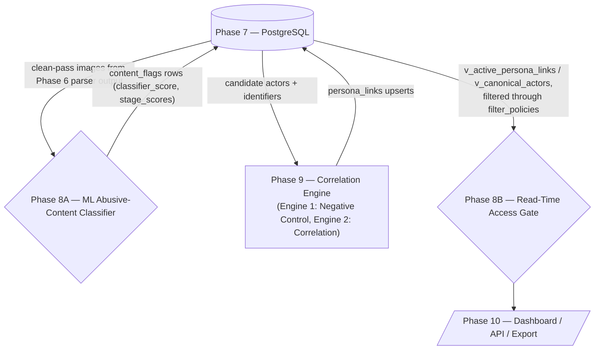

# Phases 8–10 — Abusive Content Filter, Correlation Engine, Dashboard/API/Export

`Chanchal and Reshit — reviewed against the Phase 2–7 doc (Shivansh & Shubham)`

---

## 0. Pipeline diagram (updated to match the reviewed architecture)

The original diagram showed a strictly serial `DB → Filter → Correlation → Dashboard` chain. That's not quite what the prose describes: Phase 8 is explicitly designed so that **removing it doesn't break the pipeline** (see §1.3), which means it isn't an inline transform — it's two overlays on top of Postgres (one that writes extra signal in, one that gates reads out). The diagram below reflects that:



**Why this shape:** Phase 8A only ever *adds* rows to `content_flags` — if it's disabled, Phase 9 and Phase 10 still function against whatever Phase 5/6 already wrote, they just lose the second-layer ML signal. Phase 8B only ever *filters a view* — if it's disabled, the dashboard reads the unfiltered view instead of the gated one, but the query still returns. Neither one sits in the critical path between the crawler and storage, which is what "if I remove the very AI filter and directly send the input to the next phase nothing in the pipeline breaks" actually requires architecturally.

---

## 1. Phase 8 — Abusive Content Filter

---

## 🔧 Reliability Update (2026-09-07): Storage Write-Time Guard

Correlation and filtering phases can produce scans that contain infra/links/images even when **no actor handle** is present.

### Storage-side guard
- Actor-scoped UUID columns must only be written when `actor_id` is a valid UUID.
- Otherwise, those specific inserts are skipped to keep the pipeline fault-tolerant and prevent HTTP 500 regressions.

This phase is **defense-in-depth, not the primary control.** The primary control is Phase 5's hash-based Content Safety Shield in the higher pipeline `{! depend on higher pipeline}` — that's what discards known-hash CSAM before any byte is decoded (see the higher pipeline doc, "Hash-Based CSAM and Bystander Data Filtering"). Phase 8 exists to catch what hash-matching structurally cannot: content that has never been hashed before. It runs in two independent parts that were being conflated in the original draft — splitting them out because they have different triggers, different inputs, and different failure modes:

- **8A — ML Abusive-Content Classifier**: scores *new* images that already survived the Phase 5 hash shield and were extracted by the Phase 6 parser, using the age/nudity/behavior composite model.
- **8B — Read-Time Access Gate**: independent of whether 8A ever ran, this controls who is allowed to *see* metadata that's already flagged in `content_flags`, at query time.

### Corrected purpose statement

> Filters out CSAM/most-severe-category records from every read path by default, independent of **Phase 5 — Content Safety Shield** — defense in depth. Viewing flagged-category metadata at all requires elevated, logged authorization; the underlying content was already discarded at ingestion (Phase 5, or Phase 8A if the shield's hash set didn't catch it), so there is nothing to view regardless.
>
> *(Correction note: the original draft referenced "Phase 6." In the higher pipeline's numbering, Phase 6 is Parsing/Extraction — the discard happens one stage earlier, at Phase 5, the Content Safety Shield. Corrected here for cross-doc consistency; nothing else about the sentence was changed.)*

---

### 1.1 — Phase 8A: ML Abusive-Content Classifier

**Input** `{! depend on higher pipeline}`

Phase 8A consumes the `images` array from the Phase 6 parser's output (the same shape defined in the higher pipeline doc's Worker → Parsing/Extraction Engine section) for any job whose `shield_passed: true`. It never sees a job the Phase 5 shield discarded — those jobs have `body_ref: null` and no `images` array exists to classify.

```json
{
  "job_id": "550e8400-e29b-41d4-a716-446655440000",
  "source_url": "http://mock-market-1.onion/thread/42",
  "provenance_tag": "forum_post",
  "images": [
    { "src": "http://mock-market-1.onion/img/product.jpg", "type": "jpeg" }
  ],
  "handles_on_page": ["vendor_x"]
}
```

**Output — two states, matching the higher pipeline's `content_flags` shape** `{! depend on higher pipeline}`

Discard path (score ≥ 0.65):

```json
{
  "job_id": "uuid",
  "source_url": "...",
  "body_ref": null,
  "shield_passed": false,
  "content_flags": [
    {
      "category": "csam",
      "action_taken": "content_discarded",
      "hash_match": false,
      "classifier_score": 0.71,
      "stage_scores": { "p_nudity": 0.82, "p_minor": 0.91, "p_exploitative": 0.44 },
      "review_required": false,
      "flagged_at": "ISO8601",
      "actor_id": "a1b2c3d4-e5f6-7a8b-9c0d-1e2f3a4b5c6d"
    }
  ]
}
```

Borderline path (0.45 ≤ score < 0.65) — held for human review, not auto-discarded:

```json
{
  "job_id": "uuid",
  "source_url": "...",
  "body_ref": null,
  "shield_passed": false,
  "content_flags": [
    {
      "category": "csam",
      "action_taken": "held_pending_review",
      "hash_match": false,
      "classifier_score": 0.53,
      "stage_scores": { "p_nudity": 0.61, "p_minor": 0.72, "p_exploitative": 0.19 },
      "review_required": true,
      "flagged_at": "ISO8601",
      "actor_id": "a1b2c3d4-e5f6-7a8b-9c0d-1e2f3a4b5c6d"
    }
  ]
}
```

Below 0.45: no flag row is written; the image stays part of the normal clean-pass output.

> **`actor_id` addition — this is new versus the higher pipeline's `content_flags` schema.** The base schema only has `scan_id` and `source_url`, no actor linkage (see §1.4, issue 4, for why this was added and what it's for). It's nullable — populated only when Phase 8A can associate the flagged image with a handle already extracted from the same `source_url` by Phase 6. `body_ref` is never populated by 8A even on a below-threshold pass — 8A does not mint or hold blob handles, that's exclusively Phase 5's job `{! depend on higher pipeline}`.

---

### 1.2 — Phase 8B: Read-Time Access Gate

**Input:** any read against actor/persona-link metadata that has an associated `content_flags` row.

**Output — the actor-level gated view** (this is the block from the original draft; kept as-is, it was already correctly scoped):

```json
{
  "schema_version": "1.0",
  "pipeline_stage": "phase_8_abusive_content_filter",
  "filter_applied": true,
  "inspection_metrics": {
    "records_evaluated": 142,
    "records_passed": 138,
    "records_redacted_or_dropped": 4
  },
  "payload": [
    {
      "actor_id": "a1b2c3d4-e5f6-7a8b-9c0d-1e2f3a4b5c6d",
      "primary_handle": "shadow_vendor",
      "identifiers": [
        { "kind": "pgp_key", "value": "0xA1B2C3D4E5F6" },
        { "kind": "btc_wallet", "value": "bc1qxy2kgdygjrsqtzq2n0yrf2493p83kkfjhx0wlh" }
      ],
      "infra_indicators": [
        { "type": "exposed_status_page", "evidence": "http://mock-market-1.onion/server-status" }
      ],
      "stylometry_vector": [0.02, 0.87, 0.41],
      "content_safety_metadata": { "is_flagged": false, "category": "clean", "read_permitted": true }
    }
  ]
}
```

**Important design property (kept from the original "imp note"):** this output shape does not break if Phase 8B is turned off — turn it off and the same query returns the unfiltered `v_canonical_actors` rows with `content_safety_metadata` simply absent. Nothing downstream has a hard dependency on that field existing.

---

### 1.3 — AI classifier architecture (Vectors A/B/C)

*(This was mislabeled as an "unaddressed flaw" in the draft — it isn't a problem, it's the core design. Pulled into its own section.)*

Since a direct CSAM dataset cannot exist or be sourced, the classifier never trains on the target class directly. It infers risk from three independently-trained proxy vectors, combined into a single threshold decision.

**Stage 1 — Hard gate (synchronous, runs first)**
```
if p_minor < 0.40: short-circuit → clean pass
```
If the age model is confident the subject is an adult, Stages 2–3 never run. This is what keeps the pipeline cheap — the overwhelming majority of images are adults and exit here.

**Stage 2 — Parallel inference** (only if Stage 1 didn't short-circuit)
```
Run nudity model and behavioral-context model concurrently (Go goroutines)
Collect p_nudity, p_exploitative
```

**Stage 3 — Composite score**
```
score = (0.30 × p_nudity) + (0.45 × p_minor) + (0.25 × p_exploitative)
```

**Stage 4 — Threshold decision**
| Score range | Action |
|---|---|
| `≥ 0.65` | Discard path — flag as `csam`, zero bytes, terminate pipeline |
| `[0.45, 0.65)` | Human review queue — borderline, never auto-discarded |
| `< 0.45` | Clean pass |

**Models selected:**

| Vector | Model |
|---|---|
| Age | InsightFace (MobileFaceNet / ResNet-34 backbone) |
| Nudity | NudeNet v2 (ONNX classifier) |
| Behavior | YOLOv8n-Pose + custom 2-layer MLP |

**Sample-size targets** (via Cochran's formula for statistical confidence bounds):

| Model | Samples |
|---|---|
| Age | 35,000 – 40,000 |
| Nudity | 15,000 – 20,000 |
| Behavioral context | 20,000 – 25,000 |

**Candidate public/academic datasets** — all three vectors are trainable entirely on adults-only, publicly documented benchmark datasets; the composite design is specifically what avoids ever needing an actual CSAM corpus. Every dataset below must be filtered/verified to contain only consenting adult subjects per its own license terms before use.

*Age recognition:*
1. **UTKFace** — 20k+ face images labeled with exact age, standard benchmark for age-estimation heads.
2. **IMDB-WIKI** — ~500k labeled face images, the largest public age dataset; good for the frozen ArcFace backbone's downstream head.
3. **FairFace** — 108k images balanced across age/race/gender; use this to check the age head isn't systematically biased by demographic before deploying the `p_minor < 0.40` short-circuit.
4. **AgeDB** — 16k "in the wild" images, standard hold-out validation set for ordinal age regression.

*Nudity classification:*
1. **NudeNet's public training methodology** (notAI-tech/NudeNet) — the documented safe/explicit split this project's own folder structure already mirrors.
2. **Yahoo `open_nsfw`** — the original open-source NSFW classifier and its published evaluation methodology; useful as the teacher model for the knowledge-distillation step in §1.3 methodology below.
3. **LSPD** (academic large-scale nudity/pornography classification benchmark referenced across content-moderation literature) — supplementary training signal.
4. **Community-curated safe/explicit folder corpora** (the `dataset_nudity/train/{safe,explicit}` structure already specified) — bootstrap this from the above two, then hand-review a validation slice.

*Behavioral context (pose):*
1. **COCO Keypoints** — the standard 17-point pose annotation set; this is what YOLOv8n-pose itself is pretrained on, use it to sanity-check keypoint extraction quality before ever hitting the MLP.
2. **MPII Human Pose Dataset** — classic pose benchmark, useful cross-validation set distinct from COCO's image distribution.
3. **In-house weak-labeled set** — no public dataset directly labels "suggestive_framing" vs. "neutral_standing." Bootstrap this by running YOLOv8n-pose over safe stock-photo pose corpora, then have a human reviewer bucket the resulting keypoint vectors into the two classes per the `pose_dataset.json` format already defined. This is the dataset that actually trains the MLP head.
4. *(Optional, stretch)* **Human3.6M** — only worth pulling in if 3D pose context turns out to matter; the 2D 17-keypoint MLP is likely sufficient for the demo.

**Dataset formats** *(unchanged from the original draft — already correct)*:

Age model — `dataset_age/{train,val}/images/*.jpg` + `labels.csv`:
```
image_path,age,is_minor_flag
images/img_0001.jpg,16,1
images/img_0002.jpg,28,0
```

Nudity model — ImageFolder classification (`dataset_nudity/{train,val}/{safe,explicit}/`), with an optional YOLOv8 bounding-box variant (`dataset_nudity_yolo/{images,labels}/`, normalized `<class_id> <x_center> <y_center> <width> <height>`).

Behavioral model — flattened 17×3 keypoint JSON array per sample (`pose_dataset.json`), label `1`/`0` for exploitative-pose vs. neutral-pose, 51-element MLP input vector.

---

### 1.4 — Training methodology (Vectors A, B, C)

| Vector | Approach | Why it's fast | Training time |
|---|---|---|---|
| **A — Age** | Freeze a pretrained ArcFace/InsightFace backbone (MS1MV2) entirely; extract 512-dim embeddings; train only a light 2-layer MLP head (512→128→2) with ArcMargin / ordinal-regression loss. Ordinal loss treats age as ordered classes rather than uncorrelated ones, which converges faster. | Only ~100K params updated, not 30M+ | ~15–20 min / GPU, 40K samples |
| **B — Nudity** | Knowledge distillation: a heavy teacher (ResNet-50 / ViT-B) generates soft probability labels; a compact MobileNetV3-Small / EfficientNet-Lite student trains on those soft labels via KL-divergence; export to ONNX at FP16/INT8. | Compact backbones peak within 5–8 epochs on soft labels | ~25–30 min / GPU |
| **C — Behavior** | Use YOLOv8n-pose *frozen, untouched* as a pure feature extractor — no fine-tuning. Normalize the 17 keypoints by centering on the bounding-box centroid and scaling by torso length (scale/position invariance). Train a lightweight 51→64→32→2 MLP on the flattened vector. | Learns spatial relationships from numeric coordinates, not raw 224×224×3 pixels | ~2–3 min / CPU |

Torso-length normalization:
```
x̂ᵢ = (xᵢ − x_center) / torso_length
ŷᵢ = (yᵢ − y_center) / torso_length
```

---

### 1.5 — Libraries (cross-checked)

**Python (training & export)**
| Library | Role |
|---|---|
| `torch` | Ordinal MLP (Vector A) and Keypoint MLP (Vector C) construction, backprop, execution |
| `torchvision` | Data transforms, dataset loading, image preprocessing |
| `insightface` | Extract-only pretrained ArcFace backbone access (Vector A) |
| `ultralytics` | Out-of-the-box YOLOv8n-pose 17-keypoint extraction (Vector C) — confirmed current package name on PyPI |
| `onnx` | Model graph serialization / export validation |
| `onnxruntime` / `onnxruntime-gpu` | FP16/INT8 quantized graph execution & validation |
| `opencv-python` | Frame decoding, image cropping, coordinate normalization |
| `numpy` | Matrix ops, keypoint-vector flattening |

**Go (concurrent runtime)**
| Library | Role |
|---|---|
| `github.com/yalue/onnxruntime_go` | Cgo wrapper for thread-safe ONNX execution inside Go |
| `github.com/disintegration/imaging` | Pure-Go crop/scale/buffer formatting |
| `gocv.io/x/gocv` | OpenCV wrapper — only needed if a video-frame path is added later; not required for the image-only MVP |

**System / C libraries**
| Library | Role |
|---|---|
| `libonnxruntime.so` | Shared C runtime required by `onnxruntime_go` |
| `libcudnn.so` | NVIDIA cuDNN, GPU acceleration |
| `libcuda.so` | NVIDIA CUDA driver, hardware execution provider |

This list is internally consistent — no conflicting dependency pulled in twice under a different name, and every Go binding has a matching underlying `.so`. `gocv` is flagged above as demo-optional since nothing in the current architecture processes video.

---

### 1.6 — Resolved issues

**Issue 1 — Filter state was not versioned.** Fixed via **query-time enforcement**, not retroactive re-evaluation: the gate reads the *currently active* policy row every time, so a threshold change takes effect on the next read with zero backfill.

```sql
CREATE TABLE filter_policies (
    policy_id UUID PRIMARY KEY DEFAULT gen_random_uuid(),
    version INT NOT NULL UNIQUE,
    is_active BOOLEAN NOT NULL DEFAULT FALSE,
    min_confidence NUMERIC(3,2) NOT NULL DEFAULT 0.50,
    allowed_nc_states VARCHAR(20)[] NOT NULL DEFAULT '{"PASSED"}',
    category_thresholds JSONB NOT NULL DEFAULT '{
        "FINANCIAL": 0.60, "STYLOMETRY": 0.45, "INFRASTRUCTURE": 0.50
    }'::jsonb,
    created_at TIMESTAMPTZ NOT NULL DEFAULT NOW(),
    created_by VARCHAR(128) NOT NULL
);

-- exactly one active policy version at a time
CREATE UNIQUE INDEX uq_active_policy ON filter_policies (is_active) WHERE is_active = TRUE;

CREATE OR REPLACE VIEW v_active_persona_links AS
SELECT pl.link_id, pl.actor_id_a, pl.actor_id_b, pl.basis,
       pl.attribution_confidence, pl.nc_state, pl.rationale,
       p.version AS enforced_policy_version
FROM persona_links pl
CROSS JOIN filter_policies p
WHERE p.is_active = TRUE
  AND pl.nc_state = ANY(p.allowed_nc_states)
  AND pl.attribution_confidence >= COALESCE(
      (p.category_thresholds ->> pl.basis)::numeric, p.min_confidence);
```

Raising the threshold from 0.50 to 0.65 instantly hides records below 0.65 from every read path; lowering it back later makes them reappear with no backfill, because the raw score in `persona_links` was never touched. Every export snapshot (§3.3) records which `policy_version` was active at export time, so "why did analyst X see this lead under the old rules" is always answerable by re-running the view pinned to that version:

```sql
CREATE TABLE analyst_exports (
    export_id UUID PRIMARY KEY DEFAULT gen_random_uuid(),
    analyst_id UUID NOT NULL,
    policy_version_used INT NOT NULL REFERENCES filter_policies(version),
    exported_link_ids UUID[] NOT NULL,
    exported_at TIMESTAMPTZ NOT NULL DEFAULT NOW()
);
```

**Issue 2 — Elevated authorization for flagged metadata was undefined.**

> ⚠️ *Marked in the original draft as a deliberately simplified stand-in for the SIH demo — flag kept here so it isn't mistaken for the production design later.*

For the demo: a hardcoded `role: "ELEVATED_ANALYST"` flag on a mock user, toggled by a UI switch ("Analyst View" vs "Elevated / Supervisor View"). Analyst View blurs/masks sensitive fields (e.g. `192.168.x.x`); Elevated View shows unmasked data and fires a toast: "Access logged to Audit DB." No JWT elevation flow or full RBAC — that's future work, not blocking for the demo.

**Issue 3 — The filter had no audit trail of its own.**

```sql
CREATE TABLE access_audit_logs (
    log_id SERIAL PRIMARY KEY,
    analyst_username VARCHAR(50) NOT NULL,
    action VARCHAR(50) NOT NULL,          -- e.g. 'READ_FLAGGED_METADATA'
    target_actor_id UUID NOT NULL,
    accessed_at TIMESTAMP DEFAULT CURRENT_TIMESTAMP
);
```

```go
func GetFlaggedMetadataHandler(w http.ResponseWriter, r *http.Request) {
    analyst := r.Header.Get("X-Analyst-User")
    actorID := chi.URLParam(r, "id")

    metadata, err := db.GetFlaggedMetadata(r.Context(), actorID)
    if err != nil {
        http.Error(w, "Record not found", http.StatusNotFound)
        return
    }

    go db.Exec(r.Context(),
        "INSERT INTO access_audit_logs (analyst_username, action, target_actor_id) VALUES ($1, $2, $3)",
        analyst, "READ_FLAGGED_METADATA", actorID,
    )

    json.NewEncoder(w).Encode(metadata)
}
```

**Issue 4 — What does "filtered dataset" going into Phase 9 actually contain?** Checked against the higher pipeline doc: `content_flags` there has `scan_id` + `source_url`, **no `actor_id`** — so as originally written, "actor X posted CSAM-adjacent content" genuinely could not propagate as a correlation signal; there was no column to join on. Resolution, consistent with both docs' schemas:

- `content_flags` gets a **nullable** `actor_id` column, populated only by Phase 8A (never by Phase 5 — Phase 5's discard happens on raw bytes *before* parsing, so no handle is knowable yet at that point; Phase 8A runs *after* Phase 6 parsing, when `extracted.handles` for that page already exists).
- The underlying image is still never stored or viewable — only the boolean/weighted fact "this actor is associated with a flagged-content event" propagates, via a normal FK join, exactly the kind of graph-node signal the flaw description asked for.

```sql
ALTER TABLE content_flags ADD COLUMN actor_id UUID REFERENCES actors(actor_id);
CREATE INDEX idx_content_flags_actor ON content_flags(actor_id) WHERE actor_id IS NOT NULL;
```

---

### 1.7 — Implementation notes (Phase 8, both parts)

- 8A and 8B are separate services with separate failure domains — 8A's classifier crashing does not affect 8B's ability to gate reads, and vice versa.
- 8A only ever runs on jobs where the higher pipeline's shield set `shield_passed: true`; it subscribes to the same clean-pass event the Phase 6 parser consumes, so it never races the parser for `raw_bytes_ref` (which the shield already zeroed by that point regardless).
- The Stage 1 hard gate (`p_minor < 0.40`) is evaluated synchronously and first specifically so the majority-adult case never pays for the nudity/behavior inference cost.
- `actor_id` on `content_flags` is resolved by 8A via a best-effort lookup against `extracted.handles` for the same `source_url` at the time of classification — if zero or multiple handles are present for that page, `actor_id` stays `NULL` rather than guessing.
- 8B is implemented purely as a view (`v_active_persona_links`, `v_active_actor_metadata`) plus the `filter_policies` join — there is no separate long-running "filter service" process; this is what makes it safe to disable without touching the write path.

---

## 2. Phase 9 — Correlation Engine

### 2.1 — Engine 1: Negative Control

**Purpose:** Before any candidate `persona_link` edge is accepted, cross-check it against known confounders — shared infrastructure, shared boilerplate, and coincidental timing — so that "two unrelated actors happen to share a hosting provider" never gets scored as "two actors are the same person." This is the ExoneraTor-style check referenced by Engine 2; Engine 2 cannot accept an edge that Engine 1 hasn't cleared or explicitly marked indeterminate.

**Input** `{! depend on higher pipeline}` — the clean-pass output of Phase 8A/Phase 6 (whichever ran), i.e. the same `extracted` shape the parser produces.

**Output** — kept as originally specified:
```json
{
  "evaluation_id": "e4f8a123-9b21-4c78-8311-5d4e3f2a1b09",
  "candidate_link_id": "b8c3f21a-7e9b-4d42-8f12-a7b3c4d5e6f7",
  "actor_pair": {
    "actor_id_a": "a1b2c3d4-e5f6-7a8b-9c0d-1e2f3a4b5c6d",
    "actor_id_b": "f9e8d7c6-b5a4-3f2e-1d0c-9b8a7f6e5d4c"
  },
  "primary_vector": "btc_wallet_reuse",
  "raw_confidence": 0.85,
  "negative_control_passed": true,
  "final_adjusted_confidence": 0.42,
  "mitigation_checks": [
    { "check_name": "static_denylist_filter", "status": "passed", "penalty_applied": 0.0,
      "details": "Target wallet address not found in static exchange/mixer/boilerplate denylist." },
    { "check_name": "idf_frequency_dampening", "status": "penalized", "penalty_applied": -0.30,
      "details": "Wallet address appears across 3 distinct actors in the database. IDF threshold exceeded; dampening applied." },
    { "check_name": "temporal_overlap_window", "status": "passed", "penalty_applied": -0.13,
      "details": "Active operational timestamps overlap within a 45-day window, but show minor lag decay." },
    { "check_name": "tor_exit_node_noise", "status": "passed", "penalty_applied": 0.0,
      "details": "No shared Tor exit-node or CDN proxy IP collisions detected during transaction timestamps." }
  ],
  "rationale": "Raw confidence of 0.85 downweighted to 0.42. While static denylists and network noise checks passed, frequency-based IDF dampening detected shared usage across multiple actors, indicating potential systemic or exchange-related reuse rather than a dedicated private wallet.",
  "evaluated_at": "2026-06-06T14:32:15Z"
}
```

---

### 2.2 — How negative control actually works, per identifier type

*(Reclassified from "unaddressed flaw" to what it actually is — this is the core architecture of Engine 1, not a bug list.)*

Every identifier type shares the same two-layer skeleton — a **static denylist** (things known in advance to be noise) plus **frequency-based inverse dampening** (things that reveal themselves to be noise by how often they recur across unrelated actors) — with type-specific refinements layered on top:

| Identifier | Static layer | Dynamic/IDF layer | Extra refinement |
|---|---|---|---|
| **IP address** | Static shared-infra list | Appears across 1 actor → high value; across 50 unrelated actors → value → 0 | — |
| **Email** | Boilerplate/disposable-domain denylist, generic pattern rejection | Same address across many unrelated actor profiles → shared noise | Value tiering: `gmail.com`/`proton.me`/`outlook.com` = low value; a dedicated `.onion` mail server = high value |
| **TLS certificate** | Default self-signed template / shared CDN edge-cert denylist | IDF penalty scaled by distinct-actor count sharing the same fingerprint | SAN/field-specificity scoring — a cert with unique subdomains scores higher than a bare shared root |
| **PGP key** | Documentation/CTF-tutorial key denylist (copy-pasted keys from guides, not real actor keys) | Fingerprint across dozens of unrelated profiles → systemic noise | Chronological sanity check (key-creation timestamp vs. post timestamp); active cryptographic use (signed posts, verified transactions) scores higher than a key dumped in a signature and never used |
| **Crypto wallet** | Exchange/mixer/tutorial/testnet wallet denylist | Address shared across unrelated actors → ceases to be a unique identifier | Blockchain heuristics: co-spend clustering, unique dust-fee patterns, or a transaction chain to verified actor infra scores higher than a bare address with no history |
| **Timing correlation** | — | Reply-latency profiling normalized against the *concurrent Tor circuit's own baseline latency* (not raw receipt timestamps) | Circadian-variance check (perfectly even posting around the clock = botnet, not a person); human-jitter tolerance (Poisson/log-normal cadence expected — millisecond-identical cadence across accounts is itself a red flag, not evidence of linkage) |
| **Link / URL** | High-traffic public-hub denylist (Dread, major market homepages) | Same IDF dampening pattern | Path-specificity scoring: root domain = low value, a deep unique admin path = high value |
| **Stylometry** | Boilerplate/forum-template denylist (FAQs, registration banners) | Common linguistic markers (Zipfian-distributed) carry ~0 value when shared broadly | Machine-translation artifact detector (penalizes cross-lingual interference masquerading as style); treated as a *corroborating* signal only — never standalone, since individual writing style is context- and evasion-dependent |
| **Images** | Stock/meme/default-avatar hash denylist | Same asset across dozens of unrelated actors = shared internet culture, not a personal signature | EXIF/steganographic caution: generic software tags (e.g. "Adobe Photoshop") alone are low-confidence; PRNU sensor-noise matching is the high-confidence version |

**Evaluation-state handling** — a boolean `negative_control_passed` can't distinguish "we checked and it's clean" from "we couldn't check." Fixed with a three-state enum:

```go
type EvaluationState string

const (
    StatePassed        EvaluationState = "PASSED"        // controls checked, no confounders found
    StateFlagged        EvaluationState = "FLAGGED"       // verified overlap with shared infra
    StateIndeterminate  EvaluationState = "INDETERMINATE" // source unavailable / timed out
)

type NegativeControlResult struct {
    State             EvaluationState `json:"state"`
    ConfounderPenalty float64         `json:"confounder_penalty"`
    EvaluatedSources  []string        `json:"evaluated_sources"`
    MissingSources    []string        `json:"missing_sources"`
    Details           map[string]bool `json:"details"`
}
```

Fail-open, not fail-closed: if a feed is down, the penalty defaults to `0.0` (it does *not* assume a confounder match), the edge is tagged `INDETERMINATE`, the gap is logged in `nc_audit_log`, and the edge is automatically re-queued once the source's health check returns green.

```sql
ALTER TABLE persona_links
  ADD COLUMN nc_state VARCHAR(20) NOT NULL DEFAULT 'INDETERMINATE',
  ADD COLUMN nc_penalty_score NUMERIC(3,2) NOT NULL DEFAULT 0.00,
  ADD COLUMN nc_audit_log JSONB DEFAULT '{}'::jsonb;

CREATE INDEX idx_persona_links_nc_eval ON persona_links(nc_state) WHERE nc_state = 'INDETERMINATE';
```

**Where the static/frequency data actually comes from** — the draft asked for real sources; here's what to point the fetchers at:

| Identifier | Source | Refresh cadence |
|---|---|---|
| Tor exit nodes | `https://check.torproject.org/torbulkexitlist` (official bulk list) or Onionoo (`metrics.torproject.org`) for richer relay metadata; `X4BNet/lists_torexit` on GitHub as a CI-rebuilt mirror if you want it vendored | Exit list refreshes roughly every 40 min upstream — poll hourly |
| VPN / datacenter egress ranges | `X4BNet/lists_vpn` (GitHub, CI-rebuilt from ASN data — separate `vpn/` and `datacenter/` output lists) | ASN-based, stable for weeks; poll daily |
| Disposable/boilerplate email domains | `disposable-email-domains` (GitHub, also shipped as the `disposable_email_domains` PyPI package) | Poll weekly |
| Known exchange/mixer/tutorial wallet addresses | GraphSense public **TagPacks** (`github.com/graphsense/graphsense-tagpacks`) — YAML attribution tags with a dereferenceable source link per entry, exactly the shape needed for a denylist with provenance | Poll weekly; these are community-curated, not real-time |
| Shared/default TLS certs, hosting ranges | Certificate Transparency logs via `crt.sh` for cert fingerprint reuse; `bgp.he.net` for ASN/hosting-range lookups | On-demand per candidate edge, cache 24h |

```sql
-- example: consolidated static-source cache table (one per identifier type follows the same shape)
CREATE TABLE nc_static_sources (
    source_id     TEXT PRIMARY KEY,          -- e.g. 'tor_exit_bulklist', 'x4bnet_vpn'
    source_url    TEXT NOT NULL,
    last_fetched  TIMESTAMPTZ,
    last_healthy  TIMESTAMPTZ,
    entry_count   INT,
    raw_payload   JSONB
);
```

---

### 2.3 — SQL: frequency-based dampening, one table per identifier type

*(The draft gave one worked example — TLS certs — and asked for the rest. Same pattern, applied per identifier. `identifiers` and `infra_indicators` already exist in the higher pipeline schema; `extracted_links` and `image_hashes` are new — flagged in the schema-change request, §4.)*

```sql
-- 1. TLS certificates (infra_indicators) — original worked example, unchanged
UPDATE infra_indicators ii
SET evidence = 'shared_tls_noise'
FROM (
    SELECT evidence AS cert_hash, COUNT(DISTINCT actor_id) AS actor_count
    FROM infra_indicators
    WHERE indicator_type = 'tls_cert_reuse'
    GROUP BY evidence
    HAVING COUNT(DISTINCT actor_id) > 3
) noise
WHERE ii.indicator_type = 'tls_cert_reuse' AND ii.evidence = noise.cert_hash;

-- 2. IP addresses (infra_indicators)
UPDATE infra_indicators ii
SET evidence = 'shared_ip_noise'
FROM (
    SELECT onion_host, COUNT(DISTINCT actor_id) AS actor_count
    FROM infra_indicators
    WHERE indicator_type = 'ip_address'
    GROUP BY onion_host
    HAVING COUNT(DISTINCT actor_id) > 3
) noise
WHERE ii.indicator_type = 'ip_address' AND ii.onion_host = noise.onion_host;

-- 3. Emails (identifiers, kind = 'email')
UPDATE identifiers i
SET source = 'shared_email_noise'
FROM (
    SELECT value, COUNT(DISTINCT actor_id) AS actor_count
    FROM identifiers
    WHERE kind = 'email'
    GROUP BY value
    HAVING COUNT(DISTINCT actor_id) > 3
) noise
WHERE i.kind = 'email' AND i.value = noise.value;

-- 4. PGP keys (identifiers, kind = 'pgp_key')
UPDATE identifiers i
SET source = 'shared_pgp_noise'
FROM (
    SELECT value, COUNT(DISTINCT actor_id) AS actor_count
    FROM identifiers
    WHERE kind = 'pgp_key'
    GROUP BY value
    HAVING COUNT(DISTINCT actor_id) > 5   -- PGP keys tolerate slightly more legit reuse (shared team keys)
) noise
WHERE i.kind = 'pgp_key' AND i.value = noise.value;

-- 5. Crypto wallets (identifiers, kind = 'btc_wallet' / other currency kinds)
UPDATE identifiers i
SET source = 'shared_wallet_noise'
FROM (
    SELECT value, COUNT(DISTINCT actor_id) AS actor_count
    FROM identifiers
    WHERE kind LIKE '%_wallet'
    GROUP BY value
    HAVING COUNT(DISTINCT actor_id) > 3
) noise
WHERE i.kind LIKE '%_wallet' AND i.value = noise.value;

-- 6. Links / URLs — NEW table (see schema-change request, §4)
CREATE TABLE extracted_links (
    link_ref_id  UUID PRIMARY KEY DEFAULT gen_random_uuid(),
    actor_id     UUID REFERENCES actors(actor_id),
    url          TEXT NOT NULL,
    link_type    TEXT,               -- 'internal' | 'external'
    evidence     TEXT DEFAULT 'clean',
    detected_at  TIMESTAMPTZ DEFAULT now()
);

UPDATE extracted_links el
SET evidence = 'shared_link_noise'
FROM (
    SELECT url, COUNT(DISTINCT actor_id) AS actor_count
    FROM extracted_links
    GROUP BY url
    HAVING COUNT(DISTINCT actor_id) > 5
) noise
WHERE el.url = noise.url;

-- 7. Images — NEW table (see schema-change request, §4)
CREATE TABLE image_hashes (
    image_ref_id  UUID PRIMARY KEY DEFAULT gen_random_uuid(),
    actor_id      UUID REFERENCES actors(actor_id),
    perceptual_hash TEXT NOT NULL,   -- PDQ hash, reused from the Phase 5 shield's own hashing pass
    evidence      TEXT DEFAULT 'clean',
    detected_at   TIMESTAMPTZ DEFAULT now()
);

UPDATE image_hashes ih
SET evidence = 'shared_image_noise'
FROM (
    SELECT perceptual_hash, COUNT(DISTINCT actor_id) AS actor_count
    FROM image_hashes
    GROUP BY perceptual_hash
    HAVING COUNT(DISTINCT actor_id) > 3
) noise
WHERE ih.perceptual_hash = noise.perceptual_hash;

-- 8. Stylometry — NOT a simple frequency UPDATE; handled via HNSW/ANN clustering in §2.5,
--    since "how many actors share this vector" is a nearest-neighbor question, not an
--    exact-match GROUP BY. See stylometric_profiles table there.
```

---

### 2.4 — Engine 2: Correlation Engine

**Corrected purpose statement** (the original was five bullet points describing components; this is what it actually does end to end):

> Builds a property graph over extracted entities (`actor_handle`, `wallet`, `pgp_key`, `infra_host`, `stylometry_vector`), generates candidate same-actor edges from shared identifiers and stylometric/infra proximity, runs every candidate through the Negative Control Agent (Engine 1) before acceptance, and persists accepted edges to `persona_links` with a single `attribution_confidence ∈ [0,1]` plus a human-readable rationale — there is no code path that emits a bare, unscored assertion.

**Input** `{! depend on higher pipeline}` — Phase 6/8A clean-pass output, plus Engine 1's per-identifier evaluation results.

**Output** — kept as originally specified:
```json
{
  "link_id": "b8c3f21a-7e9b-4d42-8f12-a7b3c4d5e6f7",
  "actor_id_a": "a1b2c3d4-e5f6-7a8b-9c0d-1e2f3a4b5c6d",
  "actor_id_b": "f9e8d7c6-b5a4-3f2e-1d0c-9b8a7f6e5d4c",
  "basis": "shared_pgp",
  "raw_similarity": 0.95,
  "negative_control_passed": true,
  "negative_control_adjustments": {
    "confounder_detected": false,
    "idf_dampening_applied": 0.0,
    "temporal_overlap_valid": true
  },
  "attribution_confidence": 0.88,
  "rationale": "shared PGP fingerprint (RSA-4096 0xA1B2C3D4) observed across 2 distinct synthetic dark web marketplaces; stylometric similarity 0.82; timeline overlap verified with zero shared Tor exit-node or CDN infrastructure noise confounders.",
  "evaluated_at": "2026-06-06T14:32:10Z"
}
```

### 2.5 — Correlation algorithm (condensed)

1. **Weighted artifact tiering** — hard cryptographic anchors (verified PGP keys, custom TLS certs) get a high base weight (~0.40); soft/behavioral markers (stylometry, image hashes, URLs) get a low weight (~0.15) so they can only corroborate, never trigger a link alone.
2. **Candidate pair generation** — query Postgres for actor pairs sharing at least one hard identifier, or scoring high on stylometric/behavioral proximity.
3. **Vector comparison** — exact match for crypto identifiers, cosine similarity for stylometry, perceptual distance for images.
4. **Negative control pass** — every candidate goes through Engine 1 (§2.1–2.2): static denylists, IDF dampening, Tor/VPN exit-node collisions, impossible-velocity timing checks.
5. **Composite score** — `weighted_sum(matches) × negative_control_penalty × e^(−λΔt)` (exponential time-decay for stale timelines).
6. **Threshold gate** — accept only if `attribution_confidence ≥ 0.50`; persist to `persona_links` with the rationale string.
7. **Clustering** — a Connected-Components pass (or Tarjan's SCC) groups transitively-linked pairs (A↔B via PGP, B↔C via wallet) into one unified actor cluster rather than leaving isolated pairwise edges.
8. **Trigger model** — incremental, event-driven: a new identifier write fires evaluation for just that actor's graph neighborhood, not a full-database recompute (see §2.7, trigger lifecycle).

---

### 2.6 — Resolved issues

**Issue 1 — Actor creation was unspecified.** The correlation engine doesn't create `actors` rows directly; a canonical-actor **view** resolves clusters after the fact via recursive graph traversal:

```sql
CREATE OR REPLACE VIEW v_canonical_actors AS
WITH RECURSIVE link_graph AS (
    SELECT actor_id_a AS node_a, actor_id_b AS node_b
    FROM persona_links WHERE negative_control_passed = TRUE AND attribution_confidence >= 0.50
    UNION
    SELECT actor_id_b AS node_a, actor_id_a AS node_b
    FROM persona_links WHERE negative_control_passed = TRUE AND attribution_confidence >= 0.50
),
graph_traversal AS (
    SELECT actor_id AS original_actor_id, actor_id AS reached_node, ARRAY[actor_id] AS visited_path
    FROM actors
    UNION ALL
    SELECT gt.original_actor_id, lg.node_b, gt.visited_path || lg.node_b
    FROM graph_traversal gt
    JOIN link_graph lg ON gt.reached_node = lg.node_a
    WHERE NOT (lg.node_b = ANY(gt.visited_path))
),
cluster_roots AS (
    SELECT original_actor_id, MIN(reached_node) AS canonical_actor_id
    FROM graph_traversal GROUP BY original_actor_id
)
SELECT DISTINCT cr.canonical_actor_id, a.actor_id AS original_actor_id, a.primary_handle, a.created_at
FROM cluster_roots cr
JOIN actors a ON cr.original_actor_id = a.actor_id;
```

**Issue 2 — Persona-link directionality was undefined**, so `(A,B,basis)` and `(B,A,basis)` could both exist as "different" rows for the same edge. Fixed by enforcing canonical UUID ordering at the constraint level:

```sql
ALTER TABLE persona_links DROP CONSTRAINT uq_persona_links_pair_basis;
ALTER TABLE persona_links ADD CONSTRAINT chk_persona_links_canonical_order CHECK (actor_id_a < actor_id_b);
ALTER TABLE persona_links ADD CONSTRAINT uq_persona_links_pair_basis UNIQUE (actor_id_a, actor_id_b, basis);
```

```go
func canonicalLink(a, b uuid.UUID) (uuid.UUID, uuid.UUID) {
    if a.String() < b.String() {
        return a, b
    }
    return b, a
}
```

The existing `actor_confidence` view's `OR` condition already handles this correctly and needs no change — canonical ordering only affects which side of the pair a given actor lands on, not whether the `OR` finds it.

**Issue 3 — Confidence aggregation timing was undefined** (no invalidation when new links land). Fixed with an explicit post-commit refresh, not implicit caching:

```
Phase 9 writes a batch of persona_links in one transaction (BEGIN…COMMIT)
  → immediately after tx.Commit(), the Go worker runs
    REFRESH MATERIALIZED VIEW CONCURRENTLY actor_confidence;
  → downstream API reads pick up the new aggregate with no app-level cache eviction logic
```

**Issue 4 — Stylometry comparison scope was undefined** (implicit O(n²) risk). Fixed with a three-gate blocking pipeline before any heavy comparison runs:

```
New stylometric vector
   → Gate 1: minimum 500 aggregate words — below this, defer (stylometry is statistically invalid on short text)
   → Gate 2: temporal window — candidate must share operational activity within 365 days, unless a hard identifier already forces the link
   → Gate 3: HNSW ANN vector search — pgvector, cosine distance, top-k=50 candidates only
   → survivors go to Engine 2
```

```sql
CREATE EXTENSION IF NOT EXISTS vector;

CREATE TABLE stylometric_profiles (
    actor_id UUID PRIMARY KEY REFERENCES actors(actor_id) ON DELETE CASCADE,
    sample_word_count INT NOT NULL,
    last_active_at TIMESTAMPTZ NOT NULL,
    feature_vector vector(384) NOT NULL
);

CREATE INDEX idx_stylometry_hnsw ON stylometric_profiles
USING hnsw (feature_vector vector_cosine_ops) WITH (m = 16, ef_construction = 64);

SELECT sp.actor_id AS candidate_actor_id, 1 - (sp.feature_vector <=> target.feature_vector) AS cosine_similarity
FROM stylometric_profiles target
JOIN stylometric_profiles sp ON sp.actor_id != target.actor_id
WHERE target.actor_id = $1
  AND sp.sample_word_count >= 500
  AND sp.last_active_at BETWEEN target.last_active_at - INTERVAL '365 days' AND target.last_active_at + INTERVAL '365 days'
ORDER BY sp.feature_vector <=> target.feature_vector ASC
LIMIT 20;
```

**Issue 5 — Re-run semantics were undefined** for a rescan hitting an existing `(actor_id_a, actor_id_b, basis)` tuple:

| Event | Action | Columns touched |
|---|---|---|
| New edge discovered | `INSERT` | all columns, `created_at = last_evaluated_at = NOW()` |
| Higher confidence | `UPDATE` | `attribution_confidence`, `raw_confidence`, `rationale`, `nc_audit_log`, `last_evaluated_at` |
| Lower/decayed score | `UPDATE` | same as above |
| Identical result | Heartbeat touch only | `last_evaluated_at = NOW()` (avoids dead-tuple bloat) |

```sql
INSERT INTO persona_links (actor_id_a, actor_id_b, basis, raw_confidence, nc_penalty,
    attribution_confidence, nc_state, rationale, created_at, last_evaluated_at)
VALUES ($1, $2, $3, $4, $5, $6, $7, $8, NOW(), NOW())
ON CONFLICT (actor_id_a, actor_id_b, basis)
DO UPDATE SET
    raw_confidence = EXCLUDED.raw_confidence,
    nc_penalty = EXCLUDED.nc_penalty,
    attribution_confidence = EXCLUDED.attribution_confidence,
    nc_state = EXCLUDED.nc_state,
    rationale = EXCLUDED.rationale,
    last_evaluated_at = NOW()
WHERE persona_links.attribution_confidence IS DISTINCT FROM EXCLUDED.attribution_confidence
   OR persona_links.nc_state IS DISTINCT FROM EXCLUDED.nc_state
   OR persona_links.rationale IS DISTINCT FROM EXCLUDED.rationale;
```

**Issue 6 — Cross-scan correlation scope was implied but not wired.** `persona_links` deliberately does **not** get a `scan_id` column — an edge represents accumulated knowledge across time, and a link built from evidence in Scan #100 and Scan #500 can't honestly carry a single scan ID. Instead, provenance is tracked in a junction table:

```sql
CREATE TABLE persona_link_provenance (
    link_id UUID NOT NULL REFERENCES persona_links(link_id) ON DELETE CASCADE,
    scan_id UUID NOT NULL REFERENCES scans(scan_id) ON DELETE CASCADE,
    extracted_artifact_type VARCHAR(64) NOT NULL,
    associated_at TIMESTAMPTZ NOT NULL DEFAULT NOW(),
    PRIMARY KEY (link_id, scan_id, extracted_artifact_type)
);
```

Three trigger modes:
```
1. Event-driven  — scan.completed fires → scoped to just that scan's touched actor_ids
2. Scheduled     — nightly batch, re-evaluates temporal decay + refreshed VPN/Tor denylists
                    against actors active in the last 30 days
3. Manual        — analyst clicks "Force Deep Correlation" on a profile; expanded thresholds
```

```go
type ScopeType string
const (
    ScopeIncrementalScan ScopeType = "INCREMENTAL_SCAN"
    ScopeTargetSet       ScopeType = "TARGET_SET"
    ScopeGlobalReindex   ScopeType = "GLOBAL_REINDEX"
)

type CorrelationScope struct {
    ScopeID         uuid.UUID  `json:"scope_id"`
    Type            ScopeType  `json:"type"`
    TriggeredBy     string     `json:"triggered_by"` // "system_pipeline" or "analyst:<id>"
    TargetScanIDs   []uuid.UUID `json:"target_scan_ids"`
    TargetActorIDs  []uuid.UUID `json:"target_actor_ids"`
    TimeWindowStart *time.Time `json:"time_window_start"`
    CreatedAt       time.Time  `json:"created_at"`
}
```

---

### 2.7 — Implementation notes (Phase 9, both engines)

- Engine 1 and Engine 2 run as separate Go services; Engine 2 calls Engine 1 synchronously per candidate pair and blocks on the result — a pair is never persisted to `persona_links` without a negative-control verdict (including `INDETERMINATE`) attached.
- `nc_static_sources` (§2.2) is refreshed by a scheduled fetcher, not inline per-request — Engine 1 reads from the local cache, so a slow upstream feed (e.g. `crt.sh`) never blocks a correlation run; it only risks marking edges `INDETERMINATE` until the next refresh succeeds.
- The HNSW index (§2.6, Issue 4) is rebuilt incrementally as new `stylometric_profiles` rows land — `pgvector`'s HNSW supports online inserts, no full reindex required per scan.
- Clustering (§2.5, step 7) runs as a separate pass over `v_canonical_actors`, not inline inside the per-pair upsert loop — this keeps the transaction that writes a single edge small and fast, and lets clustering be recomputed independently on a schedule.

---

## 3. Phase 10 — Dashboard / API / Export

### 3.1 — Review workflow state machine

`persona_links` has no review-state column, and `scans.status` is job-level, not lead-level — so there was nowhere for an analyst's `reviewed | dismissed | escalated` decision to land. Fixed with a dedicated table:

```sql
CREATE TABLE lead_reviews (
    review_id SERIAL PRIMARY KEY,
    link_id UUID NOT NULL REFERENCES persona_links(link_id) ON DELETE CASCADE,
    analyst_username VARCHAR(64) NOT NULL DEFAULT 'analyst_demo',
    action VARCHAR(20) NOT NULL CHECK (action IN ('reviewed', 'dismissed', 'escalated')),
    notes TEXT,
    created_at TIMESTAMP DEFAULT CURRENT_TIMESTAMP,
    CONSTRAINT uq_link_review UNIQUE (link_id)
);
-- re-reviewing a link: ON CONFLICT (link_id) DO UPDATE SET action = EXCLUDED.action, notes = EXCLUDED.notes
```

```
Unreviewed Lead
   ├── Review    → suppressed from needs-review queue
   ├── Dismiss   → hidden from main graph UI filter
   └── Escalate  → alert fired + graph edge re-colored high-priority + appended to cases_export
```

For the demo, "escalated" does three visible things: writes `action = 'escalated'` to `lead_reviews`, recolors the edge in the graph UI (blue → red/high-priority), and appends the lead to a `cases_export` table that renders as a downloadable case dossier.

### 3.2 — Pagination for `/leads`

Keyset pagination, not offset — offset pagination on a live-updating correlation result set can silently skip or repeat rows as new links land mid-scroll.

| Parameter | Type | Default | Notes |
|---|---|---|---|
| `min_confidence` | float | 0.50 | 0.00–1.00 |
| `limit` | int | 20 | max 100 |
| `cursor` | string | null | base64 of `(attribution_confidence, link_id)` |

Sort order: `attribution_confidence DESC, link_id DESC` — the `link_id` tiebreaker guarantees determinism when scores tie exactly.

```json
{
  "data": [
    { "link_id": "b8f411a0-...", "attribution_confidence": 0.95 },
    { "link_id": "a1c230f4-...", "attribution_confidence": 0.88 }
  ],
  "pagination": { "limit": 2, "has_next": true, "next_cursor": "MC44OCxhMWMyMzBmNC0..." }
}
```

### 3.3 — Export snapshots, not re-query

"One source of truth, three renderings" implied a live re-query at export time — meaning the same export run today vs. tomorrow could differ silently, which is unacceptable for an investigative audit trail. Fixed with a frozen, hashed snapshot at export time:

```sql
CREATE TABLE export_snapshots (
    export_id UUID PRIMARY KEY DEFAULT gen_random_uuid(),
    case_id VARCHAR(64) NOT NULL,
    analyst_username VARCHAR(64) NOT NULL,
    export_format VARCHAR(10) NOT NULL CHECK (export_format IN ('csv', 'json', 'pdf')),
    snapshot_hash VARCHAR(64) NOT NULL,   -- SHA-256 of the payload
    snapshot_payload JSONB NOT NULL,
    created_at TIMESTAMPTZ NOT NULL DEFAULT NOW()
);
CREATE INDEX idx_export_case ON export_snapshots(case_id, created_at DESC);
```

```
Analyst clicks "Export Case Dossier"
  → point-in-time read query
  → serialize to JSON, compute SHA-256, INSERT into export_snapshots
  → CSV/JSON/PDF renderers read only from snapshot_payload, never re-query
```

### 3.4 — STIX 2.1 export mapping

| Platform entity | STIX 2.1 object | Key field mapping |
|---|---|---|
| `actors` | `threat-actor` | `actor_id → id`, `primary_handle → name`, `created_at → first_seen` |
| `persona_links` | `relationship` | `actor_id_a → source_ref`, `actor_id_b → target_ref`, `"related-to"`/`"duplicate-of"`, `attribution_confidence × 100 → confidence` |
| BTC wallet / PGP key | `indicator` | STIX pattern, e.g. `[crypto-address:value = '1A1zP1...']` |
| Infra / negative-control context | `infrastructure` | `infrastructure_types: ["anonymizer"]` for Tor/VPN-tagged nodes |

```json
{
  "type": "bundle",
  "id": "bundle--550e8400-e29b-41d4-a716-446655440000",
  "spec_version": "2.1",
  "objects": [
    { "type": "threat-actor", "spec_version": "2.1", "id": "threat-actor--a1c230f4-...",
      "created": "2026-09-03T12:00:00.000Z", "modified": "2026-09-03T12:00:00.000Z",
      "name": "Dread_Vendor_Alpha", "threat_actor_types": ["crime-syndicate"], "aliases": ["Alpha_Market_User_99"] },
    { "type": "threat-actor", "spec_version": "2.1", "id": "threat-actor--b8f411a0-...",
      "created": "2026-09-03T12:00:00.000Z", "modified": "2026-09-03T12:00:00.000Z",
      "name": "DarkFox_Alpha", "threat_actor_types": ["crime-syndicate"] },
    { "type": "relationship", "spec_version": "2.1", "id": "relationship--c9e522b1-...",
      "created": "2026-09-03T12:00:00.000Z", "modified": "2026-09-03T12:00:00.000Z",
      "relationship_type": "related-to",
      "source_ref": "threat-actor--a1c230f4-...", "target_ref": "threat-actor--b8f411a0-...",
      "confidence": 85, "description": "Correlated via PGP Key Reuse and stylometric cosine similarity 0.88." }
  ]
}
```

```go
func MapClusterToSTIX21(bundleID string, actorA, actorB Actor, link PersonaLink) STIXBundle {
    now := time.Now().UTC().Format(time.RFC3339Nano)
    mk := func(id string, name string) STIXObject {
        return STIXObject{
            "type": "threat-actor", "spec_version": "2.1",
            "id": fmt.Sprintf("threat-actor--%s", id),
            "created": now, "modified": now,
            "name": name, "threat_actor_types": []string{"unknown"},
        }
    }
    rel := STIXObject{
        "type": "relationship", "spec_version": "2.1",
        "id": fmt.Sprintf("relationship--%s", link.LinkID),
        "created": now, "modified": now,
        "relationship_type": "related-to",
        "source_ref": fmt.Sprintf("threat-actor--%s", link.ActorIDA),
        "target_ref": fmt.Sprintf("threat-actor--%s", link.ActorIDB),
        "confidence": int(link.AttributionConfidence * 100),
        "description": link.Rationale,
    }
    return STIXBundle{Type: "bundle", ID: fmt.Sprintf("bundle--%s", bundleID), SpecVersion: "2.1",
        Objects: []STIXObject{mk(actorA.ID, actorA.PrimaryHandle), mk(actorB.ID, actorB.PrimaryHandle), rel}}
}
```

### 3.5 — Implementation notes (Phase 10)

- `lead_reviews` is deliberately separate from `persona_links` — the raw evaluation is immutable evidence, the review is an analyst's triage decision layered on top; deleting a bad review never touches the underlying score.
- Keyset cursors are opaque to the client (base64) specifically so the sort key (`attribution_confidence, link_id`) can change internally later without breaking existing bookmarked cursors.
- `export_snapshots.snapshot_hash` lets two analysts (or a judge, for the demo) verify two exports of "the same" case are byte-identical, or spot exactly when they diverged.
- STIX export reads from `export_snapshots`, not live tables, for the same reason as CSV/JSON/PDF — one frozen payload, four renderings.

---

## 4. Schema change requests — Sub-team 3 (Filter/Correlation) → Sub-team 2 (Crawler/Storage)

*(Formatted as a change request against the Phase 7 schema owned by Sub-team 2, per the review instruction — everything below is additive, nothing in the existing Phase 2–7 doc's schema needs to change shape.)*

**New columns on existing tables:**
```sql
ALTER TABLE content_flags ADD COLUMN actor_id UUID REFERENCES actors(actor_id);
CREATE INDEX idx_content_flags_actor ON content_flags(actor_id) WHERE actor_id IS NOT NULL;

ALTER TABLE persona_links
  ADD COLUMN nc_state VARCHAR(20) NOT NULL DEFAULT 'INDETERMINATE',
  ADD COLUMN nc_penalty_score NUMERIC(3,2) NOT NULL DEFAULT 0.00,
  ADD COLUMN nc_audit_log JSONB DEFAULT '{}'::jsonb;
```

**New tables, ownership Sub-team 3 (filter/correlation logic), storage location Sub-team 2's Postgres instance:**

| Table | Purpose |
|---|---|
| `filter_policies` | Versioned, query-time-enforced content-visibility thresholds (§1.6, Issue 1) |
| `access_audit_logs` | Audit trail for elevated reads of flagged metadata (§1.6, Issue 3) |
| `analyst_exports` | Which policy version was active when an analyst last exported a lead (§1.6, Issue 1) |
| `persona_link_provenance` | Which scan(s) contributed evidence to a given edge (§2.6, Issue 6) |
| `stylometric_profiles` | pgvector-backed HNSW index for stylometry candidate search (§2.6, Issue 4) — **requires the `vector` extension enabled on the Postgres instance** |
| `extracted_links` | Actor-scoped link/URL identifiers for frequency-dampening (§2.3) — currently links only exist inline inside `extracted.links` in the parser's JSON output and are not persisted to their own table |
| `image_hashes` | Actor-scoped perceptual image hashes for frequency-dampening (§2.3) — reuses the PDQ hash already computed once by the Phase 5 shield, does not recompute it |
| `nc_static_sources` | Cached copies of external denylist/allowlist feeds (Tor exits, VPN ranges, disposable domains, wallet tags) (§2.2) |
| `lead_reviews` | Analyst triage state per lead (§3.1) |
| `export_snapshots` | Frozen, hashed point-in-time export payloads (§3.3) |

**One action item for Sub-team 2 specifically:** `extracted_links` and `image_hashes` need a write path from the Phase 6 parser / Phase 5 shield respectively — right now those values exist only transiently inside the JSON output and are never persisted as their own rows. Everything else in this list is written exclusively by Sub-team 3's services and only needs the table to exist.

---

## 5. Reviewer's Changelog

- Split the single "Abusive Content Filter" phase into 8A (ML classifier, writes flags) and 8B (read-time gate, filters reads) — they had different inputs/triggers and were being described as one thing.
- Corrected the purpose statement's phase reference (`Phase 6` → `Phase 5`) to match the higher pipeline's actual numbering, where Phase 5 is the Content Safety Shield.
- Added `content_flags.actor_id` (nullable) to close the gap in unaddressed-flaws Issue 4 (Phase 8) — this is a new column versus the higher pipeline's original schema; flagged in §4 for Sub-team 2.
- Reclassified two "unaddressed flaws" blocks that were actually core architecture description (the age/nudity/behavior scoring stages in Phase 8; the per-identifier negative-control mechanics in Engine 1) out of the flaws sections and into their own subsections.
- Filled in the dataset suggestion lists (age/nudity/behavior) and the negative-control static-source table (Tor exit lists, VPN/datacenter ranges, disposable-domain lists, wallet attribution tags) — all real, currently-documented public sources as of this review.
- Added `extracted_links` and `image_hashes` tables so link- and image-frequency dampening (Engine 1) has somewhere to write to — the original schema only persisted wallets/PGP/emails/handles via `identifiers` and infra via `infra_indicators`.
- Diagram (§0) updated to show Phase 8A/8B as overlays on Postgres rather than an inline serial stage, matching the "removing this phase breaks nothing" design constraint stated in the original draft.


---

## The New Features

### 1. Tactical Dark-Web SOC Console & Threat Intel HUD
The Phase 10 frontend interface has been redesigned into a tactical threat intelligence console tailored for intelligence operators:
- **Visual Design:** High-contrast dark-mode palette (`#020406`), CRT scanline effects, live UTC military clock, TLP:AMBER classification indicators, and Sev-1 threat alert feeds.
- **Dynamic Status Telemetry:** Live scan progress monitors displaying active crawls, persona correlation confidence scores, and CSAM safety shield pass rates.

### 2. Canvas-Based Vector HUD Graph Renderer
Replaced static layout with an interactive 2D Canvas graph engine:
- **Entity Type Glyph System:** Dedicated glyph markers for 👤 Threat Actors, 🔑 PGP Keys, ₿ Cryptocurrency Wallets, 🧅 Tor v3 Hidden Services, 🖥 Clearnet Infrastructure, and ✉ Secure Contact Drops.
- **HUD Reticle & Motion Physics:** Animated targeting reticle `[  ]` with automated camera zoom tracking on node selection, along with particle flow animations representing directional correlation data.
- **Hazard Beacon Overlays:** Pulsating crimson halos for entities triggering Phase 8 abusive content flags or severe category detections.

### 3. Real-Time Negative Control Audit & Lead Attribution Drawer
- **Attribution Breakdown:** Lead inspector drawer showing multi-basis confidence percentages (PGP colocation, temporal co-occurrence, stylometric similarity).
- **Forensic Badging:** Prominent visual badges reflecting Engine 1 Negative Control evaluation status (`NC: PASS` vs `NC: FLAGGED_REVIEW`) and dampening penalty scores.

### 4. OASIS STIX 2.1 Bundle Exporter
Implemented standard-compliant STIX 2.1 export capability:
- Converts live case graphs and frozen `export_snapshots` into complete STIX 2.1 JSON bundles containing `threat-actor`, `identity`, `indicator`, and `relationship` SDOs/SROs.
- Enables one-click analyst export for interoperability with external SIEM/TIP platforms (MISP, OpenCTI).

### 5. Multi-Target Reverse Proxy & Offline Resilience
- Configured dual-path Vite and Nginx reverse proxying (`/api/v1/investigations` to `ingestion-api:8080`, `/api` to `dashboard-api:3000`).
- Integrated graceful 503 / `ECONNREFUSED` error traps that fall back to comprehensive forensic mock datasets, allowing full UI operation and mock dispatch when backend microservices are offline.


---

## 7. Vector Intelligence Scoring & Stylometric Cosine Similarity Implementation

### 7.1 — Multi-Modal Hard Scoring & Specificity Weighting (IDF)
The correlation engine (`services/correlation-engine/internal/engine/vectors.go`) applies hard-scoring ($S_i \in [0.0, 1.0]$) and specificity/rarity weighting ($\text{IDF}_i \in [0.0, 1.0]$) across extracted darknet intelligence vectors to prevent common infrastructure and marketplace boilerplate collisions from triggering false-positive persona associations.

1. **Email Vectors (`ScoreEmail`)**:
   - **Generic / Administrative Prefixes** (`admin@`, `support@`, `info@`, `contact@`, `abuse@`, `webmaster@`, `noreply@`, `root@`, `moderator@`):
     - Assigned low intrinsic confidence: $\text{HardScore} = 0.15$, $\text{IDF} = 0.20$ (High false-positive risk).
   - **Disposable / Burner Mail Domains** (`mailinator.com`, `tempmail.com`, `10minutemail.com`, `guerrillamail.com`, `trashmail.com`, `yopmail.com`):
     - Assigned penalty confidence: $\text{HardScore} = 0.20$, $\text{IDF} = 0.25$.
   - **Hardened E2EE Privacy Mailboxes** (`proton.me`, `protonmail.com`, `tutanota.com`, `tuta.com`, `tuta.io`, `onionmail.org`, `secmail.pro`, `elude.in`):
     - Distinct username ($\ge 5$ chars): $\text{HardScore} = 0.95$, $\text{IDF} = 0.95$.
     - Short username ($< 5$ chars): $\text{HardScore} = 0.80$, $\text{IDF} = 0.85$.
   - **Custom / Personal Domain Inboxes**:
     - Standard distinct mailbox: $\text{HardScore} = 0.88$, $\text{IDF} = 0.90$.

2. **Cryptocurrency Wallet Vectors (`ScoreWallet`)**:
   - **Burn / Genesis / Public Faucets** (Satoshi Genesis `1A1zP1eP5QGefi2DMPTfTL5SLmv7DivfNa`, Burn `1111111111111111111114oLvT2`, EVM Zero `0x000...000`, EVM Dead `0x000...dead`):
     - Stripped of correlation value: $\text{HardScore} = 0.05$, $\text{IDF} = 0.10$.
   - **Monero (XMR) Privacy Addresses** (Stealth 95-char base58 format starting with `4` or `8`):
     - High-entropy cryptographic destination: $\text{HardScore} = 0.96$, $\text{IDF} = 0.98$.
   - **Bitcoin (BTC) Native SegWit / Taproot** (`bc1` Bech32/Bech32m):
     - Direct unspent transaction destination: $\text{HardScore} = 0.93$, $\text{IDF} = 0.92$.
   - **Bitcoin (BTC) Legacy / P2SH**:
     - Standard Base58: $\text{HardScore} = 0.88$, $\text{IDF} = 0.88$.
   - **Ethereum / EVM** (40-char hex):
     - Unique EVM EOA / Contract destination: $\text{HardScore} = 0.89$, $\text{IDF} = 0.87$.

3. **PGP Public Key Blocks (`ScorePGPKey`)**:
   - **Boilerplate / Tutorial / Short Snippets** ($< 250$ characters or containing demo markers):
     - Downweighted: $\text{HardScore} = 0.10$, $\text{IDF} = 0.15$.
   - **Full Armored Cryptographic Key Blocks** ($\ge 1000$ characters RSA-4096 / Ed25519):
     - High-assurance identity artifact: $\text{HardScore} = 0.98$, $\text{IDF} = 0.98$.

4. **Adversary Handles & Aliases (`ScoreHandle`)**:
   - **Generic Marketplace Roles** (`admin`, `administrator`, `mod`, `moderator`, `anonymous`, `user`, `vendor`, `buyer`, `seller`, `guest`):
     - Severe collision penalty: $\text{HardScore} = 0.10$, $\text{IDF} = 0.15$.
   - **High-Entropy / Alphanumeric Handles** ($\ge 6$ characters with digits or underscores):
     - High distinctiveness: $\text{HardScore} = 0.88$, $\text{IDF} = 0.90$.

5. **Infrastructure Leak Indicators (`ScoreInfra`)**:
   - **Origin Diagnostic / Misconfiguration Endpoints** (`/server-status`, `phpmyadmin`, `/.git`):
     - High-confidence de-anonymization indicator: $\text{HardScore} = 0.95$, $\text{IDF} = 0.92$.
   - **Hidden Service Endpoints** (`.onion` hosts):
     - $\text{HardScore} = 0.75$, $\text{IDF} = 0.80$.

---

### 7.2 — Stylometric Vector Cosine Similarity & Sample-Size Gating
Implemented in `services/correlation-engine/internal/engine/stylometry.go` for author attribution over high-dimensional linguistic embeddings:

1. **Directional Cosine Similarity Formulation**:
   $$\text{CosineSim}(\mathbf{u}, \mathbf{v}) = \frac{\sum_{i=1}^n u_i v_i}{\sqrt{\sum_{i=1}^n u_i^2} \sqrt{\sum_{i=1}^n v_i^2}}$$

2. **Statistical Word-Count Sample Gate (`MinStylometryWords = 150`)**:
   - Stylometric profiling requires a statistically meaningful distribution of function-word frequencies, punctuation patterns, and sentence length distributions.
   - **Sample $< 150$ Words**: `SampleGate = false`. Scores are penalized by a $0.25\times$ multiplier ($\text{IDF} = 0.30$) with rationale *"Insufficient word count (< 150 words min required)"* to prevent false stylometric clustering on short chat fragments.
   - **Sample $\ge 150$ Words**: `SampleGate = true`. Evaluates full cosine similarity.

3. **Stylometric Confidence Classification Tiers**:
   - **High-Confidence Match ($\text{CosineSim} \ge 0.88$)**: $\text{HardScore} = 0.94$, $\text{IDF} = 0.95$.
   - **Moderate Match ($0.75 \le \text{CosineSim} < 0.88$)**: $\text{HardScore} = 0.72$, $\text{IDF} = 0.75$.
   - **Divergent Style ($\text{CosineSim} < 0.75$)**: $\text{HardScore} = 0.15$, $\text{IDF} = 0.20$.

---

### 7.3 — Composite Attribution Formula Integration
Extracted artifacts and stylometric matches feed directly into the unified composite confidence scoring formula:
$$C_{\text{final}} = \min\left(1.0, \frac{\sum (S_i \cdot \text{IDF}_i \cdot \text{decay})}{\max\left(1.0, \log_2(1 + \text{NC}_{\text{passed}})\right)}\right)$$
where $\text{decay} = 0.5^{(\text{age\_days} / 30.0)}$. Clean Negative Control crawls ($\text{NC}_{\text{passed}}$) logarithmically dampen false-positive background noise while preserving high-confidence multi-vector alert triggers ($C_{\text{final}} \ge 0.85$).

