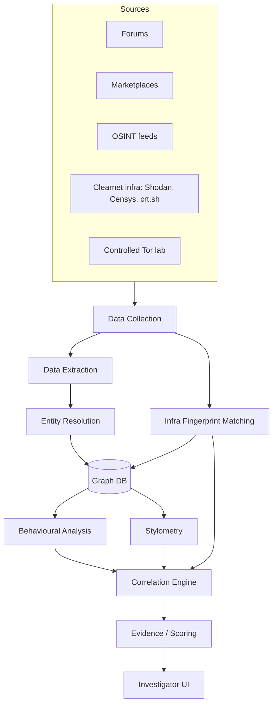

# Dark Web Threat Actor Attribution System

**SIH 2026 — Problem Statement 26151**
Deanonymization of dark web threat actors and linkage to real-world entities.

This document merges the pipeline discussed as a team (forums/marketplaces → data collection → extraction → entity resolution → graph DB → behavioural/stylometry analysis → correlation → scoring → investigator UI) with the three core capabilities the problem statement asks for. It's meant as the working reference for the whole team, not a final spec — update it as design decisions change.

---

## 1. What the system needs to do

Per the problem statement, the system has three core capabilities:

1. **Infrastructure deanonymization** — find misconfigurations in Tor hidden services (exposed status pages, reused SSL certs, default banners, descriptor inconsistencies) and match them to clearnet servers to point at a likely real-world origin.
2. **Cross-marketplace actor mapping** — link the same threat actor across different marketplaces/forums into one relationship graph, using handles, PGP keys, wallets, and trust/vouching links.
3. **AI-based persona linking** — use stylometry (writing-style fingerprinting) and behavioural profiling to detect when a rebranded or migrated persona is actually a known actor.

Everything below the fold has to feed into a queryable, exportable investigator front end.

---

## 2. Glossary (for anyone new to the domain)

| Term | Meaning |
|---|---|
| Tor hidden service (.onion) | A site reachable only over Tor, designed to hide its real server location/owner. |
| Misconfiguration | An operator mistake (leftover debug page, reused TLS cert, default banner) that leaks identifying info. |
| Descriptor | Metadata a hidden service publishes to the Tor network so clients can reach it; timing/behaviour quirks in it can sometimes be cross-matched to a real server. |
| PGP key | A cryptographic identity used to sign messages; reuse across sites is a strong linking signal. |
| Wallet | A cryptocurrency address (BTC/XMR); also reusable across sites and traceable on-chain. |
| Stylometry | Identifying an author from writing style (word choice, sentence length, punctuation) using ML instead of a human ear. |
| Behavioural profiling | Linking actors by patterns of behaviour (posting times, pricing habits, typos) rather than content. |
| Attribution confidence | A score (not a certainty) expressing how sure the system is that two personas are the same actor. |

---

## 3. Architecture overview

This is the same shape as our earlier whiteboard diagram, with one addition: **Infra Fingerprint Matching** is pulled out as its own module, because it's explicitly one of the three core capabilities in the problem statement and shouldn't get buried inside generic "Data Collection."

---

## 4. Component breakdown

### 4.1 Sources
- **Forums / Marketplaces**: the actual dark web content — listings, posts, profile pages, vouches.
- **OSINT feeds**: Shodan, Censys, crt.sh (certificate transparency logs) — clearnet infrastructure data used later for fingerprint matching.
- **Controlled Tor lab**: an isolated environment (sandboxed VM, dedicated Tor client, no direct internet egress from the analyst machine) for any active probing, so the team never touches live illegal marketplaces from an untraceable/uncontrolled setup.

> ⚠️ **Team note**: decide early, with a mentor, whether the demo will crawl real onion sites or run against a static/simulated dataset (e.g. research corpora like Agora/DUTA, or a self-generated synthetic dataset). Live scraping of drug/weapons marketplaces raises real legal exposure for a student team — most SIH teams on this PS demo against a controlled dataset and present the live-crawler as an architectural capability.

### 4.2 Data Collection
Scheduled crawlers (Python + Playwright/Selenium via a Tor SOCKS proxy) that pull raw HTML, screenshots, and metadata from sources, plus API connectors to OSINT feeds. An orchestrator (Airflow, or Celery + cron for a simpler build) runs this on a schedule to satisfy the "autonomous mode" requirement, and tags each source with a reliability/quality score.

### 4.3 Infra Fingerprint Matching (Capability 1)
For each onion service: capture TLS certificate hash, HTTP headers, default error pages, favicon hash, and descriptor timing where possible. Cross-reference against Censys/Shodan/crt.sh for a clearnet server with a matching fingerprint. A match is a candidate real-world origin server. (Worth studying the open-source **OnionScan** project — it pioneered exactly this technique.)

### 4.4 Data Extraction
NLP + regex over every scraped post/profile to pull structured identifiers:

| Field | Example |
|---|---|
| Username | `ShadowX` |
| Email | `shadow.x@protonmail.com` |
| PGP fingerprint | `4F3A...` |
| Wallet address | BTC/XMR address pattern |
| Timestamp | Post/listing date |
| Post content | Raw text, for stylometry input |

### 4.5 Entity Resolution
Handles are messy — `ShadowX`, `shadow_x`, and `ShadowX77` might be one person or three. This stage clusters near-duplicate identifiers using fuzzy string matching (edit distance, phonetic matching) combined with shared hard identifiers (same PGP key or wallet = strong merge signal; similar username alone = weak signal, needs corroboration).

### 4.6 Graph DB (Neo4j or similar)
The central store. Nodes: **Actors, Accounts, Wallets, PGP keys, Posts, Infrastructure**. Edges: "same wallet," "same PGP key," "posted in," "vouched for," "hosted on." This is what makes cross-marketplace mapping (Capability 2) queryable.

### 4.7 Behavioural Analysis + Stylometry (Capability 3)
Two parallel signal sources computed per actor:
- **Stylometry**: writing-style fingerprint (function-word frequency, sentence length distribution, punctuation habits, or a transformer embedding of their posts).
- **Behavioural analysis**: activity timing patterns, pricing strategy, product categories, recurring typos/phrasing habits.

Both feed the Correlation Engine — an actor who "vanishes" and a new persona with a highly similar fingerprint on either axis gets flagged as a likely rebrand.

### 4.8 Correlation Engine
Combines three independent signal types — infra fingerprint matches, graph proximity/shared identifiers, and stylometric/behavioural similarity — into candidate actor-to-actor links.

### 4.9 Evidence / Scoring
Converts correlation output into an **attribution confidence score** per link, attaches supporting evidence (which signals contributed, raw snapshots), and stores it so it's auditable — an investigator should be able to see *why* the system made a link, not just the score.

### 4.10 Investigator UI
- Actor profile pages (identifiers, category, last scan date, source)
- Relationship graph view (e.g. Cytoscape.js or a Neo4j Bloom embed)
- Evidence viewer (raw snapshots, matched signals)
- Confidence display per link
- Timeline filter/query across a date range
- Export to **CSV, JSON, and report (PDF)**

---

## 5. Suggested tech stack

| Layer | Suggested tech |
|---|---|
| Crawling | Python, Playwright/Selenium, Tor SOCKS proxy |
| Orchestration | Airflow (or Celery + cron for MVP) |
| NLP / extraction | spaCy, regex, HuggingFace transformers |
| Graph DB | Neo4j |
| Full-text search | Elasticsearch |
| Raw evidence storage | S3-compatible object store (MinIO for local dev) |
| Backend API | FastAPI |
| Frontend | React + Cytoscape.js (graph) |
| Stylometry model | scikit-learn (baseline) → transformer embeddings (stretch) |

---

## 6. Suggested build order for the hackathon

1. **Entity extraction + Entity Resolution + Graph DB** — the clearest, most demoable core value.
2. **Investigator UI** with graph view and CSV/JSON export — this is what judges see first.
3. **Stylometry baseline** (even a simple classifier on a small labeled set) as proof-of-concept for Capability 3.
4. **Infra Fingerprint Matching** module last — it depends on external API keys (Shodan etc.) that can be flaky in a live demo, so build it as a well-documented module even if the live demo runs on cached results.

---

## 7. Open questions for the team

- [ ] Live crawling vs. controlled/simulated dataset for the demo — decide with mentor.
- [ ] Which dataset will we use for training/testing the stylometry model?
- [ ] Confidence scoring formula — simple weighted sum first, or a trained classifier over the three signal types?
- [ ] Evidence retention policy — how long do we keep raw scraped content, and how is it secured?
