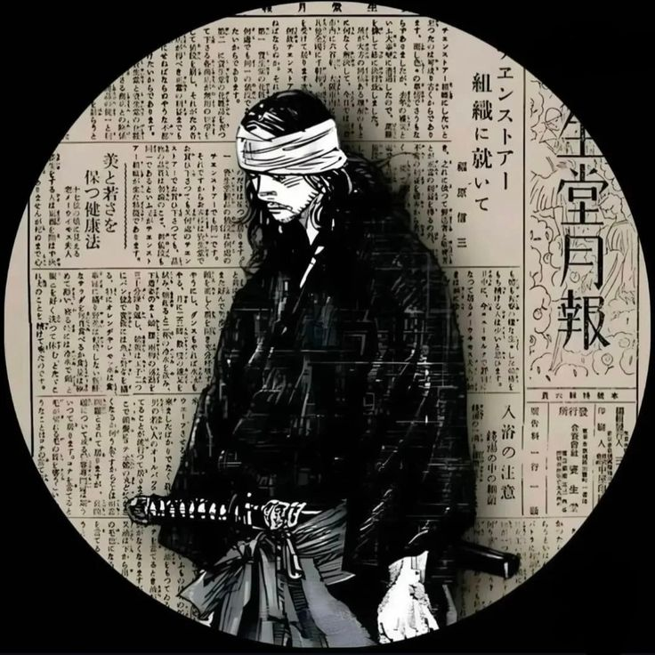

# Personal Plans Repo

---

## TO MIYAMOTO

<p align="center">
  
</p>

| [[TimeTable](#day-routien)] [[Workout](#workout-guide)] [[Work-Routien](#cybersecurity-guide)] |

**THE WAY I ~WANNA~ CHOOSE TO LIVE**

**TIER 1 : Esteem & actualisation**
```
Morals -> Strong enough for others 
M-virtues -> 
Purpose -> Great cyber organization 
Autonomy -> Being struct is freedom
Comptenece -> Being the strongest evr
Relatedness -> Startup owner & hacker
```
**TIER 2 : Persuit and purpose**
```
Carrier -> Build a CYBERSEC empire/bn
why ? -> Create the paradise i wanted 
dedicated hours -> 45 Hrs/week student 
money made -> (money made 00k/need 45k)

min viableTime actions : 
1) 1 Good cyber engag/week
2) 1 Good cybe writeup/day
3) all main issue closed/wk 
4) 1 Good SocialM post/day
5) 1 community post,event/wk
6) 1 expert approached/week

Traing style -> mart art + calethnic
why ? -> I wanna be the strongest IK
dedicated hours -> 2Hrs every sig-day
fights won -> [0 / 0 ]
min viableTime -> 30min / justShowUp

current date : [6 October 2027]
milestone 1yr -> Make this profitable 
milestone 6mn -> Every component Run well
milestone 3mn -> Every component running

milestone 1yr -> WON aiu - atleast brow
milestone 6mn -> Become very skilled atl
milestone 3mn -> Master basics + all move 
```
**TIER 3 : Love and Belonging**
```
God -> His most diligent creation
Friendship -> Most competent people
Family -> Must fulfill duty & protect
Intimacy -> Phy stabile,supp & mature
Community -> Startup,selfimp & cyber

mentors : 
1. hamza Ahemad : self improvement 
2. Andrew Tate : Competence & Disc
3. Miyamoto mushashi : Way of life
4. kabib Narmedagov : Dis,res & mor
```
`Time Management: Bring along/make time`

**TIER 4 : Physical requirement**
```
Food -> protein,whole,func over taste
Water -> Water,Tea,coffee over taste
Sleep -> Work > family > sleep > fun 
Shelter -> minimal,maintained & orga
looks -> baggy or tyler and clean aw
entertain -> Socialise over modernEn
possesion -> Minimal but high quality
spirituality -> He will stay,remember
```
---

## DAY ROUTIEN

`Only Day you are free: Saturday`
```
Title: Getting ready
Time :5:30-6:00
Objective
1. Pray to god properly + truly 
2. Get sunlight + water asap
3. Spend time without glasses
4. Setup & start work environment

[ Prayer to God ]

"God, I ask you for strength, so give me 
difficulties to go through. I ask you for 
wisdom, so give me problems to solve. I 
ask you for courage, so give me dangers to 
overcome. I ask you for love, so give me 
troubled people to help. Let me not run 
from what you send, but meet it, grow 
through it, and become who I'm meant to 
be."
```

```
Title: Workout / Work
Time :6:00-8:00
Objective : Workout routine

---------------> 5mins meditation
shadowboxing
1) Round 1:Basic footwork
2) Round 2:Fundam punches
3) Round 3:Fundament kicks
4) Round 4:Takedown/ Throws
5) Round 5:Combination rnds
6) Round 6:Freestyle rounds

Resistance work
1) padding work (form + power)
2) Sparring rd (implementation)
3) wrestle rds (implementation)

Conditioning work
1) Muscle ups (03)(02)(mayo)
2) 1A pull up (03)(16)(mayo)
3) 1A chin up (03)(15)(mayo)
4) 1A d hangs (03)(02)(mayo)

1) HS pushup (03)(05)(swit)
or Hindu-PUs (03)(30)(mayo)
2) 1A pushup (03)(30)(drop)
3) Planch PU (03)(05)(mayo)
4) Advan dip (03)(15)(mayo)
or Exp brupe (03)(35)(mayo)

1) Pistol sq (03)(03)(drop)
or squat/jps (03)(35)(mayo)
2) Russian tw (03)(40)(drop)
3) RCK planks (03)(2m)(drop)
4) LR/ab roll (03)(09)(drop)
or Ful sit-up (03)(40)(mayo)

------------> 5mins meditation

[log everything learned today]
```

```
Title: breakfast + get-ready
Time :8:00-9:00
Objective
- 6 boiled eggs (36gm protein)
- 1 black coffee (50mg caffei)

~ Prefer protein whole foods ~
---------------------------------
[Clothing style]

- Hair : Maintained middle part 
- Contact lens / med rectangle

- Base layer is always fitted
- Top layer stays unbuttoned
- Bottoms stay slim/straight
- Everything looks a little worn

Or 

- Every & all layer is oversized
- Bottoms are wide-leg / baggy
- Donot stack multiple layers 
- Footwear is chunky/sneaker
```

```
Title: 9to5 work planning
Time :9:00-17:00
Objective: Work routine
-------------------------------
[Opportunity block]

meet people 
- Prakruti mam RRU [7 oct 2026]
- Pranjal sir RRU [7 oct 2026]
- Ankita mam RRU [7 Oct 2026]
- Approach for DPDP [7 oct 2026]

attend event 
- ICISHCT Phisical [26 oct 2026]
- OWASP AppSec Days [21 Nov 2026]
- ISC2 Security Cong [24 Oct 2026]
- Trace Lab Srh Party [24 Oct 2026]

good internship/certs 
- Social eng-top 15 [30 sep 2026]
- Good cert go for [--to find--]

good project/tools 
- Onion eye:dark web [5oct-1jan]
- Red_Phsisher:SocEng [1sep-1Feb]
- Red_Sentinal:SocEng [1Nov-1Mar]

community event org 
- Social engineer CTF [1 November]
- Social engineer awar [<11october]

[Work Routine]
---------------------------------
Monday
Objectives completed :[Tool Building]
- CTFS targets: []
- GitHub targets: []
- Social media targets: []
- Community Activity : []
- Special targets: []

Tuesday
Objectives completed :[Red teaming work]
- CTFS targets: []
- GitHub targets: []
- Social media targets: []
- Community Activity : []
- Special targets: []

Wednesday
Objectives completed :[Tool Building]
- CTFS targets: []
- GitHub targets: []
- Social media targets: []
- Community Activity : []
- Special targets: []

Thurday
Objectives completed :[Red teaming work]
- CTFS targets: []
- GitHub targets: []
- Social media targets: []
- Community Activity : []
- Special targets: []

Friday
Objectives completed :[Tool Building]
- CTFS targets: []
- GitHub targets: []
- Social media targets: []
- Community Activity : []
- Special targets: []

saturday
Objectives completed :[Red teaming work]
- CTFS targets: []
- GitHub targets: []
- Social media targets: []
- Community Activity : []
- Special targets: []

sunday
Objectives completed :[mangement + work]
- CTFS targets: []
- GitHub targets: []
- Social media targets: []
- Community Activity : []
- Special targets: []
--------------------------------------
~ 45cm, 2HRs, 20mins eye rules ! ~
```

**INBETWEEN**

```
Title: Lunch nutrition plan
Time :12:30-1:00
Objective
- Carbohydrate (250-150-100)
- 1cup coffee (50mg caffeine)
- Add leafy veggies (non-cal)
```

```
Title: Getting - ready
Time :17:00-17:30
Objective
- Get fully refreshed & stuff
- Organized & setup work env
```

```
Title: Must Workout
Time :17:30-:19:30
Objective :Workout routein 

~ Routine is in the morning blk ~
-----------------------------------
[Full kit accomplished]

Complete dress 
- Good upper*3 [Completed]
- Good LC (3*2) [Completed]
- Good Low cov [Completed]
- Hair - bands [Completed] 
- Proper shoes [Completed]
- Proper towel [Completed] 

Complete kit 
- Groin gaurd*2 [Ordered In]
- Mouth - gaurd [Ordered In]
- Box hand wrape [Completed] 
- Water tumbler [Completed]
- Cale parallets [In -future]
- Calethinics rg [In -future]
```

```
Title: Dinner + get-ready
Time :19:30-20:00
Objective
- 100gm soy chunks (50gm protein)
- anything else (mostly fruits)

~ Prefer protein whole foods ~
```

```
Title: Must work session
Time :20:00-23:00
Objective

~ Continuation of grind block ~
```

```
Title: Cool-down time
Time :23:00-23:30
Objective :
- Put down all screens & work
- Think of improvements to make
- Down-regulate activities
- Pray to god properly + truly 

[ Prayer to God ]

"God, I ask you for strength, so give me 
difficulties to go through. I ask you for 
wisdom, so give me problems to solve. I 
ask you for courage, so give me dangers to 
overcome. I ask you for love, so give me 
troubled people to help. Let me not run 
from what you send, but meet it, grow 
through it, and become who I'm meant to 
be."
```

`Timetable is an anchor, not a must-follow block; be adaptable.`

## CYBERSECURITY GUIDE

### 🧰 TOOL BUSINESS

A short, practical reference for running the engineering side of a team and the founder side of a startup.

---

#### Part 1: Engineering (Team Management)

**1. Creating Issues**
- One issue = one deliverable. Break big work into small, closeable pieces.
- Include: clear title, *why* it matters, acceptance criteria, and links to relevant code/docs.
- Always assign an owner and priority at creation — never leave it as "TBD."
- Label consistently (bug / feature / tech-debt) so the backlog stays scannable, not a junk drawer.

**2. Weekly 1:1s & Working Updates**
- Keep it a fixed, recurring slot — don't let it get bumped for "more urgent" things repeatedly.
- Structure: how they're doing → current blockers → what's next → feedback (both directions).
- Use a shared doc so updates can be added async before the call — saves the meeting for actual discussion.
- End with one concrete action item, not just "sounds good, keep going."

**3. Review Code & Architecture**
- Review PRs same-day where possible — slow feedback loops quietly kill velocity.
- First pass: architecture/design decisions. Second pass: style/nitpicks.
- Comment to teach — explain the *why*, not just "change this."
- Run a separate, recurring architecture review (not tied to any one PR) for bigger structural decisions — otherwise they never get discussed until it's too late.

---

#### Part 2: Founder Side (Non-Technical)

**1. Review Actual Users**
- Talk to users directly on calls, not just through support tickets — tickets show symptoms, calls show context.
- Watch them use the product live when you can. What people *do* often differs from what they *say*.
- Look for patterns across conversations, not just individual complaints — one loud user isn't a trend.

**2. Meetings with Mentors**
- Bring specific decisions or questions, not a general status update — mentors are most useful when pointed at something concrete.
- Share real numbers, not just narrative ("users dropped 20% after X" beats "growth felt slow").
- Follow up next time on what you did with their advice — it's what keeps them invested in helping you.

**3. Hiring / Meeting Other People**
- Write down the actual must-haves for a role before taking meetings — otherwise every candidate looks appealing for different reasons.
- Use founder/dev meetups for market intel and warm intros, not just networking for its own sake.
- Keep a simple pipeline (who you talked to, what's next) — casual conversations are the easiest thing to lose track of.

---

#### Part 3: Developer (Personal Workflow)

**1. Daily & Weekly Planning**
- Plan before you're in the day — decide priorities in a fixed 10–15 min block, not reactively.
- Sort tasks by urgent/important, not just a flat list, so today's time goes to what actually matters.
- Plan in weekly cycles too, so one chaotic day doesn't derail the whole week.

**2. Deep Work vs. Communication**
- Timebox: deep coding needs long uninterrupted blocks; email/Slack doesn't — don't mix them.
- Batch communication into 2–3 windows a day instead of reacting to every message instantly.
- Protect maintenance time (bugs, tech debt, dependencies) — it always loses to "urgent" work unless scheduled.

**3. Systems & Review**
- Keep one source of truth for tasks — one tool, not scattered across your head and Slack DMs.
- Say no / defer explicitly — managing everything "perfectly" means consciously choosing what waits.
- Run a quick weekly retro on yourself — what ate your time, what to cut — and adjust the system.

### 🛡️ PENTEST AGENCY

A short, practical reference for running a small offensive security group — covering CTFs, freelance engagements, and bug bounty hunting.

---

#### Part 1: Team Management (Running the Crew)

**1. Creating Engagements & Tasks**
- One task = one target/scope item — don't lump "test the whole app" into a single ticket.
- Include: scope boundaries, rules of engagement, target/API endpoints, and deadline (CTF timer, client due date, bounty disclosure window).
- Assign an owner per target/challenge category (web, network, binary, etc.) — no one attacks the same box blind.
- Tag by engagement type (CTF / client / bounty) so priorities don't get mixed up.

**2. Weekly Sync & Working Updates**
- Fixed weekly call/async check-in — what's found, what's blocked, what needs a second pair of eyes.
- Structure: findings so far → blockers (WAF, rate limits, tricky auth) → next target → anything needing review.
- Use a shared doc/board (even a private repo or Notion) so people post async — saves live time for actual discussion.
- End with one clear next step per person, not just "keep digging."

**3. Reviewing Findings & Reports**
- Every finding gets a second reviewer before it's submitted (bounty) or delivered (client) — false positives cost trust and money.
- First pass: is the vulnerability real and reproducible (PoC works)? Second pass: is the write-up clear enough for someone else to verify it?
- Give feedback that teaches — explain *why* a PoC is weak or a CVSS score is off, not just "redo this."
- Keep a running internal knowledge base of past findings/techniques — so the same bug class isn't rediscovered from scratch every time.

---

#### Part 2: Business Side (Clients & Bounty Programs)

**1. Client & Engagement Management**
- Get scope, rules of engagement, and a signed agreement/NDA locked before any testing starts — no exceptions, even for friends.
- Set clear timelines and check-in points with the client so "silence" isn't mistaken for "nothing's happening."
- Deliver a report that's readable by non-security people too — an exec summary plus the technical detail.

**2. Bug Bounty Program Selection & Triage**
- Don't hunt everywhere — pick programs based on payout history, scope size, and how saturated they already are.
- Triage internally before submitting: is this a duplicate risk? Is the impact clearly explained? Is the PoC minimal and clean?
- Track submissions in one place (status, program, payout, response time) — bounty income is easy to lose track of otherwise.

**3. Reputation & Networking**
- CTF placements, write-ups, and public disclosures (once allowed) build credibility that brings in freelance work — treat them as marketing, not just fun.
- Talk to more experienced hunters/pentesters regularly — a second opinion on a weird finding or a stuck engagement saves hours.
- Keep a simple pipeline of leads/contacts (who referred what, ongoing conversations) — freelance work dries up fast if this isn't tracked.

---

#### Part 3: You (Personal Workflow)

**1. Daily & Weekly Planning**
- Decide before the day starts: is this a CTF day, a client engagement day, or a bounty-hunting day? Mixing all three daily fragments focus.
- Sort by deadline pressure — a client engagement with a due date beats an open-ended bounty hunt most days.
- Plan weekly too: block real time for skill-building (new techniques, CTF practice) or it always gets crowded out by "paying" work.

**2. Deep Work vs. Communication**
- Exploit development and deep recon need long, uninterrupted blocks — notifications off, one target at a time.
- Batch client emails, bounty triage responses, and team check-ins into set windows instead of context-switching all day.
- Protect time for writing reports/PoCs properly — rushed write-ups are where credibility (and bounty payouts) are lost.

**3. Systems & Review**
- Keep one place for notes, scope docs, and findings per engagement — scattered notes across tools is how details get missed (and how scope violations happen).
- Say no to engagements/programs that don't fit your time or skill level right now — spreading thin lowers quality everywhere.
- Run a quick personal retro weekly: what took longer than expected, what technique worked well, what to drop next week.

## WORKOUT GUIDE

**MOVEMENT FORMS**

**movement**

```
Forward/Backward Leap

1. Stance set, knees bent, weight centered
2. Push off rear leg, drive forward
3. Lead leg lands first, absorb impact
4. Rear foot follows, reset your stance
5. Guard stays up through entire movement

(Backward: reverse the push — drive off lead leg, rear leg lands first, lead foot follows back)

Right/Left Leap

1. Stance set, weight balanced, guard up
2. Push off opposite-side leg, drive sideways
3. Near-side foot lands first, absorb weight
4. Trailing foot follows, reset stance width
5. Stay low, guard up throughout leap

Pivoting & Rotation

1. Weight shifts onto pivot foot fully
2. Rise slightly onto ball of foot
3. Rotate hip and shoulder together, unified
4.Turn body to new angle needed
5. Reset stance, guard up, weight settled

Switching Stances

1. Weight centered, knees soft, ready position
2. Hop both feet, switch simultaneously midair
3. Swap lead and rear foot placement
4. Land softly, knees bent, absorb landing
5. Guard resets instantly, stance stable again

Circling Out

1. Guard up, weight on balls of feet
2. Step lead foot laterally, open angle
3. Follow with rear foot, maintain width
4. Keep facing opponent, don't cross feet
5. Continue stepping, exit angle to safety
```

**punches**

```
Jab

1. Stance set, hands up, chin tucked
2. Fire lead hand straight from chin
3. Rotate fist palm-down at extension
4. Rear hand stays glued to chin
5. Snap back same line to guard

Cross

1. Load weight rear leg, guard up
2. Pivot rear foot, rotate hip-shoulder
3. Drive rear hand straight down center
4. Rotate fist, tuck chin behind shoulder
5. Retract same path, reset stance square

Rear Hook

1. Balanced stance, weight ready, guard up
2. Pivot rear foot, rotate hip-shoulder
3. Elbow bent 90°, arm parallel ground
4. Swing hips, transfer weight through punch
5. Snap back to guard immediately

Lead Hook

1. Weight on lead leg, guard tight
2. Pivot lead foot, rotate hip-shoulder
3. Elbow bent 90°, arm shoulder height
4. Snap fist through via hip rotation
5. Rear hand stays, return to guard

Rear Uppercut

1. Slight crouch, dip rear shoulder down
2. Pivot rear foot, load hip rotation
3. Drive fist straight up, palm in
4. Punch through target, no looping
5. Retract same line, guard chin again

Lead Uppercut

1. Slight crouch, dip lead shoulder down
2. Pivot lead foot, load hip rotation
3. Fist travels straight up, palm in
4. Keep compact, punch through target
5. Snap back, guard chin immediately
```

**kicks**

```
Roundhouse Kick — Low (Thigh)

1. Stance set, weight on base leg
2. Pivot base foot, rotate hip fully
3. Swing shin low into outer thigh
4. Lean torso back, hip drives through
5. Snap leg back, reset your guard

Roundhouse Kick — Mid (Chest)

1. Stance set, hands up guarding face
2. Pivot base foot, turn hip level
3. Chamber knee up, hip rotating in
4. Extend shin into ribs, hip full
5. Recoil leg fast, return to stance

Roundhouse Kick — High (Face)

1. Stance set, guard tight, chin down
2. Pivot base foot, rotate hip vertical
3. Chamber knee high, hip turns fully
4. Snap shin upward, strike with instep
5. Recoil quickly, guard hands stay up

Push/Thrust Kick

1. Stance set, weight on base leg
2. Chamber knee straight up to chest
3. Thrust hip forward, extend leg fast
4. Strike target with heel or ball
5. Retract knee first, plant foot down

Side Push Kick

1. Turn body sideways, chamber knee high
2. Point knee at target, hip cocked
3. Thrust leg out, drive through heel
4. Extend hip fully, blade foot strikes
5. Retract leg fast, pivot back down

Back Push Kick

1. Look back, spot target over shoulder
2. Pivot base foot, turn hips away
3. Chamber knee tight against your body
4. Drive leg straight back, heel first
5. Retract quickly, spin back to stance
```

**take down**

```
Single Leg Takedown

1. Close distance, level change, bend knees
2. Shoot in, grab opponent's lead leg
3. Drive shoulder into thigh, lock grip
4. Lift leg, off-balance them backward
5. Drive forward, finish opponent to ground

Double Leg Takedown

1. Close distance, level change, stay low
2. Shoot forward, wrap both legs tight
3. Drive shoulder into hips, head up
4. Pull legs in, drive through hard
5. Finish takedown, control opponent down

Sweep Leg Throw

1. Close distance, control opponent's upper body
2. Off-balance them, step in close
3. Sweep foot through their standing leg
4. Pull upper body opposite sweep direction
5. Follow through, control them to ground

360° Body Throw

1. Grip opponent, pull them in close
2. Step across, turn your back in
3. Load hips low under their weight
4. Rotate full circle, driving the throw
5. Pull down and through, complete throw

Inside Leg Trip

1. Control upper body, step in close
2. Hook their inside ankle or heel
3. Pull hooked leg forward, break balance
4. Push upper body opposite direction hard
5. Follow through, control them to ground

Outside Leg Trip

1. Control upper body, step in close
2. Off-balance them backward, shift weight
4. Reap outside leg, sweep it out
5. Drive hip and shoulder through them
6. Follow through, complete throw to ground
```

**Defensive meth**

```
Blocking + Counters (Punches)

1. Guard up, track incoming punch path
2. Block with forearm, absorb the shot
3. Redirect block, load counter position fast
4. Fire counter punch, no hesitation gap
5. Reset guard, ready for next exchange

Parrying + Counters (Punches)

1. Guard up, watch opponent's punching hand
2. Parry with open palm, redirect strike
3. Deflect off centerline, create clean opening
4. Counter punch straight through the opening
5. Snap back to guard after landing

Catch + Single Leg Takedown (Kicks)

1. Read the kick, step slightly off-line
2. Catch kicking leg under your arm
3. Trap leg tight against your body
4. Step in, drive weight forward hard
5. Sweep base leg, finish takedown clean

Evade + Counter Strike (Kicks)

1. Read kick, shift weight off-line
2. Slip or step outside kick's path
3. Close distance while opponent still extended
4. Fire counter strike into open target
5. Reset stance, guard up immediately

The Sprawl (Takedown Defense)

1. Spot the shot, react instantly
2. Kick both legs back, hips drop
3. Drive weight onto opponent's shoulders
4. Sprawl legs wide, flatten them down
5. Circle hips out, regain top control

Underhook & Framing (Takedown Defense)

1. Insert arm deep under opponent's armpit
2. Lift underhook, control their upper body
3. Frame forearm against hip or shoulder
4. Push frame, create space off you
5. Work back to feet or neutral

Overhook & The Whizzer (Takedown Defense)

1. Wrap arm over opponent's shoulder tight
2. Drive whizzer down, block their hip
3. Circle away from their control side
4. Push their head down, off-balance them
5. Sprawl or spin free to safety
```

**CONDITIONING PART**

**PUSH EXERCISES DETAILS**
```
Pike Ups -->
Pike push-up -> Elevated pike push-up -> Wall handstand hold -> Wall HSPU negative -> Wall HSPU -> Deficit wall HSPU -> Freestanding HSPU

Push ups -->
Push-up -> Wide push-up -> Archer push-up -> Typewriter push-up -> One-arm push-up negative -> Assisted one-arm push-up -> One-arm push-up

Planchup -->
Push-up -> Pseudo planche push-up -> Tuck planche hold -> Tuck planche push-up -> Advanced tuck planche push-up -> Straddle planche hold -> Straddle planche push-up -> Full planche push-up

Base Dip -->
Band-assisted dip -> Bent-knee assisted dip -> Full dip -> Ring dip -> RTO ring dip -> Bulgarian dip -> Archer dip -> One-arm dip
```

**PULL EXERCISES DETAILS**
```
Exp pullup -->
Pull-up -> High pull-up (chest-to-bar) -> False grip pull-up -> Jumping muscle-up -> Band-assisted muscle-up -> Muscle-up -> Ring muscle-up -> One-arm muscle-up

Str pullup -->
Pull-up -> Wide-grip pull-up -> Archer pull-up -> Typewriter pull-up -> Uneven pull-up -> One-arm pull-up negative -> Assisted one-arm pull-up -> One-arm pull-up

str chinup -->
Chin-up -> Close-grip chin-up -> Archer chin-up -> Typewriter chin-up -> Uneven chin-up -> One-arm chin-up negative -> Assisted one-arm chin-up -> One-arm chin-up

dead hangs -->
Dead hang -> Towel hang -> Uneven hang -> One-arm hang negative -> One-arm hang -> One-arm towel hang -> One-arm active towel hang -> One-arm 90° towel hang

```
**LEG EXERCISES DETAILS**
```
upcoming
```
